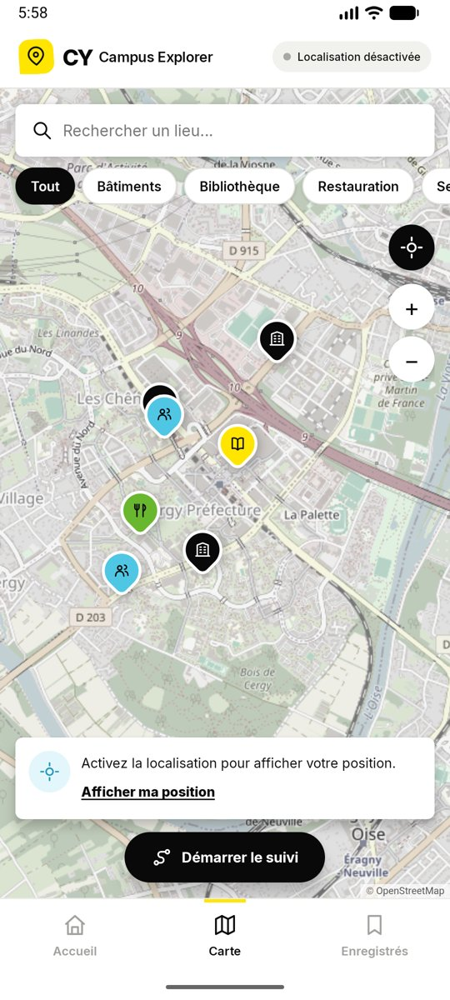
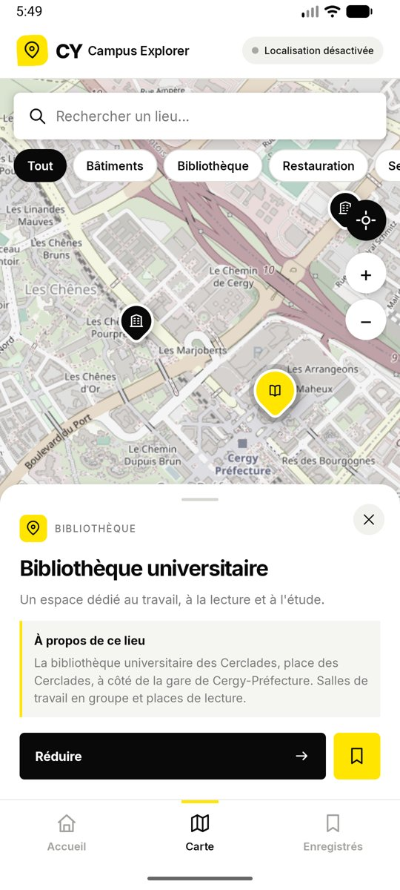
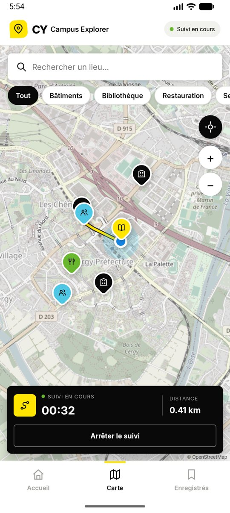
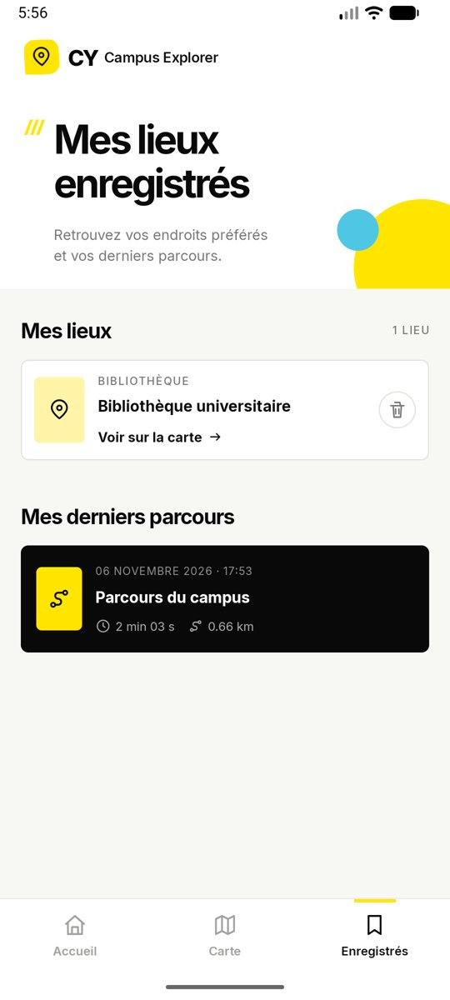

# CY Campus Explorer

Campus Explorer helps students find their way around the CY Cergy campus. It shows a map with the
main places (teaching sites, university library, university restaurant, student house), displays
the user's position, and can record a walk as a tracking session that keeps running in the
background.

Java, XML layouts, Android Studio. minSdk 26 (Android 8.0), targetSdk 36. The map is OpenStreetMap,
displayed with Leaflet.js inside a WebView.

| Home | Map | Place details | Tracking | Saved places |
|---|---|---|---|---|
|  |  |  |  |  |

## Running the project

1. Open the folder in Android Studio (**File > Open**) and let Gradle sync.
2. Run on a phone or an emulator with Internet access (map tiles).
3. On the emulator, set a position in Cergy: **⋯ > Location**, search "Cergy", **Set location**.
   To simulate a walk, change the position a few times while tracking is running.

## Screens and Activities

| Activity | Screen | Main elements |
|---|---|---|
| `MainActivity` | Home (launcher) | categories, three places to discover, buttons to the map and to saved places |
| `MapActivity` | Campus map | Leaflet map in a WebView, search, category filters, place sheet, location, start/stop tracking |
| `SavedActivity` | Saved places and history | places saved with the bookmark button, last tracking sessions |

A bottom bar links the three screens. Navigation uses explicit Intents with
`FLAG_ACTIVITY_REORDER_TO_FRONT`, so each Activity exists once in the back stack. The identifier of
a place (`EXTRA_PLACE_ID`) or a category (`EXTRA_CATEGORY`) travels as an Intent extra;
`MapActivity` reads it in `onCreate` or, when it already exists, in `onNewIntent`.

## Course concepts

| Concept | Where |
|---|---|
| Activities, explicit Intents, extras | `BaseActivity.openTab`, `MainActivity.openMap`, `MapActivity.handleIntent` |
| Activity lifecycle | `BaseActivity` logs every callback (Logcat tag `Lifecycle`). `MapActivity.onResume` starts the on-screen location updates and registers the tracking receiver; `onPause` stops and unregisters them |
| Background service | `TrackingService`: foreground service of type `location`, persistent notification with a STOP action, independent of the map screen |
| Sensor | GPS (`LocationManager.GPS_PROVIDER`, network as a complement indoors) |
| Location and maps | runtime permissions with `ActivityResultContracts`, Leaflet + OpenStreetMap tiles in a `WebView` |
| Local data | saved places in `SharedPreferences` (`SavedPlaces`), session summaries in SQLite (`SessionDb`) |

## The map: Leaflet in a WebView

The page `app/src/main/assets/map/index.html` loads Leaflet (bundled in `assets/map/leaflet`, no
CDN) and `map.js`. It is served by `WebViewAssetLoader` at
`https://appassets.androidplatform.net/assets/map/index.html`: with a `file://` URL the page has no
web origin, and the OpenStreetMap tile servers reject requests without a Referer (HTTP 403). The
WebView user agent also identifies the app, as the OpenStreetMap tile usage policy requires.

Java and JavaScript talk both ways:

- Java → JavaScript: `webView.evaluateJavascript("CampusMap.select(3, true)")`;
- JavaScript → Java: `Android.onPlaceClicked(id)`, through `addJavascriptInterface`. These
  callbacks run on a WebView thread, so they use `runOnUiThread` before touching any view.

The search text is passed through `JSONObject.quote` so that whatever the user types cannot break
or inject JavaScript.

## Location and tracking

- Location permission is requested only when the user needs it ("Afficher ma position" or
  "Démarrer le suivi"), after a dialog that explains why. If it is denied, the map still shows the
  campus places and nothing crashes.
- **On-screen location** (the blue dot) is active only between `onResume` and `onPause` of
  `MapActivity`.
- **Tracking** is done by `TrackingService`, started by the user with `startForegroundService`. It
  calls `startForeground` with type `FOREGROUND_SERVICE_TYPE_LOCATION`, shows an ongoing
  notification (chronometer, distance, STOP action), and receives GPS updates while the screen is
  off or another app is open.
- **Live tracking, like a navigation app.** The service asks for one position per second. Every
  position moves the blue dot (with an arrow in the walking direction), and the map follows the
  user; dragging the map stops following, the location button resumes it. The line always ends at
  the blue dot, and the distance on the panel changes with every position ("350 m", then
  "1.25 km").
- **Clean distance.** The service filters the positions before counting them:
  - GPS first: a network position (Wi-Fi, cell towers) is used only when the GPS has been silent
    for 10 s, because mixing both makes the line zigzag;
  - positions with an accuracy worse than 35 m are ignored;
  - a point is added only when the user has moved more than 5 m, or more than the accuracy of the
    positions, so the GPS jitter of someone standing still does not add metres;
  - a jump faster than 50 m/s is a GPS error, not a walk, and is ignored.
- During a session, the screen's own location listener steps aside: only the service places the
  blue dot, so two sources never disagree.
- When the session stops (from the map or from the notification), the service saves the summary in
  SQLite, removes the location updates, removes the notification and stops itself. It never runs
  without an active session (`START_NOT_STICKY`).
- On Android 13+, the notification permission is requested before the first session.

Tested on the emulator (API 37): permission dialog, denied permission, position display, a
simulated walk of 660 m with the app in the background (`MapActivity.onStop`, service still in
the foreground), stop from the notification, session in the history, map without network.

## Languages

The app follows the phone language: French when the phone is in French, English otherwise.

- `res/values/` holds the default texts, in English; `res/values-fr/` holds the French ones. Android
  picks the folder that matches the phone language, with no code.
- The texts of the places are resources too (`places.xml` in both folders): `Place` stores
  `@StringRes` ids, resolved with `getString()` when they are displayed.
- Dates (`DateFormat.getDateTimeInstance`) and distances (`getString(R.string.tracking_km, ...)`)
  use the phone's formats: "6 novembre 2026 17:53" and "0,66 km" in French, "November 6, 2026 5:53 PM"
  and "0.66 km" in English. Only the coordinates sent to JavaScript always use `Locale.US`, because
  JavaScript needs a decimal point.
- On Android 13+, `res/xml/locales_config.xml` lets the user pick the app language alone, in
  **Settings > Apps > CY Campus Explorer > Language**.

## Design

The interface follows the Figma prototype (`design/`): the same colors (`res/values/colors.xml`
copies the CSS variables), the Inter font (bundled in `res/font`, OFL licence), the icons
(converted to vector drawables from the prototype's SVG paths), and the same screens and states.
Text sizes are about 1.3 times those of the prototype, which was drawn small; Android recommends
at least 11sp for readable text. The OpenStreetMap tiles get a CSS filter to look closer to the
muted map of the prototype.

The launch screen (yellow background, black pin of the icon) uses the `core-splashscreen`
library: `MainActivity` calls `installSplashScreen()` before `super.onCreate`, and the theme
`Theme.CampusExplorer.Starting` switches to the home theme afterwards. The library shows the same
screen from Android 8 to Android 16, whereas the system splash screen only exists from Android 12.
It stays at least 0.7 s at launch so that it can be seen.

The places' coordinates come from OpenStreetMap (Nominatim and Overpass, November 2026). The four
places of the prototype come first, then the other CY sites in Cergy-Pontoise (Saint-Martin,
Bernard Hirsch, Neuville, CY Tech) and in Île-de-France (Saint-Germain-en-Laye, Versailles,
Argenteuil, Gennevilliers, Sarcelles). The overview frames the Cergy-Pontoise sites; the search
frames whatever it finds ("Versailles", "IUT"). It reads the name and the address and ignores
accents ("chenes" finds the Chênes site).

## Files

| File | Role |
|---|---|
| `BaseActivity.java` | lifecycle logs, bottom bar, system bar insets |
| `MainActivity.java`, `activity_main.xml` | home screen |
| `MapActivity.java`, `activity_map.xml` | map screen, permissions, on-screen location |
| `SavedActivity.java`, `activity_saved.xml` | saved places and history |
| `Dialogs.java`, `dialog_confirm.xml` | dialogs of the prototype |
| `tracking/TrackingService.java` | foreground tracking service and its notification |
| `tracking/TrackingState.java` | state of the running session, shared with the screens |
| `data/Place.java`, `data/Places.java` | predefined places |
| `data/SavedPlaces.java` | saved places (SharedPreferences) |
| `data/SessionDb.java` | session history (SQLite) |
| `assets/map/` | Leaflet page, styles and script |
| `design/` | Figma Make prototype (source code and `.make` file) |

## Limits

- Map tiles need Internet. Without it, a message is shown and already cached tiles and all places
  stay available.
- Tracking stops if Android kills the app's process; the session in progress is then lost.
- Sessions store only a summary (start, duration, distance), not the route itself.
