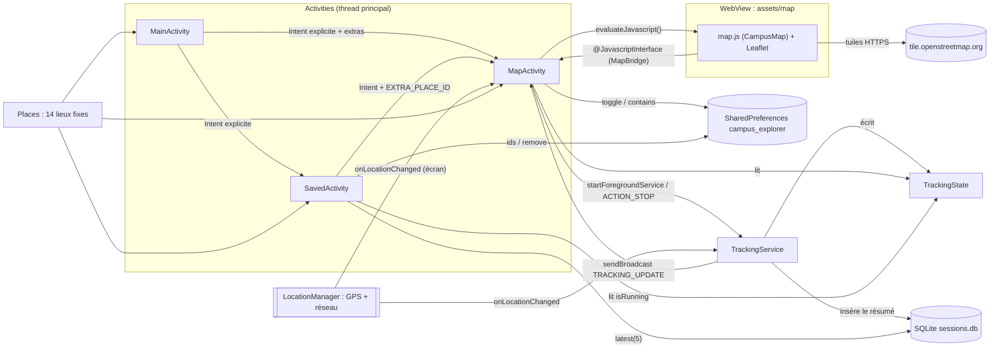
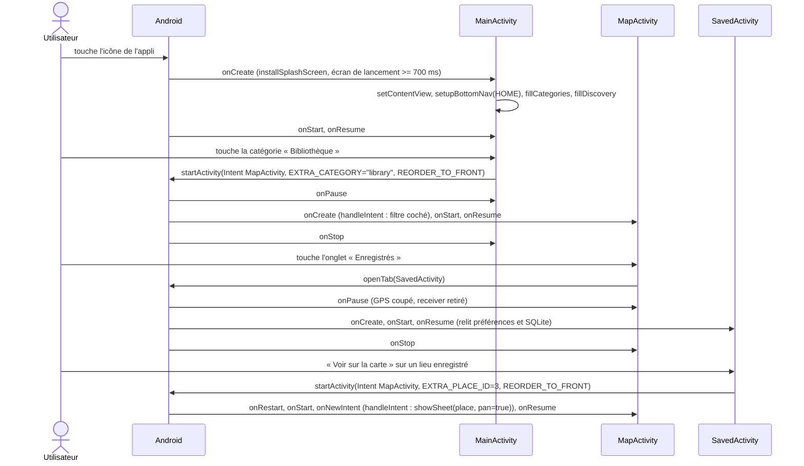
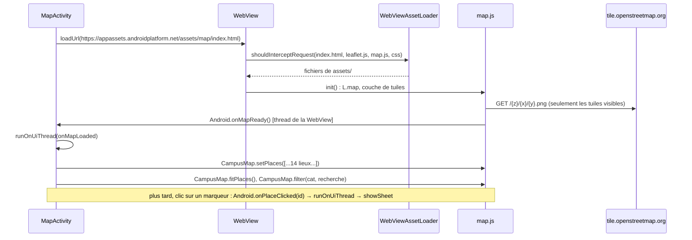
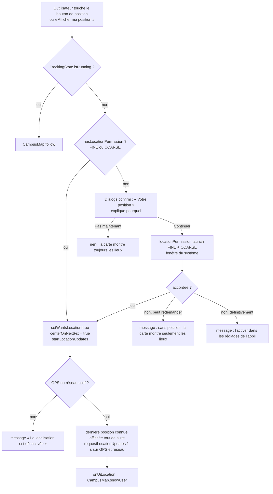
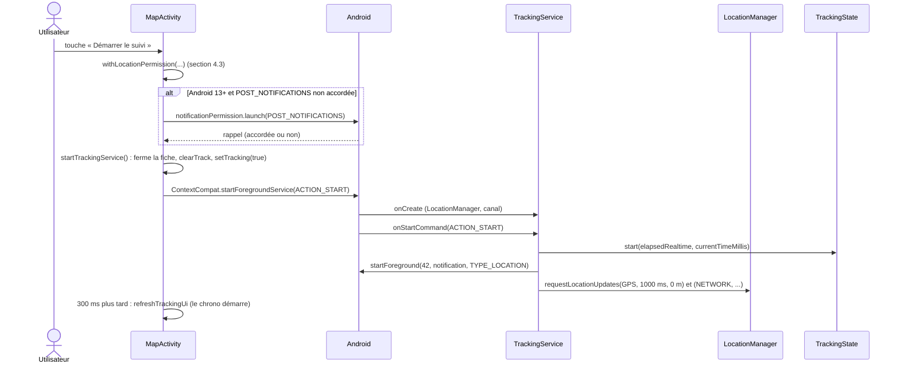
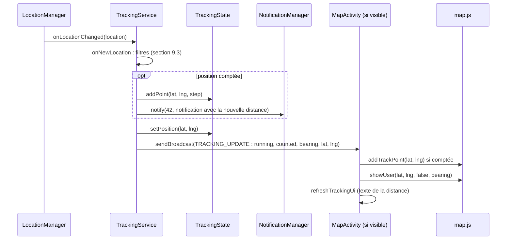
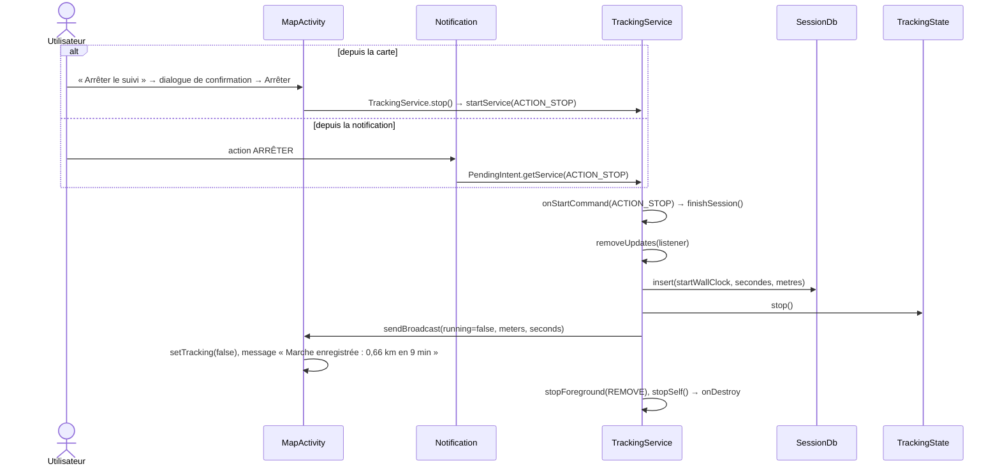
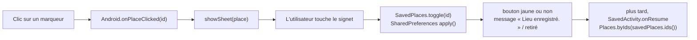
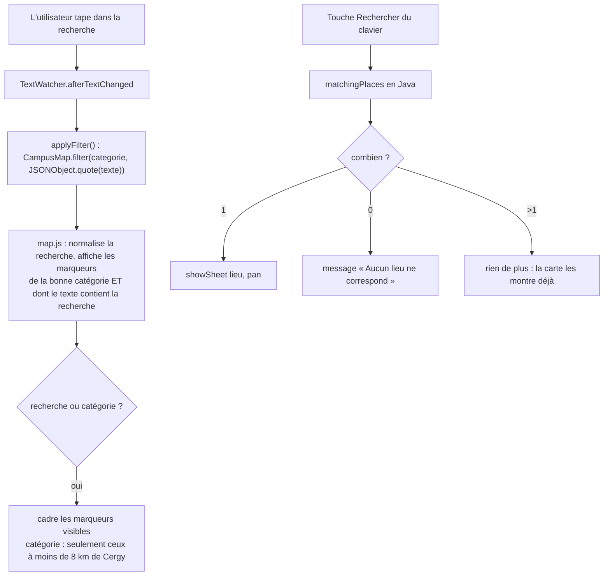
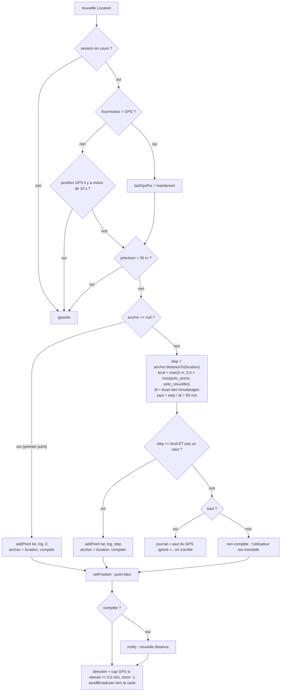

# CY Campus Explorer : documentation technique

Projet de la mineure Mobile Computing, L3 Informatique, CY Cergy Paris Université.
Équipe : BACHIR BEY Asma, GANDONOU Koffi Patrick-Léon. Enseignant : Dimitrios Kotzinos.

Ce document décrit le code tel qu'il est le 13 novembre 2026 (branche `main` plus les modifications
non commitées du 12 novembre : suivi en direct, 14 lieux, écran de lancement). Chaque affirmation
renvoie à un fichier, une classe ou une méthode du projet. Quand quelque chose n'existe pas dans le
code, le document le dit, et les propositions sont toujours signalées par **Proposition**.

Les chemins partent de `app/src/main/`. Les classes Java sont dans `java/fr/cyu/campusexplorer/`.
Version anglaise : `TECHNICAL_DOCUMENTATION.md`, même plan, mêmes numéros de section.

**Diagrammes modifiables (draw.io) :** `docs/diagrams/campus_explorer_diagrammes_FR.drawio` (anglais :
`campus_explorer_diagrams_EN.drawio`), 6 pages : architecture, diagramme de classes, navigation,
session de suivi, filtre GPS, permission de position. Ouvrez-les sur https://app.diagrams.net
(Fichier > Ouvrir depuis > Appareil), dans l'application draw.io, ou dans VS Code avec l'extension
« Draw.io Integration ».

---

## Sommaire

1. Vue d'ensemble : ce que fait l'application
2. Architecture et diagramme de classes
3. Analyse classe par classe
4. Déroulement (diagrammes de séquence et organigrammes)
5. Permissions et dépendances
6. Interface et layouts
7. Stockage des données et préférences
8. Capteurs et matériel
9. Parcours, distance et vitesse
10. Code commenté
11. Origine du code et références
12. Notions du cours dans le projet
13. Conformité, exigence par exigence
14. Vue technique de bout en bout
15. Préparer la soutenance : questions probables et réponses

---

## 1. Vue d'ensemble : ce que fait l'application

CY Campus Explorer aide un étudiant à trouver les lieux de CY Cergy Paris Université. Elle a trois
écrans (Activities) et un composant en arrière-plan (un Service au premier plan) :

| Écran / composant | Ce que l'utilisateur peut faire |
|---|---|
| **Accueil** (`MainActivity`) | ouvrir la carte ; l'ouvrir filtrée sur une catégorie (bâtiments, bibliothèque, restauration, services) ; ouvrir directement l'un des 3 premiers lieux ; ouvrir les lieux enregistrés |
| **Carte** (`MapActivity`) | voir 14 lieux en marqueurs sur une carte OpenStreetMap ; chercher par nom ou adresse (sans tenir compte des accents) ; filtrer par catégorie ; ouvrir la fiche d'un lieu (description, détails, bouton enregistrer) ; afficher sa position (point bleu) ; démarrer et arrêter l'enregistrement d'une marche |
| **Enregistrés** (`SavedActivity`) | voir et retirer les lieux enregistrés ; rouvrir un lieu sur la carte ; voir les 5 dernières marches (date, durée, distance) |
| **Suivi** (`TrackingService`) | enregistre une marche écran éteint ou dans une autre appli ; affiche une notification avec chrono, distance et bouton ARRÊTER |

Ce que l'application **ne fait pas** (vérifié dans le code) : pas de calcul d'itinéraire vers un
lieu, pas de distance restante, pas d'affichage de la vitesse, pas d'accéléromètre ni de gyroscope,
pas de compte utilisateur, pas de base distante. La section 9 explique ce qu'il faudrait pour en
ajouter certains.

---

## 2. Architecture et diagramme de classes

### 2.1 Organisation

Le code est réparti en trois paquets Java et une page web :

| Partie | Contenu | Rôle |
|---|---|---|
| `fr.cyu.campusexplorer` | `BaseActivity`, `MainActivity`, `MapActivity`, `SavedActivity`, `Dialogs` | les écrans (présentation et logique d'écran) |
| `fr.cyu.campusexplorer.data` | `Place`, `Places`, `SavedPlaces`, `SessionDb` | les données : lieux fixes, lieux enregistrés, historique |
| `fr.cyu.campusexplorer.tracking` | `TrackingService`, `TrackingState` | le suivi en arrière-plan et son état partagé |
| `assets/map/` | `index.html`, `map.js`, `map.css`, `leaflet/` | la carte, une page Leaflet affichée dans une `WebView` |

Il n'y a pas de couche MVVM ni de ViewModel : chaque Activity porte sa logique d'écran, dans le
style du cours. Les classes de données ne touchent jamais aux vues ; les Activities ne touchent
jamais au GPS pendant un suivi (c'est le service qui s'en charge).



### 2.2 Diagramme de classes UML

```mermaid
classDiagram
    direction LR
    class AppCompatActivity
    class Service
    class SQLiteOpenHelper
    class BaseActivity {
        <<abstract>>
        #LIFECYCLE : String
        #onCreate/onStart/onResume/onPause/onStop/onDestroy()
        #applySystemBarInsets(View root, View bottomNav)
        #setupBottomNav(Tab current)
        -setupTab(int id, int icon, int label, boolean selected, Class target)
        #openTab(Class target)
        #noTransition()
    }
    class Tab {
        <<enumeration>>
        HOME
        MAP
        SAVED
    }
    class MainActivity {
        -SPLASH_MIN_MS : long = 700
        #onCreate(Bundle)
        -fillCategories()
        -addCategory(GridLayout, LayoutInflater, Category, int, int)
        -fillDiscovery()
        -openMap(Category, int placeId)
    }
    class MapActivity {
        +EXTRA_PLACE_ID : String
        +EXTRA_CATEGORY : String
        -webView : WebView
        -mapReady : boolean
        -selected : Place
        -lastLocation : Location
        -locationManager : LocationManager
        -savedPlaces : SavedPlaces
        -locationPermission : ActivityResultLauncher
        -notificationPermission : ActivityResultLauncher
        -uiListener : LocationListener
        -trackingReceiver : BroadcastReceiver
        #onCreate / onNewIntent / onResume / onPause / onDestroy
        -handleIntent(Intent)
        -setupWebView()
        -onMapLoaded()
        -js(String code)
        -applyFilter()
        -showSheet(Place, boolean pan)
        -refreshOverlays()
        -withLocationPermission(Runnable)
        -startLocationUpdates() / stopLocationUpdates()
        -onUiLocation(Location)
        -startTrackingService()
        -refreshTrackingUi()
        -isOnline() boolean
    }
    class MapBridge {
        +onMapReady()
        +onPlaceClicked(int id)
        +onTilesError()
        +onTilesLoaded()
    }
    class SavedActivity {
        -savedPlaces : SavedPlaces
        -sessionDb : SessionDb
        #onCreate / onResume / onDestroy
        -showSavedPlaces()
        -showHistory()
    }
    class Dialogs {
        <<utility>>
        ~confirm(Activity, icon, colors, title, text, primary, secondary, Runnable)$
    }
    class Place {
        +id : int
        +name : int
        +category : Category
        +shortCategory : int
        +description : int
        +details : int
        +lat : double
        +lng : double
    }
    class Category {
        <<enumeration>>
        BUILDINGS
        LIBRARY
        FOOD
        SERVICES
        +key : String
        +icon : int
        +markerColor : int
        +softColor : int
    }
    class Places {
        <<utility>>
        -ALL : List~Place~
        +all() List~Place~$
        +byId(int) Place$
        +byIds(List~Integer~) List~Place~$
    }
    class SavedPlaces {
        -prefs : SharedPreferences
        +ids() List~Integer~
        +contains(int) boolean
        +toggle(int) boolean
        +remove(int)
        -save(List~Integer~)
    }
    class SessionDb {
        +onCreate(SQLiteDatabase)
        +onUpgrade(SQLiteDatabase, int, int)
        +insert(long, long, double) long
        +latest(int) List~Session~
    }
    class Session {
        +id : long
        +startTime : long
        +durationSeconds : long
        +distanceMeters : double
    }
    class TrackingService {
        +ACTION_START / ACTION_STOP / BROADCAST_UPDATE
        -locationManager : LocationManager
        -anchor : Location
        -lastGpsFix : long
        -listener : LocationListener
        +start(Context)$
        +stop(Context)$
        +onCreate()
        +onStartCommand(Intent, int, int) int
        -requestUpdates()
        -onNewLocation(Location)
        -finishSession()
        -buildNotification() Notification
        +onDestroy()
        +onBind(Intent) IBinder
    }
    class TrackingState {
        <<static state>>
        -running : boolean
        -startElapsed : long
        -startWallClock : long
        -distanceMeters : double
        -points : List~double[]~
        -position : double[]
        ~start(long, long)$
        ~addPoint(double, double, double)$
        ~setPosition(double, double)$
        ~stop()$
        +isRunning() boolean$
        +distanceMeters() double$
        +points() List$
        +position() double[]$
        +formatDistance(Context, double) String$
    }

    AppCompatActivity <|-- BaseActivity
    BaseActivity <|-- MainActivity
    BaseActivity <|-- MapActivity
    BaseActivity <|-- SavedActivity
    BaseActivity +-- Tab
    Service <|-- TrackingService
    SQLiteOpenHelper <|-- SessionDb
    SessionDb +-- Session
    Place +-- Category
    MapActivity +-- MapBridge
    Places o-- "14" Place
    MainActivity ..> Places
    MainActivity ..> MapActivity : Intent
    MainActivity ..> SavedActivity : Intent
    SavedActivity ..> MapActivity : Intent
    MapActivity --> SavedPlaces
    MapActivity ..> Places
    MapActivity ..> Dialogs
    MapActivity ..> TrackingService : start / stop
    MapActivity ..> TrackingState : lit
    TrackingService ..> TrackingState : écrit
    TrackingService ..> SessionDb : insert
    TrackingService ..> MapActivity : broadcast + PendingIntent
    SavedActivity --> SavedPlaces
    SavedActivity --> SessionDb
    SavedActivity ..> TrackingState : isRunning
```

Légende : `<|--` héritage, `+--` classe imbriquée, `-->` attribut (association), `..>` utilisation
(dépendance), `$` statique.

---

## 3. Analyse classe par classe

Les classes internes sont décrites avec leur classe englobante. « Appelle » liste les classes du
projet utilisées ; « appelée par » liste qui l'utilise.

### 3.1 `BaseActivity` (abstraite, hérite de `AppCompatActivity`)

**Rôle.** Ce que les trois écrans partagent : le journal du cycle de vie, la barre de navigation du
bas et les marges pour les barres système. Elle n'est jamais instanciée seule (`abstract`).

| Méthode | Ce qu'elle fait | Entrées / sortie |
|---|---|---|
| `onCreate`, `onStart`, `onResume`, `onPause`, `onStop`, `onDestroy` | appellent `super`, puis écrivent `"<NomDeClasse>.onXxx"` dans Logcat avec le tag `Lifecycle` | les callbacks standard ; pas de retour |
| `applySystemBarInsets(View root, View bottomNav)` | enregistre un `OnApplyWindowInsetsListener` : marge haute de `root` = hauteur de la barre d'état, marge basse de `bottomNav` = hauteur de la barre de navigation | les deux vues ; pas de retour |
| `setupBottomNav(Tab current)` | remplit les 3 onglets (icône, libellé), marque l'onglet courant | `Tab.HOME`, `MAP` ou `SAVED` |
| `setupTab(...)` (privée) | un onglet : icône, libellé, `setSelected`, description d'accessibilité ; un clic ouvre l'écran cible, sauf sur l'onglet courant | id, icône, libellé, sélectionné, classe cible |
| `openTab(Class target)` | `Intent` explicite avec `FLAG_ACTIVITY_REORDER_TO_FRONT`, puis `noTransition()` | classe de l'Activity cible |
| `noTransition()` | `overridePendingTransition(0, 0)` : pas d'animation de glissement entre onglets | aucune |

**Type imbriqué.** `enum Tab { HOME, MAP, SAVED }`.

**Utilise.** `AppCompatActivity`, `ViewCompat` / `WindowInsetsCompat` (AndroidX Core), `Log`.
**Utilisée par.** Les trois Activities (`extends BaseActivity`).

**Pourquoi `FLAG_ACTIVITY_REORDER_TO_FRONT` :** sans lui, chaque clic sur un onglet créerait une
nouvelle instance de l'écran, et le bouton Retour repasserait par tous les écrans visités.

### 3.2 `MainActivity` (Accueil, point d'entrée)

**Rôle.** L'Activity de lancement (filtre `MAIN` / `LAUNCHER` dans `AndroidManifest.xml`). Elle
affiche l'écran de lancement, puis la page d'accueil.

| Méthode | Ce qu'elle fait |
|---|---|
| `onCreate(Bundle)` | **avant** `super.onCreate` : `SplashScreen.installSplashScreen(this)` ; au vrai lancement (`savedInstanceState == null`), garde l'écran de lancement au moins 700 ms (`setKeepOnScreenCondition`). Puis `setContentView(R.layout.activity_main)`, marges, barre du bas (`Tab.HOME`), clics sur `btn_explore`, `btn_see_all` (ouvrent la carte) et `btn_saved`, puis `fillCategories()` et `fillDiscovery()` |
| `fillCategories()` | ajoute 4 cartes de catégorie dans le `GridLayout` `category_grid` |
| `addCategory(grid, inflater, category, label, index)` | gonfle `item_category.xml`, met texte, icône et couleur pastel, calcule la place dans la grille (ligne `index / 2`, colonne `index % 2`, écart de 9 dp converti en pixels) ; clic → `openMap(category, -1)` |
| `fillDiscovery()` | gonfle `item_discovery.xml` pour les 3 premiers lieux de `Places.all()`, numérotés 01 à 03 ; clic → `openMap(null, place.id)` |
| `openMap(Category category, int placeId)` | `Intent` explicite vers `MapActivity`, avec `EXTRA_CATEGORY` (la clé de catégorie) et/ou `EXTRA_PLACE_ID` |

**Utilise.** `Places`, `Place.Category`, `MapActivity` (constantes), `SavedActivity`, `SplashScreen`
(AndroidX core-splashscreen). **Appelée par.** Le système (icône du lanceur) et l'onglet Accueil.

### 3.3 `MapActivity` (écran Carte)

**Rôle.** L'écran central : la carte, la recherche et les filtres, la fiche d'un lieu, la position à
l'écran, et les commandes du suivi. C'est la plus grosse classe (environ 830 lignes avec les
commentaires).

**État (attributs).** `webView`, `mapReady` (la page a appelé `onMapReady`), `search`, `filters`,
`currentCategory` (`"all"` par défaut), `sheet`, `sheetExpanded`, `selected` (le `Place` ouvert, ou
null), les vues superposées, `handler` (`Handler` du thread principal pour les actions différées),
`savedPlaces`, `locationManager`, `listeningLocation`, `lastLocation`, `lastUiGpsFix`,
`centerOnNextFix`, `afterPermission` (ce qu'il faut faire une fois la permission accordée).

| Groupe | Méthode | Ce qu'elle fait |
|---|---|---|
| Cycle de vie | `onCreate` | layout, marges, barre du bas, `SavedPlaces`, `LocationManager`, puis `bindViews`, `setupWebView`, `setupSearchAndFilters`, `setupControls`, `setupSheet`, `setupTracking` ; restaure le lieu ouvert après une rotation ; `handleIntent(getIntent())` |
| | `onNewIntent(Intent)` | l'Activity existe déjà (ramenée devant) : lit les nouveaux extras |
| | `onResume` | `webView.onResume()` ; enregistre `trackingReceiver` (`RECEIVER_NOT_EXPORTED`) ; démarre la position à l'écran si l'utilisateur l'a demandée et que la permission est accordée ; rafraîchit le bandeau hors connexion, le panneau de suivi et les éléments superposés ; rouvre la fiche |
| | `onPause` | arrête la position à l'écran, retire le receiver, arrête le `Chronometer`, `webView.onPause()` |
| | `onSaveInstanceState` | garde l'id du lieu ouvert |
| | `onDestroy` | vide le `Handler`, retire l'interface JavaScript, détruit la `WebView` |
| Intents | `handleIntent(Intent)` | `EXTRA_CATEGORY` → coche le filtre ; `EXTRA_PLACE_ID` → `showSheet(place, true)` ; chaque extra est retiré après usage |
| Carte | `setupWebView()` | `WebViewAssetLoader` sert `assets/` à `https://appassets.androidplatform.net/assets/` ; JavaScript activé, accès fichiers et contenus désactivé ; user agent + « CampusExplorer/1.0 » ; `WebViewClient` qui intercepte les requêtes et bloque la navigation ; `addJavascriptInterface(new MapBridge(), "Android")` ; charge `map/index.html` |
| | `onMapLoaded()` | `mapReady = true`, envoie les lieux (`CampusMap.setPlaces`), les cadre, applique le filtre, resélectionne le lieu, replace le point bleu et, pendant un suivi, tout le tracé |
| | `drawFullTrack()` | envoie `TrackingState.points()` en JSON, la dernière position, et `setTracking(true)` |
| | `js(String)` | `webView.evaluateJavascript(code, null)` si `mapReady` |
| | `placesJson()` | construit `[{"id","name","text","cat","lat","lng"}, ...]` avec `org.json` |
| | `searchText(Place)`, `simplify(String)` | nom + détails, en minuscules, sans accents (`Normalizer` NFD + expression `\p{M}`) |
| | `coords(lat, lng)` | `"%.6f,%.6f"` avec `Locale.US` (une virgule décimale casserait l'appel JavaScript) |
| Recherche | `setupSearchAndFilters()` | `TextWatcher` → `applyFilter()` ; bouton effacer ; touche Rechercher du clavier → ouvre la fiche si un seul lieu correspond, message si aucun ; boutons radio des filtres → `currentCategory` |
| | `applyFilter()` | `CampusMap.filter(categorie, recherche)` ; la recherche passe par `JSONObject.quote` (pas d'injection JavaScript) |
| | `matchingPlaces()` | la même règle en Java, pour la touche Rechercher |
| | `categoryFor`, `filterIdFor`, `FILTERS` | id du bouton radio ↔ clé de catégorie |
| | `hideKeyboard()` | `InputMethodManager.hideSoftInputFromWindow` |
| Boutons | `setupControls()` | zoom +/− ; bouton de position : pendant un suivi `CampusMap.follow()`, sinon `showMyPosition()` |
| | `showMyPosition()` | permission → mémorise le choix → point bleu centré → démarre la position à l'écran |
| Fiche | `setupSheet()` | fermer, bouton « Voir les détails », bouton enregistrer (`savedPlaces.toggle`, message) |
| | `showSheet(Place, boolean pan)` | remplit la fiche, colore l'icône selon la catégorie, `CampusMap.select(id, pan)` |
| | `hideSheet()`, `updateSaveButton()` | fermeture ; bouton enregistrer jaune si le lieu est enregistré |
| Superpositions | `refreshOverlays()` | décide à partir de 3 états (suivi, lieu sélectionné, position connue) lesquels sont visibles : panneau de suivi, fiche, bouton Démarrer, invitation à activer la position ; et la pastille d'état |
| | `setStatus`, `showToast` (2 surcharges) | texte et couleur de la pastille ; message noir maison qui apparaît et disparaît avec `View.animate()` et le `Handler` |
| Permission | `locationPermission` (attribut) | `registerForActivityResult(RequestMultiplePermissions)` : accordée → exécute `afterPermission` ; refusée → message, différent après un refus définitif |
| | `notificationPermission` (attribut) | `RequestPermission` pour `POST_NOTIFICATIONS` ; quelle que soit la réponse, démarre le service |
| | `hasLocationPermission()` | FINE **ou** COARSE accordée |
| | `withLocationPermission(Runnable)` | accordée → exécute tout de suite ; sinon dialogue d'explication (`Dialogs.confirm`), puis demande au système |
| | `wantsLocation()`, `setWantsLocation(boolean)` | la préférence `show_location` (section 7) |
| Position | `uiListener` (attribut) | `LocationListener` → `onUiLocation` |
| | `startLocationUpdates()` | GPS et/ou réseau actifs ? sinon message ; dernière position connue affichée tout de suite ; `requestLocationUpdates(fournisseur, 1000 ms, 0 m, uiListener)` |
| | `stopLocationUpdates()` | `removeUpdates(uiListener)` |
| | `onUiLocation(Location)` | ignorée pendant un suivi ; position réseau ignorée si le GPS a répondu dans les 10 dernières secondes ; déplace le point bleu |
| Suivi | `setupTracking()` | bouton Démarrer : permission, puis (Android 13+) permission des notifications, puis `startTrackingService()` ; Arrêter : dialogue de confirmation puis `TrackingService.stop(this)` |
| | `startTrackingService()` | ferme la fiche, efface l'ancien tracé, la carte suit l'utilisateur, `TrackingService.start(this)`, rafraîchit l'écran 300 ms après |
| | `trackingReceiver` (attribut) | `EXTRA_RUNNING == true` : nouvelle position (point du tracé si `EXTRA_COUNTED`, point bleu avec direction, panneau) ; `false` : fin de session, message de résumé |
| | `refreshTrackingUi()` | base du `Chronometer` = `TrackingState.startElapsed()`, texte de la distance |
| Hors connexion | `updateOfflineBanner()`, `isOnline()` | `ConnectivityManager.getActiveNetwork()` + `NET_CAPABILITY_INTERNET` |

**Classe interne `MapBridge`.** Quatre méthodes `@JavascriptInterface` appelées par `map.js` :
`onMapReady()`, `onPlaceClicked(int id)`, `onTilesError()`, `onTilesLoaded()`. Elles tournent sur
un thread de la WebView ; chacune passe donc par `runOnUiThread`.

**Utilise.** `Places`, `Place`, `SavedPlaces`, `TrackingService`, `TrackingState`, `Dialogs`,
`WebView`, `WebViewAssetLoader`, `LocationManager`, `ConnectivityManager`, `ActivityResultContracts`,
`org.json`. **Appelée par.** `MainActivity`, `SavedActivity`, `BaseActivity.openTab`, et la
notification de `TrackingService` (`PendingIntent`).

### 3.4 `SavedActivity` (lieux enregistrés et historique)

| Méthode | Ce qu'elle fait |
|---|---|
| `onCreate` | layout, marges, barre du bas (`Tab.SAVED`), crée `SavedPlaces` et `SessionDb` ; « Explorer » et « session en cours » → carte |
| `onResume` | `showSavedPlaces()`, `showHistory()`, affiche la carte « session en cours » si `TrackingState.isRunning()`. Tout est relu ici pour qu'une modification faite sur la carte apparaisse au retour |
| `onDestroy` | `sessionDb.close()` |
| `showSavedPlaces()` | `Places.byIds(savedPlaces.ids())` ; compteur au pluriel (`R.plurals.saved_count`) ; état vide ; un `item_saved_place.xml` par lieu ; « Voir sur la carte » → `Intent` avec `EXTRA_PLACE_ID` ; corbeille → `savedPlaces.remove(id)` et redessin |
| `showHistory()` | `sessionDb.latest(5)` ; date au format du téléphone (`DateFormat.LONG, SHORT`), durée `min:s`, distance en km |

**Utilise.** `SavedPlaces`, `SessionDb`, `Places`, `TrackingState`, `MapActivity`.

### 3.5 `Dialogs` (utilitaire, visibilité paquet, `final`, constructeur privé)

Une méthode statique, `confirm(activity, icon, iconColor, iconBackground, title, text, primary,
secondary, onPrimary)` : gonfle `dialog_confirm.xml`, le remplit, crée un `AlertDialog` à fond de
fenêtre transparent (seule la carte arrondie se voit), exécute `onPrimary` après le bouton
principal, ferme sur le second. **Appelée par** `MapActivity` : l'explication avant la permission
de localisation (`withLocationPermission`) et la confirmation d'arrêt (`setupTracking`).

### 3.6 `Place` et `Place.Category` (modèle de données)

`Place` est un objet valeur immuable (tous les champs `final`) : `id`, `name`, `category`,
`shortCategory`, `description`, `details` (des **identifiants de ressources** texte, `@StringRes
int`), `lat`, `lng`. Garder des identifiants plutôt que des `String` permet à `getString()` de
traduire les textes au moment de l'affichage (`values/places.xml` en anglais,
`values-fr/places.xml` en français).

`Category` est un `enum` de 4 valeurs, chacune avec une `key` (envoyée au JavaScript :
`"buildings"`, `"library"`, `"food"`, `"services"`), une icône, une couleur de marqueur et une
couleur pastel. `softColor` est déclarée mais lue nulle part (`MainActivity` utilise son propre
tableau de couleurs).

### 3.7 `Places` (utilitaire, les 14 lieux fixes)

`ALL` est une liste non modifiable de 14 objets `Place`, construite une seule fois (statique). Les
coordonnées viennent d'OpenStreetMap. Les lieux 1 à 4 sont ceux de la maquette Figma, 5 à 9 les
autres sites de Cergy-Pontoise, 10 à 14 des sites ailleurs en Île-de-France.

| N° | Nom (affiché en français) | Catégorie |
|---|---|---|
| 1 | Bibliothèque universitaire (Cerclades) | bibliothèque |
| 2 | Restaurant universitaire | restauration |
| 3 | Bâtiment d'enseignement (Chênes) | bâtiments |
| 4 | Maison des étudiants | services |
| 5 | Site de Saint-Martin | bâtiments |
| 6 | Site Bernard Hirsch | bâtiments |
| 7 | Résidence Crous | services |
| 8 | Site de Neuville | bâtiments |
| 9 | CY Tech, site du Parc | bâtiments |
| 10 | Site de Saint-Germain-en-Laye | bâtiments |
| 11 | Site de Versailles | bâtiments |
| 12 | Site d'Argenteuil | bâtiments |
| 13 | Site de Gennevilliers | bâtiments |
| 14 | Site de Sarcelles | bâtiments |

Méthodes : `all()` ; `byId(int)` (recherche linéaire, `null` si inconnu) ; `byIds(List<Integer>)`
(garde l'ordre, ignore les identifiants inconnus). **Utilisée par** les trois Activities.

### 3.8 `SavedPlaces` (accès aux SharedPreferences)

| Méthode | Ce qu'elle fait | Retour |
|---|---|---|
| constructeur | `getSharedPreferences("campus_explorer", MODE_PRIVATE)` | |
| `ids()` | lit `"saved_place_ids"` (défaut `""`), découpe aux virgules, ignore les valeurs abîmées | `List<Integer>` dans l'ordre d'ajout |
| `contains(int)` | `ids().contains(id)` | `boolean` |
| `toggle(int)` | ajoute si absent, retire si présent, enregistre | `true` si le lieu est maintenant enregistré |
| `remove(int)` | retire et enregistre | |
| `save(List<Integer>)` (privée) | joint avec des virgules, `edit().putString(...).apply()` | |

Une chaîne séparée par des virgules plutôt que `putStringSet`, parce qu'un `Set` ne garde pas
l'ordre. **Utilisée par** `MapActivity` (toggle, contains) et `SavedActivity` (ids, remove).

### 3.9 `SessionDb` et `SessionDb.Session` (SQLite)

`SessionDb extends SQLiteOpenHelper`, base `sessions.db`, version 1, table `SESSIONS` :

```sql
CREATE TABLE SESSIONS (
    ID          INTEGER PRIMARY KEY AUTOINCREMENT,
    START_TIME  INTEGER NOT NULL,   -- millisecondes depuis 1970
    DURATION_S  INTEGER NOT NULL,
    DISTANCE_M  REAL    NOT NULL)
```

| Méthode | Ce qu'elle fait |
|---|---|
| `onCreate(SQLiteDatabase)` | exécute le `CREATE TABLE` (une fois, quand le fichier n'existe pas) |
| `onUpgrade(...)` | vide : il n'existe que la version 1 |
| `insert(debut, duree, distance)` | `ContentValues` + `insert` ; renvoie l'id de la nouvelle ligne (−1 en cas d'erreur) |
| `latest(int limit)` | `query(... orderBy START_TIME DESC, limit)`, `Cursor` fermé par try-with-resources ; renvoie `List<Session>` |

`Session` est une ligne immuable (`id`, `startTime`, `durationSeconds`, `distanceMeters`).
**Écrite par** `TrackingService.finishSession()` ; **lue par** `SavedActivity.showHistory()`.

### 3.10 `TrackingService` (Service au premier plan)

**Rôle.** Enregistre une marche. Il ne tourne que pendant une session démarrée par l'utilisateur,
au premier plan (type `location`), avec une notification permanente. C'est un service *démarré*,
pas *lié* (`onBind` renvoie `null`).

| Méthode | Ce qu'elle fait |
|---|---|
| `start(Context)` (statique) | `ContextCompat.startForegroundService` avec `ACTION_START` |
| `stop(Context)` (statique) | `startService` avec `ACTION_STOP` |
| `onCreate()` | récupère le `LocationManager`, crée le canal de notification |
| `onStartCommand(intent, flags, startId)` | `ACTION_STOP` → `finishSession()` ; pas de permission → `stopSelf()` ; sinon démarre `TrackingState` (s'il ne tourne pas), `ServiceCompat.startForeground(..., FOREGROUND_SERVICE_TYPE_LOCATION)`, `requestUpdates()` ; renvoie `START_NOT_STICKY` |
| `hasLocationPermission()` | FINE ou COARSE |
| `requestUpdates()` | fournisseurs GPS et réseau, 1 position par seconde, sans distance minimale, livrées sur le `Looper` principal ; `SecurityException` → `finishSession()` |
| `onNewLocation(Location)` | l'algorithme de filtrage et de distance (section 9.3) |
| `accuracy(Location)` | précision en mètres, 20 m si inconnue |
| `finishSession()` | retire les mises à jour ; si une session tournait, calcule durée et distance, `SessionDb.insert`, `TrackingState.stop()` ; diffuse la fin avec le résumé ; `stopForeground(REMOVE)` ; `stopSelf()` |
| `createChannel()` | canal `"tracking"`, `IMPORTANCE_LOW` (sans son) |
| `buildNotification()` | titre, texte, distance en sous-texte, chrono depuis le départ, `setOngoing(true)`, toucher → `MapActivity`, action ARRÊTER → `ACTION_STOP` (`PendingIntent` avec `FLAG_IMMUTABLE`) |
| `onDestroy()` | retire les mises à jour de position |

**Constantes (réglages).** `MIN_TIME_MS = 1000`, `MIN_DISTANCE_M = 0`, `MAX_ACCURACY_M = 35`,
`MIN_STEP_M = 5`, `MAX_SPEED_MS = 50`, `GPS_FRESH_MS = 10 000`, `MIN_SPEED_FOR_BEARING = 0.5`.

**Extras de la diffusion** (`BROADCAST_UPDATE = "fr.cyu.campusexplorer.TRACKING_UPDATE"`) :
`running`, `counted`, `bearing`, `lat`, `lng`, et à la fin `meters`, `seconds`.

### 3.11 `TrackingState` (état statique partagé)

**Rôle.** L'état de la session en cours, partagé entre le service et les écrans. Les deux tournent
dans le même processus : un objet statique suffit. Quand la carte revient (`onResume`), elle
retrouve tout de suite le départ du chrono, la distance et le tracé.

Champs : `running`, `startElapsed` (`SystemClock.elapsedRealtime()`), `startWallClock`
(`System.currentTimeMillis()`), `distanceMeters`, `points` (liste de `{lat, lng}`), `position`
(dernière position, même si elle n'a pas été ajoutée au tracé).

Écriture (visibilité paquet, donc seul `TrackingService` peut l'appeler) : `start`, `addPoint`,
`setPosition`, `stop`. Lecture (publique) : `isRunning`, `startElapsed`, `distanceMeters`, `points`
(renvoie une **copie**), `position` (renvoie un clone), et `formatDistance(Context, metres)`
(« 350 m » sous 1 km, puis « 1,25 km » / « 1.25 km »). Toutes les méthodes sont `synchronized`.

**Limite.** L'état ne vit qu'en mémoire : si Android tue le processus, la session en cours est
perdue (section 13.3).

### 3.12 La page de la carte : `index.html`, `map.js`, `map.css`, Leaflet

`index.html` charge `leaflet/leaflet.css`, `map.css`, `leaflet/leaflet.js` (Leaflet 1.9.4, embarqué,
sans CDN) et `map.js`. `map.js` est une fonction exécutée immédiatement qui crée la carte et expose
un seul objet global, `window.CampusMap` :

| Fonction | Appelée depuis Java par | Rôle |
|---|---|---|
| `setPlaces(list)` | `onMapLoaded` | crée un `L.marker` par lieu, avec un `divIcon` (épingle SVG) ; clic → `Android.onPlaceClicked(id)` |
| `filter(category, query)` | `applyFilter` | affiche/masque les marqueurs ; cadre ceux qui restent (pour une catégorie, seulement ceux à moins de 8 km de Cergy) |
| `select(id, pan)` | `showSheet`, `hideSheet`, `onMapLoaded`, `startTrackingService` | marqueur agrandi pour le lieu choisi ; `flyTo` si `pan` |
| `fitPlaces()` | `onMapLoaded` | cadre les lieux à moins de 8 km de Cergy |
| `zoomIn()`, `zoomOut()` | boutons de zoom | |
| `showUser(lat, lng, center, bearing)` | `onUiLocation`, `trackingReceiver`, `showMyPosition`, `onMapLoaded`, `drawFullTrack` | point bleu, flèche de direction si `bearing >= 0`, la caméra suit si `following` |
| `follow()` | bouton de position pendant un suivi, première position suivie | `following = true`, `flyTo` |
| `setTracking(on)` | départ, fin, `drawFullTrack` | `tracking = following = on` |
| `setTrack(points)`, `addTrackPoint(lat, lng)`, `clearTrack()` | `drawFullTrack`, `trackingReceiver`, `startTrackingService` | le tracé (deux `L.polyline` : noire dessous, jaune dessus) |
| `hideUser()` | **jamais appelée** depuis Java | |

Fonctions internes : `bridge()` (renvoie `window.Android`, ou null dans un navigateur ordinaire),
`markerIcon`, `isNearCergy` (`distanceTo` de Leaflet, 8 000 m), `fit`, `drawTrack` (ajoute un dernier
segment jusqu'au point bleu pour que la ligne finisse sur l'utilisateur), `init` (carte centrée sur
49,0367 ; 2,0775 au zoom 15, couche de tuiles OSM, événements `tileerror`/`tileload` →
`onTilesError`/`onTilesLoaded`, `dragstart` arrête le suivi de la caméra).

---

## 4. Déroulement

### 4.1 Lancement et navigation entre les écrans



Grâce à `FLAG_ACTIVITY_REORDER_TO_FRONT`, la `MapActivity` existante est ramenée devant et reçoit
`onNewIntent` au lieu d'un second `onCreate`.

### 4.2 Chargement de la carte (Java ↔ JavaScript)



### 4.3 « Afficher ma position » (permission à l'exécution)



### 4.4 Démarrer un suivi



### 4.5 Une nouvelle position pendant un suivi



Quand la carte n'est pas visible (`onPause` a retiré le receiver), la diffusion n'est simplement pas
reçue ; le service continue d'écrire dans `TrackingState`. Au retour de la carte, `onResume` →
`refreshTrackingUi`, et `onMapLoaded`/`drawFullTrack` redessine tout le tracé à partir de
`TrackingState.points()`.

### 4.6 Arrêter un suivi (depuis l'appli ou la notification)



### 4.7 Enregistrer un lieu



### 4.8 Recherche et filtres



---

## 5. Permissions et dépendances

### 5.1 Permissions (`AndroidManifest.xml`)

| Permission | Niveau | Sert à | Utilisée dans | Demande à l'exécution | En cas de refus |
|---|---|---|---|---|---|
| `INTERNET` | normale (accordée à l'installation) | tuiles OSM dans la `WebView` | couche de tuiles de `map.js` | non | sans objet |
| `ACCESS_NETWORK_STATE` | normale | savoir si le téléphone est en ligne (bandeau hors connexion) | `MapActivity.isOnline()` | non | sans objet |
| `ACCESS_FINE_LOCATION` | dangereuse | position précise (GPS) | `MapActivity` (point bleu), `TrackingService` | oui, lanceur `locationPermission`, après le dialogue d'explication | message ; la carte marche avec les lieux ; le suivi ne peut pas démarrer |
| `ACCESS_COARSE_LOCATION` | dangereuse | position approximative | idem | oui, demandée avec FINE (Android 12+ laisse choisir « approximative ») | idem |
| `FOREGROUND_SERVICE` | normale | `startForeground` (Android 9+) | `TrackingService` | non | sans objet |
| `FOREGROUND_SERVICE_LOCATION` | normale | service au premier plan de type `location` (Android 14+) | `TrackingService`, `foregroundServiceType="location"` dans le manifeste | non, mais Android vérifie qu'une permission de localisation est accordée | le service ne démarre jamais sans permission (vérifié dans `onStartCommand`) |
| `POST_NOTIFICATIONS` | dangereuse (Android 13+) | afficher la notification du suivi | `MapActivity.notificationPermission` | oui, avant le premier suivi | le suivi démarre quand même ; la notification est masquée du volet |

`<uses-feature android:name="android.hardware.location.gps" android:required="false"/>` : l'appli
s'installe aussi sur un appareil sans GPS.

**Volontairement non demandée : `ACCESS_BACKGROUND_LOCATION`.** La session est toujours démarrée par
l'utilisateur pendant que la carte est visible, et le service est au premier plan avec le type
`location`. Dans ce cas, Android considère l'accès comme « pendant l'utilisation » : la permission
de localisation en arrière-plan n'est pas nécessaire.

**Où les permissions sont vérifiées.** `MapActivity.hasLocationPermission()` avant chaque appel de
localisation ; `TrackingService.onStartCommand` vérifie à nouveau (un service peut être démarré par
la notification) ; `requestUpdates()` attrape `SecurityException` (permission retirée pendant une
session) et termine proprement la session.

### 5.2 Bibliothèques (`app/build.gradle.kts`, `gradle/libs.versions.toml`)

| Bibliothèque | Version | Pourquoi |
|---|---|---|
| `androidx.appcompat:appcompat` | 1.8.0 | `AppCompatActivity`, `ActivityResultContracts` (via AndroidX Activity) |
| `com.google.android.material:material` | 1.14.0 | base du thème Material |
| `androidx.webkit:webkit` | 1.14.0 | `WebViewAssetLoader` (sert les assets à une adresse https) |
| `androidx.core:core-splashscreen` | 1.0.1 | écran de lancement d'Android 8 à 16 |
| Leaflet (JavaScript, embarqué) | 1.9.4 | la carte interactive |
| Tuiles OpenStreetMap (en ligne) | sans objet | fond de carte |

Build : Android Gradle Plugin 9.0.1, `compileSdk` 36, `minSdk` 26 (Android 8.0), `targetSdk` 36,
Java 11. Pas de Google Play Services, pas de clé d'API Google Maps.

### 5.3 Imports importants par classe

| Classe | Imports et raison |
|---|---|
| `BaseActivity` | `AppCompatActivity` (Activity de base), `Log` (journal du cycle de vie), `ViewCompat`, `WindowInsetsCompat`, `Insets` (marges des barres système), `@DrawableRes`/`@StringRes` (contrôle lint des identifiants de ressources) |
| `MainActivity` | `SplashScreen` (écran de lancement), `SystemClock` (durée minimale), `GridLayout`, `LayoutInflater` (construction des cartes), `ColorStateList`, `ContextCompat` (couleurs) |
| `MapActivity` | `WebView`, `WebSettings`, `WebViewClient`, `WebResourceRequest/Response`, `JavascriptInterface`, `WebViewAssetLoader` (carte) ; `LocationManager`, `LocationListener`, `Location` (position) ; `ActivityResultLauncher`, `ActivityResultContracts` (permissions) ; `BroadcastReceiver`, `IntentFilter`, `ContextCompat.registerReceiver` (messages du service) ; `ConnectivityManager`, `NetworkCapabilities` (hors connexion) ; `Chronometer` (durée) ; `org.json` (données pour le JavaScript) ; `Normalizer` (recherche sans accents) ; `Handler`, `Looper` (tâches différées) |
| `SavedActivity` | `DateFormat`, `Date` (dates au format du téléphone), `SavedPlaces`, `SessionDb`, `TrackingState` |
| `Dialogs` | `AlertDialog`, `ColorDrawable` (fenêtre transparente) |
| `SavedPlaces` | `SharedPreferences` |
| `SessionDb` | `SQLiteOpenHelper`, `SQLiteDatabase`, `ContentValues`, `Cursor` |
| `TrackingService` | `Service`, `LocationManager`, `LocationListener`, `Looper`, `NotificationChannel`, `NotificationCompat`, `PendingIntent`, `ServiceCompat`, `ServiceInfo` (type du premier plan), `SystemClock` |
| `TrackingState` | `Context` (mise en forme avec les ressources) |

---

## 6. Interface et layouts

### 6.1 Approche

L'interface utilise des **layouts XML et les vues Android classiques** (pas de Jetpack Compose).
Les listes sont construites dans le code en gonflant de petits layouts d'élément dans un
`LinearLayout` ou un `GridLayout` (les listes sont courtes : au plus 14 lieux, 5 sessions), donc pas
de `RecyclerView` ni de `ListView`. La carte est la seule partie dessinée par une page web (Leaflet
dans une `WebView`).

### 6.2 Fichiers de layout

| Layout | Utilisé par | Contenu |
|---|---|---|
| `activity_main.xml` | `MainActivity` | `ScrollView` : logo (`include view_logo`), titre, bouton « Explorer » (`btn_explore`), `GridLayout category_grid`, « Tout voir » (`btn_see_all`), `LinearLayout discovery_list`, bouton des lieux enregistrés (`btn_saved`) ; barre du bas |
| `activity_map.xml` | `MapActivity` | en-tête avec pastille d'état (`status_dot`, `status_text`) ; `FrameLayout` avec la `WebView map_web` dessous et, par-dessus : carte de recherche (`search`, `search_clear`), `HorizontalScrollView` avec `RadioGroup filters` (5 `RadioButton`), `offline_banner`, boutons de position et de zoom, `location_prompt`, `btn_start_tracking`, `include view_tracking_panel` (`tracking_panel`), `include view_place_sheet` (`place_sheet`), `toast` maison ; barre du bas |
| `activity_saved.xml` | `SavedActivity` | `saved_count`, `saved_list`, `empty_state` avec `btn_empty_explore`, `active_session`, `history_list`, `history_empty` ; barre du bas |
| `view_place_sheet.xml` | carte | la fiche : icône, catégorie, nom, description, zone de détails, bouton « Voir les détails », bouton enregistrer, bouton fermer |
| `view_tracking_panel.xml` | carte | `Chronometer tracking_time`, `tracking_distance`, `tracking_stop` |
| `view_bottom_nav.xml`, `view_nav_item.xml` | tous les écrans | la barre et un onglet (inclus 3 fois) |
| `view_logo.xml` | tous les écrans | logo et nom |
| `item_category.xml`, `item_discovery.xml` | accueil | carte de catégorie, carte de lieu numérotée |
| `item_saved_place.xml`, `item_session.xml` | enregistrés | ligne de lieu enregistré, ligne de session |
| `dialog_confirm.xml` | `Dialogs` | le dialogue maison |

Ressources : `res/values/colors.xml` (couleurs de la maquette), `res/font/` (Inter, licence OFL),
`res/drawable/` (formes `bg_*.xml` et icônes vectorielles `ic_*.xml`), `res/color/` (sélecteurs
d'état), `res/values/themes.xml` (`Theme.CampusExplorer` et `Theme.CampusExplorer.Starting`),
`strings.xml` et `places.xml` dans `values/` (anglais) et `values-fr/` (français),
`res/xml/locales_config.xml`.

### 6.3 Relier le XML et le Java

1. `setContentView(R.layout.activity_map)` transforme le XML en arbre d'objets View.
2. `findViewById(R.id.xxx)` renvoie une vue de cet arbre (`MapActivity.bindViews()`).
3. Les listeners sont attachés dans le code avec des lambdas, par exemple
   `findViewById(R.id.btn_zoom_in).setOnClickListener(v -> js("CampusMap.zoomIn()"))`.
   Le projet n'utilise pas l'attribut XML `android:onClick`.
4. Listes : `getLayoutInflater().inflate(R.layout.item_..., parent, false)`, remplissage, `addView`.
5. Les éléments superposés à la carte sont affichés/masqués avec `setVisibility` dans **une seule**
   méthode, `refreshOverlays()`.

### 6.4 Navigation

Uniquement des Intents explicites (`new Intent(this, MapActivity.class)`), depuis la barre du bas
(`BaseActivity.openTab`), les boutons de l'accueil (`MainActivity.openMap`), la liste des lieux
enregistrés (`SavedActivity`) et la notification (`PendingIntent.getActivity`). Données passées
entre écrans : `EXTRA_PLACE_ID` (int) et `EXTRA_CATEGORY` (String). Aucun Intent implicite.

---

## 7. Stockage des données et préférences

| Mécanisme | Utilisé ? | Quoi | Où sur le téléphone | Écrit par | Lu par | Survit à la fermeture ? |
|---|---|---|---|---|---|---|
| SharedPreferences `campus_explorer` | **oui** | lieux enregistrés, clé `saved_place_ids`, valeur comme `"3,1,4"`, défaut `""` | `/data/data/fr.cyu.campusexplorer/shared_prefs/campus_explorer.xml` | `SavedPlaces.save` (via `toggle`, `remove`) | `SavedPlaces.ids`, `contains` | oui |
| Préférences de l'Activity `MapActivity` | **oui** | clé `show_location` (booléen, défaut `false`) : l'utilisateur a demandé à voir sa position | `shared_prefs/MapActivity.xml` (`getPreferences` nomme le fichier d'après l'Activity) | `MapActivity.setWantsLocation` | `MapActivity.wantsLocation` | oui |
| SQLite `sessions.db` | **oui** | table `SESSIONS` : début, durée, distance de chaque marche | `/data/data/fr.cyu.campusexplorer/databases/sessions.db` | `TrackingService.finishSession` → `SessionDb.insert` | `SavedActivity.showHistory` → `SessionDb.latest(5)` | oui |
| Objet statique en mémoire | oui | session en cours : instants de départ, distance, points du tracé, dernière position | RAM (`TrackingState`) | `TrackingService` | `MapActivity`, `SavedActivity` | **non** : perdu si le processus est tué |
| `Bundle` (état d'instance) | oui | id du lieu ouvert | géré par Android | `MapActivity.onSaveInstanceState` | `MapActivity.onCreate` | seulement à travers une rotation |
| Code et ressources | oui | les 14 lieux (coordonnées dans `Places.java`, textes dans `places.xml`) | dans l'APK, en lecture seule | les développeurs | tout le monde | sans objet |
| Cache de la WebView | implicite | tuiles déjà téléchargées (cache HTTP de la WebView) | dossier de données de la WebView | WebView | WebView | oui, géré par la WebView |
| DataStore, Room, Firebase, fichiers | **non** | | | | | |
| API ou base distante | **non** | seul le téléchargement des tuiles OSM ; l'appli n'envoie aucune donnée | | | | |

`android:allowBackup="true"` dans le manifeste : les préférences et la base peuvent être incluses
dans la sauvegarde Android de l'utilisateur.

**Pourquoi des SharedPreferences pour les lieux et SQLite pour les sessions.** Les lieux enregistrés
sont quelques entiers sous une seule clé : une base serait disproportionnée (comme pour le nom et
l'e-mail du TP2). Les sessions sont des enregistrements à plusieurs colonnes typées, de plus en plus
nombreux, triés par date : une table avec `ORDER BY START_TIME DESC LIMIT 5` convient (même
construction que `EventDbHelper` au TP2).

**Vie privée.** Les points du parcours ne sont jamais écrits sur le disque : seulement le résumé
(début, durée, distance). Le seul trafic réseau, ce sont les demandes de tuiles à
`tile.openstreetmap.org` (elles révèlent la zone de carte regardée et l'adresse IP aux serveurs
d'OSM, comme toute carte web).

---

## 8. Capteurs et matériel

| Matériel | Utilisé ? | API | Classe | Comment |
|---|---|---|---|---|
| **Récepteur GNSS / GPS** | **oui, le capteur du projet** | `LocationManager.GPS_PROVIDER` | `TrackingService`, `MapActivity` | `requestLocationUpdates` avec un `LocationListener`, 1 position par seconde |
| Position réseau (Wi-Fi, antennes) | oui, en secours | `LocationManager.NETWORK_PROVIDER` | idem | utilisée seulement si le GPS se tait depuis 10 s (à l'intérieur) |
| Interface réseau | oui | `ConnectivityManager` | `MapActivity.isOnline` | bandeau hors connexion |
| Écran, tactile | oui | Vues, gestes de la WebView | tous les écrans | |
| Accéléromètre | **non** | (il faudrait `SensorManager`, `Sensor.TYPE_ACCELEROMETER`) | aucune | |
| Gyroscope | **non** | | aucune | |
| Magnétomètre / boussole | **non** | | aucune | la direction de la flèche vient du cap GPS, pas d'une boussole |
| Podomètre | **non** | | aucune | |

**Ce que donne un objet `Location`** (champs utilisés dans `TrackingService.onNewLocation`) :
latitude/longitude ; `getAccuracy()` (rayon en mètres, confiance de 68 %) pour rejeter les
mauvaises positions et fixer le seuil de bruit ; `getElapsedRealtimeNanos()` (horodatage) pour le
temps entre deux positions ; `getSpeed()` (m/s) et `getBearing()` (degrés depuis le nord)
seulement pour dessiner et orienter la flèche au-dessus de 0,5 m/s ; `getProvider()` pour
distinguer GPS et réseau.

**Traitement des données.** Les positions passent par le filtre de la section 9.3, puis deviennent
(1) un point du tracé et un ajout de distance dans `TrackingState`, (2) une diffusion vers la carte,
(3) une mise à jour de la notification.

**Batterie.** Le GPS n'est utilisé que pendant que la carte est visible (position à l'écran,
arrêtée dans `onPause`) ou pendant une session démarrée explicitement par l'utilisateur (service).
Sinon, aucun travail de localisation. Une position par seconde est un rythme de « navigation » :
précis mais coûteux ; un rythme plus lent économiserait la batterie (section 13.3).

---

## 9. Parcours, distance et vitesse

### 9.1 Ce que « parcours » veut dire ici

L'appli **enregistre le chemin réellement parcouru** (un tracé). Elle **ne calcule pas** d'itinéraire
vers une destination.

| Question | Réponse d'après le code |
|---|---|
| Comment le parcours est-il créé ? | par `TrackingService.onNewLocation`, qui ajoute les positions filtrées à `TrackingState.points` |
| Comment est-il affiché ? | par deux polylignes Leaflet dans `map.js` (`drawTrack`), plus un dernier segment jusqu'au point bleu |
| Comment obtient-on la position actuelle ? | `LocationManager.requestLocationUpdates` (GPS, réseau en secours), sections 4.3 et 4.5 |
| Y a-t-il une destination ? | **non.** On peut sélectionner un lieu (fiche), mais rien ne calcule de chemin ni de distance jusqu'à lui |
| Distance parcourue ou restante ? | **parcourue seulement**, affichée en direct (panneau, notification) et enregistrée (SQLite) |
| Service de cartographie | tuiles OpenStreetMap avec Leaflet. Pas d'API Google Maps, pas d'API d'itinéraire |

### 9.2 Le calcul de la distance

Distance parcourue = somme des longueurs des segments entre points **retenus** successifs :

```
d_total = Σ distance(P_i, P_i+1)        (TrackingState.addPoint ajoute chaque pas)
```

Chaque segment utilise `Location.distanceTo(Location)` (Android), qui calcule la distance sur
l'**ellipsoïde WGS84** (la forme de la Terre utilisée par le GPS) : le résultat est en mètres au sol,
pas une simple différence de coordonnées. Côté JavaScript, `isNearCergy` utilise le
`latLng.distanceTo` de Leaflet, qui applique la formule de haversine sur une sphère ; il sert
seulement à choisir quels lieux cadrer (8 km), pas à mesurer la marche.

### 9.3 L'algorithme de filtrage (`TrackingService.onNewLocation`)

Les positions GPS brutes « tremblent » de quelques mètres même quand on ne bouge pas ; les
additionner ferait grandir la distance sans bouger. L'algorithme garde une **ancre** (le dernier
point retenu) et ne compte un déplacement que s'il dépasse l'incertitude.



Exemple chiffré : précision de l'ancre 10 m, de la nouvelle position 20 m → bruit = max(5 ; 0,6 ×
20) = 12 m. Un pas de 8 m est ignoré (tremblement) ; un pas de 15 m en 10 s (1,5 m/s, la marche)
est compté ; un pas de 900 m en 2 s (450 m/s) est un saut du GPS et est ignoré.

Pourquoi mesurer depuis l'ancre et pas depuis la position brute précédente : les petits pas d'une
marche lente s'additionnent jusqu'à dépasser le seuil, donc une marche lente n'est pas perdue, alors
que le tremblement autour d'un même point ne le dépasse jamais.

### 9.4 La vitesse : ce qui existe et ce qui n'existe pas

**Ce que fait le code actuel.**

- La vitesse **n'est ni affichée ni enregistrée**.
- `location.getSpeed()` (vitesse en m/s donnée par le fournisseur de position) sert seulement à
  décider d'afficher la flèche de direction (`>= 0,5 m/s`).
- Une vitesse est calculée implicitement dans le test de saut : `step / seconds > 50 m/s`.
- La **vitesse moyenne** d'une marche se déduit déjà des données enregistrées :
  `v_moy = DISTANCE_M / DURATION_S` (par exemple 660 m en 540 s = 1,22 m/s = 4,4 km/h), mais aucun
  écran ne l'affiche.

**Quelle approche est techniquement adaptée.**

| Approche | Comment | Évaluation |
|---|---|---|
| Vitesse GPS du fournisseur | `Location.getSpeed()`, quand `hasSpeed()` | la plus simple et la plus fiable en extérieur ; les récepteurs la calculent en général par effet Doppler sur les signaux des satellites, ce qui est plus précis que de dériver les positions |
| Distance GPS sur le temps | `v = Δd / Δt` entre deux points retenus (le code a déjà `step` et `seconds`), lissée sur plusieurs points | marche avec tout fournisseur ; bruitée à la vitesse de la marche si Δt est court, donc moyenner sur une fenêtre (par exemple 10 s) |
| Vitesse moyenne de la session | `TrackingState.distanceMeters() / temps écoulé` | triviale à ajouter, stable |
| Accéléromètre | mesure une **accélération** (m/s²), gravité comprise, **pas une vitesse**. Pour une vitesse il faudrait : retirer la gravité (`TYPE_LINEAR_ACCELERATION`), passer des axes du téléphone aux axes terrestres (`TYPE_ROTATION_VECTOR`), puis intégrer `v(t) = v0 + ∫ a dt` | **inadapté seul** : un petit biais constant b donne une erreur de vitesse b·t qui grandit sans limite (un biais de 0,05 m/s² donne 3 m/s d'erreur après une minute). Utilisable seulement fusionné avec le GPS (par exemple un filtre de Kalman) pour lisser entre deux positions GPS |
| Gyroscope | mesure une **vitesse angulaire** (rad/s), c'est-à-dire une rotation | ne donne aucune vitesse linéaire ; utile seulement pour l'orientation (cap) dans une fusion de capteurs |
| Détecteur / compteur de pas | `TYPE_STEP_DETECTOR` ou `TYPE_STEP_COUNTER` × longueur de foulée | estimation raisonnable pour la marche à l'intérieur, où le GPS est faible ; il faut une longueur de foulée (calibrée ou estimée) ; demande la permission `ACTIVITY_RECOGNITION` à l'exécution depuis Android 10 |

**Recommandation pour cette appli :** une vitesse basée sur le GPS (vitesse du fournisseur quand elle
existe, sinon Δd/Δt lissé), plus la moyenne de la session. Les capteurs inertiels seulement en
amélioration ultérieure.

### 9.5 Propositions (non implémentées)

1. **Vitesse en direct dans le panneau de suivi.** Dans `onNewLocation`, mettre
   `location.getSpeed()` (si `hasSpeed()`) dans la diffusion (`EXTRA_SPEED`) ; dans
   `MapActivity.trackingReceiver`, l'afficher en km/h (`× 3,6`) dans un nouveau `TextView` de
   `view_tracking_panel.xml`.
2. **Vitesse moyenne dans l'historique.** Dans `SavedActivity.showHistory`, calculer
   `session.distanceMeters / session.durationSeconds × 3,6` (en évitant la division par 0). Aucun
   changement de la base.
3. **Distance jusqu'au lieu sélectionné (à vol d'oiseau).** Dans `showSheet`, si
   `lastLocation != null`, `Location.distanceBetween(lat, lng, place.lat, place.lng, result)` et
   afficher « à 850 m ». C'est une distance à vol d'oiseau, pas une distance à pied.
4. **Un vrai itinéraire à pied.** Il faut un moteur de calcul d'itinéraire sur le graphe des rues :
   un service en ligne construit sur les données OpenStreetMap (par exemple OSRM, GraphHopper ou
   openrouteservice), ou une extension Leaflet qui appelle un tel service. Cela ajoute une
   dépendance réseau, peut-être une clé d'API et des quotas ; cela enverrait aussi la position de
   l'utilisateur à ce service, ce qui change l'engagement de vie privée de la déclaration du projet.

---

## 10. Code commenté

Des commentaires ont été ajoutés le 13 novembre 2026 dans toutes les classes Java et dans `map.js`,
dans la langue et le style des commentaires existants (en français, sans accents dans le code
Java). Ils documentent les paramètres et les valeurs de retour, les API Android utilisées et la
raison de chaque choix. Ils expliquent pas à pas les parties complexes :
- `TrackingService.onNewLocation` (filtrage et distance) ;
- `MapActivity.refreshOverlays` (tableau des vues visibles) ;
- le parcours des permissions ;
- `SessionDb` (équivalents SQL) ;
- `SavedPlaces` (format de stockage, `apply` ou `commit`) ;
- dans `map.js` : le dessin du tracé, les tuiles et la suppression des accents.

**Comportement inchangé, vérifié :** le projet a été compilé avant et après les commentaires, et le
bytecode des 20 classes compilées a été comparé avec `javap -c -p` : aucune différence.

Par où commencer la lecture, pour la soutenance :

| Sujet | Fichier, méthode |
|---|---|
| Cycle de vie | `BaseActivity` (tous les callbacks), `MapActivity.onResume` / `onPause` |
| Intents et extras | `MainActivity.openMap`, `MapActivity.handleIntent`, `onNewIntent` |
| Permissions | `MapActivity.withLocationPermission`, `locationPermission`, `notificationPermission` |
| GPS | `TrackingService.requestUpdates`, `onNewLocation` ; `MapActivity.startLocationUpdates` |
| Service | `TrackingService.onStartCommand`, `finishSession`, `buildNotification` |
| Broadcast | `TrackingService.onNewLocation` (envoi), `MapActivity.trackingReceiver` (réception) |
| Stockage | `SavedPlaces`, `SessionDb`, `MapActivity.wantsLocation` |
| Java ↔ JavaScript | `MapActivity.setupWebView`, `MapBridge`, `js()` ; `map.js` |

---

## 11. Origine du code et références

### 11.1 Le code propre au projet

Toutes les classes Java, les layouts XML, `map.js`, `map.css` et `index.html` ont été écrits pour ce
projet (historique Git : 7 commits le 6 novembre 2026, plus les modifications non commitées du
12 novembre). Ils suivent des schémas du cours et de la documentation officielle d'Android
(ci-dessous), adaptés au projet ; aucun fichier n'a été copié d'un tutoriel, d'un dépôt GitHub ou de
Stack Overflow, et aucune source de ce type n'est citée dans le code.

> **À déclarer (décision de l'équipe).** Une partie du code, les commentaires et cette documentation
> ont été écrits avec l'aide d'un assistant de programmation par IA (Claude, d'Anthropic). Vérifiez
> les règles du cours sur les outils d'IA et déclarez cette utilisation dans le rapport ou le README
> si elles l'exigent. Les deux membres de l'équipe doivent pouvoir expliquer chaque partie : c'est
> le but de la section 15.

### 11.2 Schémas venant du cours et des TP

| Schéma | Origine | Où dans le projet |
|---|---|---|
| Activities, Intents explicites, extras | Cours 02 (Activities, Intents, UI), TP1 | `openTab`, `openMap`, `handleIntent` |
| Journal du cycle de vie | Cours 02, déclaration du projet | `BaseActivity` |
| SharedPreferences | TP2 (nom et e-mail) | `SavedPlaces`, `wantsLocation` |
| `SQLiteOpenHelper` + `ContentValues` + `Cursor` | TP2 (`EventDbHelper`) | `SessionDb` |
| `LocationManager` + `LocationListener` + `requestLocationUpdates` / `removeUpdates` | Cours 06 (Location and Maps), TP3 | `TrackingService`, `MapActivity` |
| GPS dans un service qui envoie un broadcast à l'Activity | Cours 06, premier exemple (service GPS + `sendBroadcast`) | `TrackingService` → `trackingReceiver` |
| Service démarré, `onStartCommand`, `stopSelf` | Cours 04 (Services) | `TrackingService` |
| Permissions à l'exécution | Cours 02/03, TP3, TP4 | `MapActivity` |

### 11.3 Code et ressources de tiers

| Élément | Licence | Source | Utilisation |
|---|---|---|---|
| Leaflet 1.9.4 (`assets/map/leaflet/`) | BSD 2-Clause | https://leafletjs.com, documentation https://leafletjs.com/reference.html | utilisé tel quel (fichiers embarqués) |
| Tuiles et données OpenStreetMap | ODbL (données), politique d'usage des tuiles | https://www.openstreetmap.org/copyright, https://operations.osmfoundation.org/policies/tiles/ | tuiles chargées en ligne, attribution affichée sur la carte ; le user agent identifie l'appli comme le demande la politique ; coordonnées des lieux relevées dans OSM |
| Police Inter (`res/font/`) | SIL Open Font License 1.1 (`assets/INTER_LICENSE.txt`) | https://github.com/rsms/inter | embarquée telle quelle |
| AndroidX AppCompat, Core, Webkit, Core SplashScreen ; Material Components | Apache 2.0 | dépôt Maven de Google | dépendances Gradle |
| Prototype Figma Make (`design/`) | conception de l'équipe | fait par l'équipe | source des couleurs, des icônes (tracés SVG convertis en vector drawables) et des écrans |

### 11.4 Documentation officielle derrière certaines techniques

| Technique dans le code | Référence officielle (Android Developers) |
|---|---|
| `WebViewAssetLoader` (servir les assets à une adresse https) | référence androidx.webkit `WebViewAssetLoader` : https://developer.android.com/reference/androidx/webkit/WebViewAssetLoader |
| `addJavascriptInterface`, `evaluateJavascript` | « Build web apps in WebView » : https://developer.android.com/develop/ui/views/layout/webapps/webview |
| Service au premier plan de type `location` | « Foreground services » : https://developer.android.com/develop/background-work/services/fgs |
| Permissions de localisation (premier plan, approximative, arrière-plan) | « Request location permissions » : https://developer.android.com/develop/sensors-and-location/location/permissions |
| `registerForActivityResult` et contrats de permission | « Request runtime permissions » : https://developer.android.com/training/permissions/requesting |
| Canaux de notification, `POST_NOTIFICATIONS` | « Notification runtime permission » : https://developer.android.com/develop/ui/views/notifications/notification-permission |
| Bibliothèque d'écran de lancement | « Splash screens » : https://developer.android.com/develop/ui/views/launch/splash-screen |
| Affichage bord à bord et marges des barres système | « Display content edge-to-edge » : https://developer.android.com/develop/ui/views/layout/edge-to-edge |
| `Location.distanceTo`, `getAccuracy`, `getSpeed` | référence `android.location.Location` : https://developer.android.com/reference/android/location/Location |

---

## 12. Notions du cours dans le projet

### 12.1 Notions vues en cours

| Notion (théorie) | Où | Ce que cela montre |
|---|---|---|
| **Activity** : un écran, avec son propre cycle de vie, déclaré dans le manifeste | 3 Activities ; manifeste | l'appli est découpée en écrans ayant chacun une responsabilité |
| **Cycle de vie** : `onCreate` → `onStart` → `onResume` (visible, interactive) → `onPause` → `onStop` → `onDestroy` ; ce qui est pris dans `onResume` est rendu dans `onPause` | journal de `BaseActivity` ; `MapActivity.onResume`/`onPause` (GPS, receiver, chrono, WebView) ; `SavedActivity.onResume` relit les données ; `onSaveInstanceState` pour la rotation | le GPS de l'écran ne sert que pendant qu'il est visible (batterie) ; l'état est rafraîchi au retour |
| **Intent explicite et extras** | `openMap`, `openTab`, `handleIntent`, `onNewIntent` | navigation et passage de l'id du lieu entre écrans |
| **Pile de retour et drapeaux** | `FLAG_ACTIVITY_REORDER_TO_FRONT`, `FLAG_ACTIVITY_SINGLE_TOP` (notification) | pas d'écrans en double dans la pile |
| **Manifeste et permissions** (normales ou dangereuses, demande à l'exécution) | manifeste ; `MapActivity` | permission demandée seulement au besoin, avec une explication ; refus géré |
| **Service démarré** (`startService`, `onStartCommand`, `stopSelf`, valeur de retour) | `TrackingService` | un travail qui survit à l'écran ; `START_NOT_STICKY` |
| **BroadcastReceiver** (enregistrement dynamique, `sendBroadcast`) | `TrackingService` → `MapActivity.trackingReceiver` | communication du service vers l'Activity ; diffusion privée (`setPackage`, `RECEIVER_NOT_EXPORTED`) |
| **Thread principal / thread de l'interface** | `runOnUiThread` dans `MapBridge` ; listeners sur le `Looper` principal ; `Handler` | les vues ne sont modifiées que sur le thread principal |
| **Capteur selon le schéma « manager + listener », rappel asynchrone** | `LocationManager` + `LocationListener` | le système appelle `onLocationChanged` ; l'appli s'abonne et se désabonne |
| **Fournisseurs de position** (GPS ou réseau, dernière position connue) | `requestUpdates`, `startLocationUpdates`, `getLastKnownLocation` | GPS d'abord, réseau en secours, affichage immédiat d'une position connue |
| **SharedPreferences** | `SavedPlaces`, `getPreferences` | petites données clé-valeur |
| **SQLite** (`SQLiteOpenHelper`, `onCreate`, `insert`, `query`, `Cursor`) | `SessionDb` | historique structuré |
| **Layouts XML, vues, listeners** | tous les layouts ; lambdas | interface classique à base de vues |
| **Ressources et traduction** (`values`, `values-fr`, pluriels) | `strings.xml`, `places.xml`, `R.plurals.saved_count` | l'appli suit la langue du téléphone, sans code |

### 12.2 Notions ajoutées pendant le projet (au-delà du cours)

| Notion | Où | Pourquoi elle était nécessaire |
|---|---|---|
| Service au premier plan de type `location`, canal de notification, actions `PendingIntent` | `TrackingService` | Android 8+ limite les services en arrière-plan ; Android 14 exige un type ; un service au premier plan doit afficher une notification |
| `ActivityResultContracts` (API moderne des permissions) | `MapActivity` | remplace `onRequestPermissionsResult`, déprécié |
| WebView avec pont JavaScript, `WebViewAssetLoader` | `MapActivity`, `map.js` | l'API Google Maps v1 du cours n'existe plus ; Leaflet + OSM ne demandent pas de clé d'API |
| Filtrage du bruit GPS (précision, seuil adaptatif, limite de vitesse) | `TrackingService.onNewLocation` | le GPS brut donne une fausse distance |
| Marges bord à bord | `BaseActivity.applySystemBarInsets` | dessin obligatoire sous les barres système à partir d'Android 15 (`targetSdk` 35+) |
| Bibliothèque d'écran de lancement | `MainActivity` | écran de lancement identique d'Android 8 à 16 |
| Échappement des saisies pour le JavaScript (`JSONObject.quote`) | `MapActivity.applyFilter` | empêche de casser ou de détourner l'appel JavaScript |
| Normalisation Unicode pour la recherche | `MapActivity.simplify`, `map.js` | « chenes » trouve « Chênes » |

### 12.3 Notions du cours non utilisées (et pourquoi)

- `ContentProvider` : aucune donnée partagée avec d'autres applis.
- Intents implicites : aucune appli externe n'est nécessaire.
- `AsyncTask` et threads de travail : aucun travail long et bloquant. La localisation passe par des
  rappels et les opérations SQLite sont minuscules.
- Capteurs de `SensorManager` : la déclaration a choisi le GPS comme capteur du projet.
- Géocodage : les lieux ont des coordonnées et des textes fixes.
- WakeLock : le service au premier plan garde les mises à jour de position sans WakeLock.

---

## 13. Conformité, exigence par exigence

### 13.1 Objectifs de la déclaration du projet

| N° | Exigence | Fonctionnalité | Classes / méthodes | État | Preuve |
|---|---|---|---|---|---|
| 1 | Afficher une carte du campus avec des points d'intérêt prédéfinis | carte Leaflet, 14 marqueurs | `MapActivity.setupWebView`, `onMapLoaded`, `placesJson` ; `setPlaces` de `map.js` ; `Places.ALL` | **Implémenté** | 14 objets `Place` ; `CampusMap.setPlaces` |
| 2 | Afficher les informations de base d'un lieu sélectionné | fiche avec catégorie, nom, description, détails | `showSheet`, `view_place_sheet.xml` | **Implémenté** | clic sur un marqueur → `onPlaceClicked` → `showSheet` |
| 3 | Afficher la position actuelle une fois la permission accordée | point bleu | `showMyPosition`, `startLocationUpdates`, `onUiLocation`, `CampusMap.showUser` | **Implémenté** | `withLocationPermission` avant tout appel de localisation |
| 4 | Démarrer et arrêter une session de suivi | bouton Démarrer, bouton Arrêter + dialogue, ARRÊTER dans la notification | `setupTracking`, `TrackingService.start/stop`, `finishSession` | **Implémenté** | |
| 5 | Gérer le cycle de vie et naviguer entre écrans | journal du cycle de vie, ressources dans `onResume`/`onPause`, barre du bas | `BaseActivity`, `MapActivity.onResume/onPause` | **Implémenté** | tag Logcat `Lifecycle` |
| 6 | Garder le suivi dans un service en arrière-plan quand l'appli n'est plus visible, seulement si l'utilisateur l'a démarré | service au premier plan | `TrackingService` (démarré seulement par `startTrackingService`, `START_NOT_STICKY`) | **Implémenté** | testé écran éteint / appli en arrière-plan (README) |

### 13.2 Écrans, choix techniques et règles de vie privée

| Exigence | État | Preuve / remarque |
|---|---|---|
| Accueil : nom, description, bouton vers la carte, bouton vers les lieux enregistrés | **Implémenté** | `activity_main.xml`, `btn_explore`, `btn_saved` |
| Carte : centrée sur le campus, marqueurs avec nom et description, bouton de position, démarrer/arrêter | **Implémenté** | `fitPlaces`, `btn_locate`, `btn_start_tracking`, `tracking_stop` |
| Enregistrés : lieux enregistrés et sessions récentes, choisir un lieu pour revenir à la carte, données locales | **Implémenté** | `showSavedPlaces`, `showHistory`, `EXTRA_PLACE_ID` |
| Intents explicites, id du lieu en extra | **Implémenté** | `EXTRA_PLACE_ID` |
| `onCreate`, `onResume`, `onPause`, `onStop` implémentés et testés | **Implémenté** | `BaseActivity` |
| Notification permanente avec l'état et une action Arrêter | **Implémenté** | `buildNotification` (`setOngoing`, chrono, distance, ARRÊTER) |
| À la fin de la session, arrêter les mises à jour de position et libérer les ressources | **Implémenté** | `finishSession` : `removeUpdates`, `stopForeground`, `stopSelf` ; `onDestroy` retire aussi les mises à jour |
| Le GPS comme capteur | **Implémenté** | `GPS_PROVIDER`, réseau seulement en secours |
| Lieux enregistrés et résumés de session stockés localement | **Implémenté** | SharedPreferences + SQLite |
| Permission demandée au besoin, avec une explication | **Implémenté** | `Dialogs.confirm` « Votre position » avant la fenêtre du système |
| Un refus ou l'absence de GPS ne fait jamais planter ; la carte montre toujours les lieux | **Implémenté** | messages dans `locationPermission`, `startLocationUpdates` ; `SecurityException` attrapée |
| Sans Internet : un message, les lieux restent disponibles | **Implémenté** | `offline_banner`, `onTilesError`, les marqueurs sont locaux |
| Les données de position restent sur le téléphone, rien n'est envoyé à un serveur | **Implémenté, avec une nuance** | l'appli n'envoie aucune position ; le téléchargement des tuiles atteint les serveurs d'OSM (zone regardée, IP) |
| Pas de compte, pas de cloud, pas de base distante | **Respecté** | |
| Tests : transitions, permission refusée, pas de GPS, écran éteint | **Fait à la main** (README, « Tested on the emulator ») | pas de tests automatisés (pas de dossier `test/` ni `androidTest/`) |

### 13.3 Limites et améliorations possibles

| Limite | Cause dans le code | Amélioration possible |
|---|---|---|
| Une session est perdue si Android tue le processus | `TrackingState` est en mémoire ; `START_NOT_STICKY` | enregistrer régulièrement les points dans SQLite, restaurer au redémarrage |
| Le parcours lui-même n'est pas gardé | seul le résumé est inséré | une table `POINTS` liée à `SESSIONS` (changerait l'engagement de vie privée) |
| Avec la « position approximative » seule, la distance peut rester à 0 | les positions approximatives ont en général une précision bien au-delà de `MAX_ACCURACY_M = 35` m et sont rejetées | l'expliquer à l'utilisateur, ou assouplir le filtre quand seule COARSE est accordée |
| Pas d'itinéraire, pas de distance jusqu'à un lieu, pas de vitesse | non implémenté | section 9.5 |
| Batterie : une position par seconde | `MIN_TIME_MS = 1000` | 2 à 5 s écran éteint |
| Pas de tests automatisés | aucun écrit | tests unitaires de la lecture de `SavedPlaces`, de `formatDistance`, de la logique du filtre (extraite dans une méthode pure) |
| Une API dépréciée est encore utilisée | `overridePendingTransition` (déprécié en API 34, gardé pour les versions plus anciennes) | `overrideActivityTransition` sur Android 14+ |
| Code inutilisé | `Category.softColor`, `CampusMap.hideUser` | le retirer, ou s'en servir |
| Lieux fixes | dans `Places.java` | les charger depuis un JSON en asset ou un serveur |

---

## 14. Vue technique de bout en bout

1. **Lancement.** Android démarre `MainActivity` (lanceur). `installSplashScreen` affiche l'écran
   jaune au moins 0,7 s, puis la page d'accueil est construite à partir de `activity_main.xml` ; les
   catégories et les 3 premiers lieux sont créés dans le code à partir de `Places`. Chaque callback
   du cycle de vie est écrit dans le journal par `BaseActivity`.
2. **Carte.** Une catégorie, un lieu ou l'onglet Carte envoie un Intent explicite à `MapActivity`,
   avec la catégorie ou l'id du lieu en extra. `MapActivity` charge une page Leaflet locale dans une
   `WebView` via `WebViewAssetLoader`. Quand la page est prête, elle appelle `Android.onMapReady()`,
   et Java lui envoie les 14 lieux en JSON. Ensuite, Java pilote la carte avec
   `evaluateJavascript`, et la carte signale les clics par le pont `@JavascriptInterface`. La
   recherche et les filtres masquent des marqueurs en JavaScript ; la fiche d'un lieu est une vue
   native.
3. **Position.** La première fois que l'utilisateur demande sa position, un dialogue explique
   pourquoi, puis la fenêtre du système demande la permission FINE/COARSE. Une fois accordée,
   `LocationManager` livre une position par seconde depuis le GPS (réseau en secours) à un
   `LocationListener`, **seulement entre `onResume` et `onPause`**, et le point bleu bouge.
4. **Suivi.** « Démarrer le suivi » demande la permission des notifications sur Android 13+, puis
   démarre `TrackingService` avec `startForegroundService`. Le service passe au premier plan avec le
   type `location` et une notification permanente, s'abonne aux positions GPS et, pour chacune,
   applique le filtre : assez précise, plus grande que le bruit, pas un saut. Les points retenus
   allongent le tracé et la distance dans `TrackingState` ; chaque position est diffusée à la carte,
   qui dessine la ligne et la flèche et suit l'utilisateur. Quitter la carte n'arrête pas le
   service ; au retour, tout est redessiné depuis `TrackingState`.
5. **Arrêt.** Depuis le panneau (après confirmation) ou la notification, `ACTION_STOP` arrive dans
   `onStartCommand` ; le service arrête le GPS, écrit le résumé (début, durée, distance) dans SQLite,
   diffuse la fin, retire la notification et se détruit.
6. **Enregistrés.** Le signet d'une fiche ajoute ou retire l'id du lieu dans les SharedPreferences.
   `SavedActivity` relit les lieux enregistrés et les 5 dernières sessions à chaque `onResume`, et
   peut renvoyer l'utilisateur vers un lieu sur la carte.

---

## 15. Préparer la soutenance : questions probables et réponses

Les réponses renvoient au code, pour pouvoir le montrer pendant la soutenance.

**Architecture et Activities**

1. *Pourquoi trois Activities et pas des fragments ?* La déclaration et le cours reposent sur les
   Activities et les Intents explicites ; trois écrans indépendants avec une barre du bas collent
   à ce modèle. `BaseActivity` évite de répéter le code commun.
2. *Que se passe-t-il quand on va Carte → Enregistrés → Carte ?* `openTab` utilise
   `FLAG_ACTIVITY_REORDER_TO_FRONT` : la `MapActivity` existante revient devant (`onRestart` →
   `onStart` → `onNewIntent` → `onResume`), sans seconde instance.
3. *Comment l'id du lieu est-il passé ?* `intent.putExtra(MapActivity.EXTRA_PLACE_ID, place.id)`,
   lu dans `handleIntent` avec `getIntExtra(EXTRA_PLACE_ID, -1)`, puis retiré pour qu'un retour ne
   rouvre pas une fiche fermée.
4. *Montrez la séquence du cycle de vie quand on ouvre la carte depuis l'accueil.* Accueil
   `onPause` → Carte `onCreate`, `onStart`, `onResume` → Accueil `onStop` (filtre Logcat
   `Lifecycle`).
5. *Que se passe-t-il à la rotation ?* L'Activity est recréée ; `onSaveInstanceState` garde l'id du
   lieu sélectionné, restauré dans `onCreate`. Le minuteur de l'écran de lancement ne repart pas
   (`savedInstanceState != null`).

**Position et capteur**

6. *Quel capteur utilisez-vous et comment ?* Le GPS, avec `LocationManager.requestLocationUpdates`
   et un `LocationListener`. Le système appelle `onLocationChanged` (rappel asynchrone) ; notre code
   ne l'appelle jamais.
7. *Pourquoi deux listeners de position ?* `MapActivity.uiListener` = le point bleu tant que l'écran
   est visible, arrêté dans `onPause`. `TrackingService.listener` = la session, indépendante de
   l'écran. Pendant une session, `onUiLocation` s'arrête tout de suite pour que seul le service
   déplace le point (sinon deux sources se contrediraient).
8. *Pourquoi pas `FusedLocationProviderClient` ?* Il exige les Google Play Services ;
   `LocationManager` est l'API du cours et marche sur tout appareil Android. Le Fused économiserait
   de la batterie.
9. *Et si le GPS est coupé ?* `startLocationUpdates` affiche « La localisation est désactivée sur ce
   téléphone » et s'arrête ; `requestUpdates` écrit dans le journal et attend. Rien ne plante.
10. *Pourquoi le réseau est-il utilisé, et pourquoi est-il parfois ignoré ?* À l'intérieur, le GPS
    peut se taire ; la position réseau n'est prise que si aucune position GPS n'est arrivée depuis
    10 s, car mélanger les deux fait zigzaguer la ligne.

**Distance et vitesse**

11. *Comment calculez-vous la distance ?* Somme des `Location.distanceTo` entre points retenus
    (ellipsoïde WGS84), section 9.2.
12. *Pourquoi la distance n'augmente-t-elle pas quand je ne bouge pas ?* Un pas doit dépasser
    `max(5 m ; 0,6 × la plus mauvaise précision)` ; le tremblement reste en dessous. Les sauts à plus
    de 50 m/s sont rejetés.
13. *Calculez-vous la vitesse ?* Elle n'est pas affichée. `getSpeed()` ne sert qu'à la flèche. La
    vitesse moyenne = distance / durée est possible avec les données enregistrées. L'accéléromètre
    donne une accélération, pas une vitesse ; l'intégrer dérive vite (section 9.4).
14. *Calculez-vous un itinéraire vers un lieu ?* Non. On enregistre le chemin parcouru. Un vrai
    itinéraire demanderait un service de calcul d'itinéraire sur les données OSM (section 9.5).

**Service, notification, broadcast**

15. *Pourquoi un service au premier plan et pas un service en arrière-plan classique ?* Depuis
    Android 8, les services en arrière-plan sont arrêtés vite et la localisation en arrière-plan est
    restreinte. Un service au premier plan, avec une notification visible, peut continuer à recevoir
    les positions, et l'utilisateur sait toujours qu'il tourne.
16. *Pourquoi `foregroundServiceType="location"` et `FOREGROUND_SERVICE_LOCATION` ?* Obligatoires
    depuis Android 14 pour un service au premier plan qui utilise la position ; `startForeground`
    passe `FOREGROUND_SERVICE_TYPE_LOCATION`.
17. *Pourquoi pas `ACCESS_BACKGROUND_LOCATION` ?* Le service est démarré par l'utilisateur depuis un
    écran visible et il est au premier plan : c'est un accès « pendant l'utilisation ».
18. *Pourquoi `START_NOT_STICKY` ?* La déclaration dit que le service ne tourne jamais sans une
    session démarrée par l'utilisateur. Si Android le tue, il ne doit pas redémarrer tout seul.
19. *Comment le service parle-t-il à la carte ?* `sendBroadcast` d'un Intent avec
    `setPackage(getPackageName())` ; la carte enregistre `trackingReceiver` dans `onResume` avec
    `RECEIVER_NOT_EXPORTED` et le retire dans `onPause`. Les données qui doivent survivre à l'écran
    passent par `TrackingState`.
20. *Pourquoi pas un service lié ?* La carte a seulement besoin d'être prévenue des nouvelles
    positions et de connaître l'état courant ; un broadcast et un état statique partagé sont plus
    simples et reprennent l'exemple du service GPS du cours. `onBind` renvoie null.
21. *Que fait le bouton ARRÊTER de la notification ?* Un `PendingIntent.getService` avec
    `ACTION_STOP` : `onStartCommand` → `finishSession`.
22. *Qu'est-ce que `FLAG_IMMUTABLE` ?* Obligatoire depuis Android 12 : celui qui reçoit le
    `PendingIntent` ne peut pas le modifier.

**Permissions**

23. *Quand demandez-vous la permission de localisation ?* Seulement sur « Afficher ma position » ou
    « Démarrer le suivi », après que notre propre dialogue a expliqué pourquoi
    (`withLocationPermission`).
24. *Et si l'utilisateur refuse deux fois ?* `shouldShowRequestPermissionRationale` renvoie false
    pour les deux permissions : Android n'affichera plus la fenêtre, donc on dit à l'utilisateur de
    l'activer dans les réglages.
25. *Et si la permission des notifications est refusée ?* Le suivi démarre quand même ; la
    notification est masquée du volet. Le service reste au premier plan.
26. *La permission peut-elle être retirée pendant une session ?* Android tue alors le processus, ou
    `requestUpdates` lève une `SecurityException`, attrapée, qui termine la session.

**Stockage**

27. *Où sont stockés les lieux enregistrés, et sous quel format ?* Fichier de préférences
    `campus_explorer`, clé `saved_place_ids`, valeur `"3,1,4"` pour garder l'ordre (un `Set` ne le
    garderait pas).
28. *Pourquoi SQLite pour les sessions ?* Des enregistrements typés, triés par date et limités
    (`ORDER BY START_TIME DESC LIMIT 5`), même schéma qu'au TP2.
29. *Stockez-vous les points GPS ?* Non, seulement le résumé : début, durée, distance (vie privée).
30. *`apply()` ou `commit()` ?* `apply()` : écriture asynchrone, ne bloque pas le thread de
    l'interface.

**Carte et WebView**

31. *Pourquoi Leaflet dans une WebView et pas Google Maps ?* Pas de clé d'API, pas de facturation,
    données OpenStreetMap, et c'est le choix de la déclaration.
32. *Pourquoi `WebViewAssetLoader` et pas `file:///android_asset` ?* Avec `file://`, la page n'a pas
    d'origine web, et les serveurs de tuiles d'OSM refusaient les requêtes (HTTP 403). Le loader
    sert les fichiers à `https://appassets.androidplatform.net`.
33. *Comment Java et JavaScript communiquent-ils ?* Java → JS avec
    `evaluateJavascript("CampusMap.x(...)")` ; JS → Java avec
    `addJavascriptInterface(new MapBridge(), "Android")`. Les méthodes du pont tournent sur un thread
    de la WebView, d'où `runOnUiThread`.
34. *Le pont JavaScript est-il un risque de sécurité ?* Seules les méthodes annotées
    `@JavascriptInterface` sont exposées (4 rappels sans danger) ; la page est locale ; quitter la
    page est bloqué (`shouldOverrideUrlLoading` renvoie true) ; l'accès aux fichiers est désactivé ;
    la recherche est échappée avec `JSONObject.quote`.
35. *Que se passe-t-il hors connexion ?* `isOnline()` et l'événement `tileerror` affichent le
    bandeau ; les marqueurs sont locaux, donc les lieux restent visibles.

**Interface**

36. *XML ou code ?* Des layouts XML pour chaque écran ; les petits éléments sont gonflés dans le
    code parce que les listes sont courtes et construites à partir des données.
37. *Comment l'appli est-elle traduite ?* `values/` (anglais) et `values-fr/` (français) ; `Place`
    garde des identifiants de ressources texte ; Android choisit le dossier d'après la langue du
    téléphone.

---

*Document établi à partir du code source du projet. Les diagrammes sont écrits en Mermaid : ils sont
dessinés dans la version PDF, sur GitHub et dans l'aperçu Markdown de VS Code avec une extension
Mermaid.*
