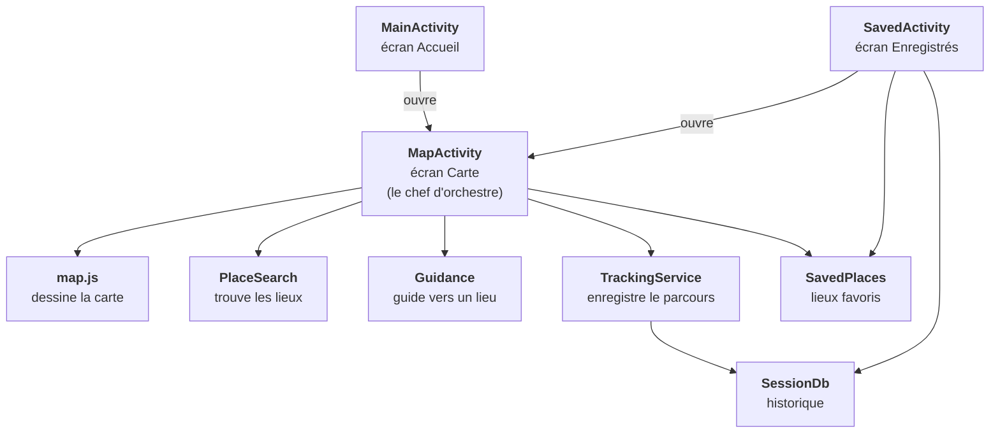
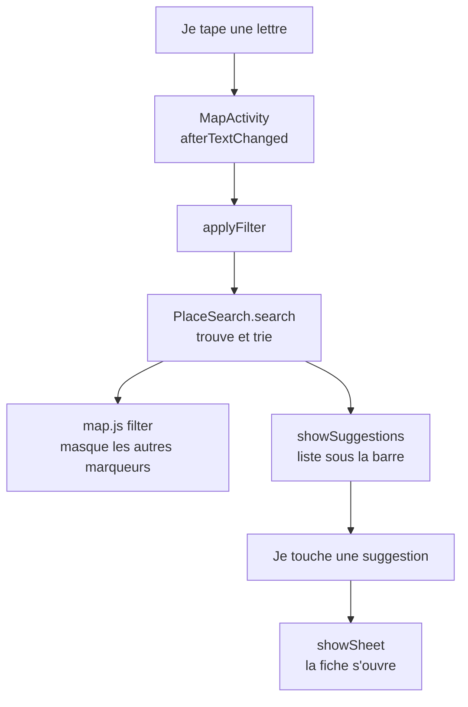
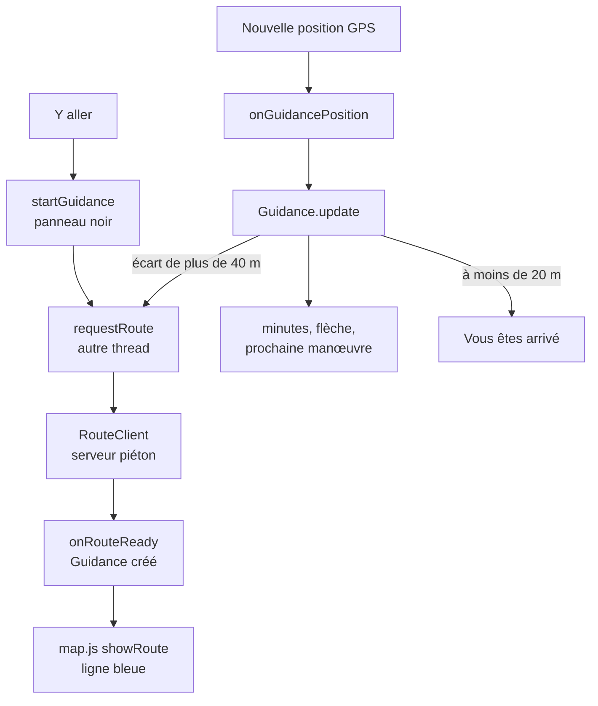
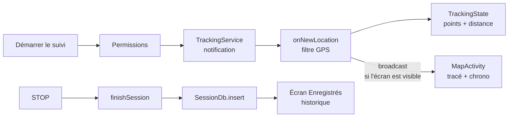
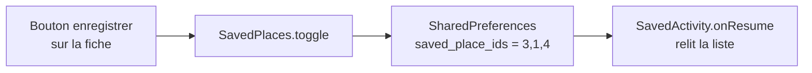

# Campus Explorer : comprendre le code pas à pas

Ce guide est fait pour lire le projet sans être expert Android. Pour chaque classe : à quoi elle sert, ce que fait chaque fonction, pourquoi elle existe, et **ce qu'on verrait à l'écran si elle n'existait pas**.

Version décrite : branche `dev` (avec le guidage « Y aller » et la nouvelle recherche).

---

## 1. Les 6 notions Android à connaître avant de lire

| Notion | En une phrase | Dans le projet |
|---|---|---|
| **Activity** | Un écran. Android appelle ses fonctions `onCreate`, `onResume`, `onPause`... quand l'écran apparaît, passe au premier plan ou est caché. | `MainActivity` (Accueil), `MapActivity` (Carte), `SavedActivity` (Enregistrés) |
| **Layout XML** | Le dessin d'un écran (boutons, textes, positions). Le Java le relie avec `findViewById`. | `res/layout/activity_map.xml`, etc. |
| **Intent** | Un message pour ouvrir un autre écran ou démarrer un service, avec des « extras » (des valeurs jointes). | « Voir sur la carte » envoie l'id du lieu dans un extra |
| **Service** | Du code qui tourne sans écran visible. « Au premier plan » = avec une notification, pour qu'Android ne le tue pas. | `TrackingService` : le suivi continue écran éteint |
| **WebView + pont JavaScript** | Une page web affichée dans l'appli. Le Java appelle le JavaScript (`evaluateJavascript`) et le JavaScript appelle le Java (`@JavascriptInterface`). | La carte Leaflet (`assets/map/map.js`) |
| **Stockage** | `SharedPreferences` = petit fichier clé/valeur. `SQLite` = vraie base de données avec des tables. | Lieux enregistrés (SharedPreferences), historique des parcours (SQLite) |

---

## 2. La carte des classes, en un coup d'œil

Une flèche veut dire « utilise ». Le schéma se lit de haut en bas : en haut ce que l'utilisateur voit, en bas ce qui travaille derrière.

Ce schéma ne montre que les 9 classes principales. Les autres sont des aides, rangées avec celle qu'elles servent :

| Classe principale | Ses aides | Rôle des aides |
|---|---|---|
| les 3 écrans | `BaseActivity`, `Dialogs` | code commun (barre du bas, journal), fenêtres de confirmation |
| `PlaceSearch` | `Places`, `Place` | la liste des 14 lieux, un lieu |
| `Guidance` | `RouteClient`, `Route`, `Instructions` | demander la route au serveur, la garder, l'écrire en phrases |
| `TrackingService` | `TrackingState` | l'état du suivi, lu aussi par la carte |

**À retenir :** `MapActivity` est le chef d'orchestre de la carte. Elle ne calcule presque rien elle-même : elle demande à `PlaceSearch` (chercher), à `Guidance` (guider), à `TrackingService` (suivre), puis elle affiche le résultat dans ses vues Android et dans `map.js`.

---

## 3. Les écrans, classe par classe

### 3.1 BaseActivity : le socle commun des 3 écrans

**Rôle :** les 3 écrans « héritent » d'elle (`extends BaseActivity`), donc ils reçoivent tous son code sans le recopier.

| Fonction | Ce qu'elle fait | Pourquoi | Sans elle, à l'écran |
|---|---|---|---|
| `onCreate`, `onStart`, `onResume`, `onPause`, `onStop`, `onDestroy` | Écrivent une ligne dans Logcat (filtre `Lifecycle`) à chaque étape de la vie de l'écran. | Le sujet demande de montrer le cycle de vie. | Rien ne change à l'écran, mais on ne peut plus montrer les transitions dans Logcat. |
| `applySystemBarInsets` | Décale le contenu sous la barre d'état et au-dessus de la barre de navigation du téléphone. | Depuis Android 15, l'appli dessine sous les barres du système. | Le logo passe sous l'heure et la batterie ; la barre du bas est cachée par les boutons du téléphone. |
| `setupBottomNav` / `setupTab` | Remplit les 3 onglets (Accueil, Carte, Enregistrés) et colore l'onglet actif. | Une seule barre, écrite une fois. | Plus de barre d'onglets fonctionnelle. |
| `openTab` | Ouvre un autre écran avec `FLAG_ACTIVITY_REORDER_TO_FRONT`. | Réutiliser l'écran déjà ouvert au lieu d'en empiler un nouveau. | Chaque clic empile un écran : le bouton retour repasse par tous les écrans visités. |
| `noTransition` | Supprime l'animation de glissement. | Comme la maquette. | Les onglets glissent au lieu de changer net. |

### 3.2 MainActivity : l'Accueil

**Rôle :** premier écran (déclaré `LAUNCHER` dans le manifeste). Il propose des raccourcis vers la carte.

| Fonction | Ce qu'elle fait | Pourquoi | Sans elle, à l'écran |
|---|---|---|---|
| `onCreate` | Garde l'écran de lancement 0,7 s, affiche `activity_main.xml`, branche les boutons. | Point d'entrée de l'appli. | L'appli ne s'ouvre sur rien. |
| `fillCategories` / `addCategory` | Crée les 4 cartes « Que recherchez-vous ? » dans une grille 2 x 2. | Ouvrir la carte déjà filtrée. | La grille des catégories est vide. |
| `fillDiscovery` | Affiche les 3 premiers lieux numérotés 01, 02, 03. | Mettre en avant des lieux. | La section « À découvrir » est vide. |
| `openMap(categorie, idLieu)` | Ouvre la carte avec un Intent, en joignant la catégorie ou l'id du lieu dans les extras. | La carte sait quoi afficher en arrivant. | Les cartes et les lieux ne mènent nulle part. |

### 3.3 MapActivity : la carte (le gros morceau)

**Rôle :** tout ce qui se passe sur l'écran Carte. Elle est rangée en blocs ; chaque bloc correspond à une zone de l'écran.

| Zone de l'écran (de haut en bas) | Ce qu'on y voit | Fonctions qui s'en occupent |
|---|---|---|
| Haut | barre de recherche et suggestions, **ou** panneau noir du guidage | `applyFilter`, `showSuggestions`, `onGuidancePosition` |
| Sous la recherche | filtres de catégorie | `categoryFor` |
| Milieu | la carte web, les boutons + / - et position | `setupWebView`, `js`, `onMapLoaded`, `setupControls` |
| Bas | fiche du lieu, **ou** bouton « Démarrer le suivi », **ou** panneau de suivi | `showSheet`, `hideSheet`, `refreshTrackingUi` |
| Partout | qui est visible ou caché | `refreshOverlays` (une seule fonction décide) |

**Démarrage et cycle de vie**

| Fonction | Ce qu'elle fait | Pourquoi | Sans elle, à l'écran |
|---|---|---|---|
| `onCreate` | Charge le layout, crée `SavedPlaces` et `PlaceSearch`, prépare chaque bloc (`setup...`). Après une rotation, retrouve le lieu ouvert et le guidage. | Tout préparer une seule fois. | Écran vide. |
| `onNewIntent` / `handleIntent` | Lit les extras : catégorie à cocher, lieu à ouvrir. | La carte est réutilisée (pas recréée) quand on revient d'un autre écran. | « Voir sur la carte » ouvre la carte sans aller au lieu. |
| `onResume` | Rebranche le GPS d'écran et le récepteur du service, relit l'état du suivi. | L'état a pu changer pendant que l'écran était caché. | En revenant sur la carte, le chrono et le trajet ne se mettent plus à jour. |
| `onPause` | Coupe le GPS d'écran, débranche le récepteur. | Économiser la batterie quand l'écran est caché. | Le GPS reste allumé pour rien. |
| `onSaveInstanceState` | Mémorise le lieu ouvert et la destination du guidage. | Android recrée l'écran quand on tourne le téléphone. | Tourner le téléphone ferme la fiche et arrête le guidage. |
| `onDestroy` | Arrête le thread des itinéraires et libère la WebView. | Ne pas laisser de mémoire ou de thread derrière. | Fuites de mémoire (invisible, mais l'appli devient lourde). |

**La carte web**

| Fonction | Ce qu'elle fait | Pourquoi | Sans elle, à l'écran |
|---|---|---|---|
| `setupWebView` | Active JavaScript, sert les fichiers `assets/map` sous une adresse https, branche le pont `Android`. | OpenStreetMap refuse les tuiles sans adresse web d'origine. | Carte grise ou erreur 403. |
| `MapBridge` (4 fonctions) | Reçoit les appels du JavaScript : carte prête, clic sur un marqueur, tuiles en erreur ou revenues. | Le JavaScript doit prévenir le Java. | Cliquer sur un marqueur n'ouvre pas la fiche. |
| `onMapLoaded` | Envoie les lieux, le filtre, la fiche ouverte, le point bleu et le tracé à la page. | La page ne connaît rien tant que le Java ne lui a rien dit. | Carte sans marqueurs. |
| `js(code)` | Exécute une instruction JavaScript, seulement si la page est prête. | Éviter d'appeler une page pas encore chargée. | Appels perdus ou erreurs au démarrage. |
| `placesJson`, `coords`, `toJson` | Transforment les données Java en texte JSON pour le JavaScript (avec un point décimal). | « 49,03 » avec une virgule casserait le JavaScript. | Marqueurs ou lignes mal placés, voire absents. |

**Recherche et filtres** (nouveau sur `dev`)

| Fonction | Ce qu'elle fait | Pourquoi | Sans elle, à l'écran |
|---|---|---|---|
| `setupSearchAndFilters` | Branche la frappe, la croix, la touche « Rechercher » (ouvre le meilleur résultat), l'apparition des suggestions au toucher, les filtres. | Réagir à chaque lettre. | Taper ne fait rien. |
| `applyFilter` | Demande les lieux à `PlaceSearch`, envoie leurs ids à `map.js` qui masque les autres, puis met à jour les suggestions. | Une seule règle de recherche, en Java. | Les marqueurs ne se filtrent plus. |
| `showSuggestions` | Affiche jusqu'à 5 lieux sous la barre, avec icône, type et distance ; un clic ouvre la fiche. | Avant, il fallait deviner le nom exact. | Pas de liste : on tape « dans le vide ». |
| `categoryFor`, `filterIdFor`, `hideKeyboard` | Petites aides : bouton de filtre vers catégorie, et l'inverse ; fermer le clavier. | Lisibilité. | Filtres et clavier mal gérés. |

**Fiche du lieu**

| Fonction | Ce qu'elle fait | Pourquoi | Sans elle, à l'écran |
|---|---|---|---|
| `setupSheet` | Branche fermer, « Voir les détails », enregistrer, et **« Y aller »**. | Les boutons de la fiche. | Boutons inactifs. |
| `showSheet` / `hideSheet` | Remplit la fiche (nom, catégorie, description) et grossit le marqueur ; ou la ferme. | Montrer un lieu. | Cliquer un lieu n'affiche rien. |
| `updateSaveButton` | Met le bouton enregistrer en jaune si le lieu est enregistré. | Voir l'état d'un coup d'œil. | On ne sait pas si le lieu est déjà enregistré. |

**Ce qui est visible en bas, la position, les messages**

| Fonction | Ce qu'elle fait | Pourquoi | Sans elle, à l'écran |
|---|---|---|---|
| `refreshOverlays` | Décide **en un seul endroit** ce qui est visible : panneau de guidage ou recherche en haut ; suivi, fiche, bouton ou invitation en bas ; pastille d'état. | Éviter deux panneaux contradictoires. | Panneaux superposés ou manquants. |
| `showToast` | Petit message noir avec une coche pendant 2,2 s. | Confirmer une action. | Aucun retour après « enregistrer ». |
| `withLocationPermission`, `hasLocationPermission`, `locationPermission` | Expliquent pourquoi on veut la position, puis demandent la permission à Android. | Obligatoire depuis Android 6, et le sujet demande d'expliquer avant. | L'appli plante ou ne montre jamais la position. |
| `wantsLocation` / `setWantsLocation` | Retiennent « l'utilisateur veut voir sa position » (préférence `show_location`). | Ne pas redemander à chaque ouverture. | Il faut réactiver la position à chaque visite. |
| `startLocationUpdates` / `stopLocationUpdates` / `onUiLocation` | Le GPS « d'écran » : une position par seconde, seulement quand la carte est visible ; place le point bleu et fait avancer le guidage. | Point bleu sans démarrer de suivi. | Pas de point bleu hors suivi, pas de guidage hors suivi. |
| `updateOfflineBanner` / `isOnline` | Affiche « Pas de connexion » si le téléphone n'a pas Internet. | Le sujet demande un comportement hors ligne. | Carte grise sans explication. |

**Suivi du parcours**

| Fonction | Ce qu'elle fait | Pourquoi | Sans elle, à l'écran |
|---|---|---|---|
| `setupTracking` | « Démarrer le suivi » : permission position, puis notification (Android 13+), puis service. Bouton arrêter : confirmation. | Les règles d'Android sur les permissions. | Le bouton ne fait rien. |
| `startTrackingService` | Vide l'ancien tracé, fait suivre la carte, démarre `TrackingService`. | Lancer une session propre. | Pas de suivi. |
| `trackingReceiver` | Reçoit chaque position du service : point bleu, tracé jaune, chrono, distance, et guidage. À la fin : message « Parcours enregistré ». | Le service n'a pas d'écran : il prévient la carte. | Le suivi tourne mais la carte ne bouge pas. |
| `refreshTrackingUi` | Met à jour le chrono et la distance depuis `TrackingState`. | Retrouver le bon état en revenant sur l'écran. | Chrono figé à 00:00. |

**Guidage « Y aller »** (nouveau sur `dev`)

| Fonction | Ce qu'elle fait | Pourquoi | Sans elle, à l'écran |
|---|---|---|---|
| `setupGuidance` / `placeControls` | Branche la croix du panneau ; descend les boutons de la carte sous le panneau noir. | Le panneau est plus haut que la barre de recherche. | Le bouton position passe sous le panneau. |
| `startGuidance(lieu)` | Permission, GPS, ferme la fiche, affiche « Calcul de l'itinéraire... », demande la route. | Point de départ du guidage. | « Y aller » ne fait rien. |
| `requestRoute` | Envoie la demande au serveur **sur un autre thread**, puis revient sur le thread de l'écran. | Android interdit le réseau sur le thread de l'écran (l'appli gèlerait). | Plantage `NetworkOnMainThreadException`. |
| `onRouteReady` | Ignore les réponses périmées ; crée le `Guidance` ; cadre tout le trajet ; sans réseau, passe « à vol d'oiseau ». | Le serveur répond plus tard, parfois pas. | Rien ne s'affiche après le calcul. |
| `onGuidancePosition` | À chaque position : distance restante, minutes, heure d'arrivée, prochaine manœuvre, flèche, ligne bleue raccourcie. Recalcule si on s'écarte de plus de 40 m. Arrivée à moins de 20 m. | Le côté « dynamique ». | Panneau figé, pas de détection d'arrivée. |
| `stopGuidance` | Efface la ligne, ferme le panneau, réaffiche la recherche. | Croix ou arrivée. | Impossible d'arrêter le guidage. |
| `rounded` | Arrondit à 5 m (10 m au-delà de 100 m). | Le GPS tremble : sans arrondi le chiffre change sans cesse. | « 437 m, 441 m, 436 m... » qui clignote. |

### 3.4 SavedActivity : l'écran Enregistrés

| Fonction | Ce qu'elle fait | Pourquoi | Sans elle, à l'écran |
|---|---|---|---|
| `onCreate` | Ouvre `SavedPlaces` et `SessionDb`, branche les boutons. | Préparer l'écran. | Écran vide. |
| `onResume` | Relit les lieux et l'historique ; montre la carte verte « Suivi en cours » si un suivi tourne. | Un lieu ajouté sur la carte doit apparaître tout de suite. | Liste pas à jour en revenant. |
| `showSavedPlaces` | Une ligne par lieu enregistré, avec « Voir sur la carte » et la corbeille. | Afficher les favoris. | Liste vide. |
| `showHistory` | Les 5 derniers parcours (date, durée, distance) lus dans SQLite. | Afficher l'historique. | Historique vide. |
| `onDestroy` | Ferme la base SQLite. | Libérer la ressource. | Invisible, mais connexion laissée ouverte. |

### 3.5 Dialogs : les fenêtres de confirmation

| Fonction | Ce qu'elle fait | Pourquoi | Sans elle, à l'écran |
|---|---|---|---|
| `confirm(...)` | Fenêtre à deux boutons au style de la maquette ; seul le bouton principal lance l'action. | Utilisée deux fois : explication avant la permission, confirmation avant d'arrêter le suivi. | Permission demandée sans explication ; suivi arrêté par erreur. |

---

## 4. Les données

### 4.1 Place et Places : les 14 lieux

| Élément | Ce qu'il fait | Pourquoi | Sans lui, à l'écran |
|---|---|---|---|
| `Place` | Un lieu : id, nom, catégorie, textes, latitude, longitude. Les textes sont des **identifiants de ressources** traduits au moment de l'affichage. | Une seule forme pour tous les lieux ; français ou anglais selon le téléphone. | Aucun lieu nulle part. |
| `Place.Category` | Les 4 catégories avec leur icône et leur couleur. | Même couleur partout (marqueur, fiche, suggestions). | Couleurs et icônes incohérentes. |
| `Places.all()` | La liste fixe des 14 lieux. | Le sujet n'exige pas de serveur de données. | Rien à afficher. |
| `Places.byId(id)` / `byIds(ids)` | Retrouvent un lieu par son numéro. | Les Intents et les préférences ne transportent que des numéros. | « Voir sur la carte » et les favoris ne retrouvent pas leur lieu. |

### 4.2 PlaceSearch : la recherche tolérante (nouveau sur `dev`)

| Fonction | Ce qu'elle fait | Pourquoi | Sans elle, à l'écran |
|---|---|---|---|
| constructeur | Prépare une fois le texte de chaque lieu : nom, type, description, détails, mots-clés de la catégorie (« resto », « BU », « cafet »...). | Chercher vite à chaque lettre. | Recherche lente ou limitée au nom. |
| `search(texte, catégorie, position)` | Garde les lieux où **chaque mot tapé** est trouvé, puis trie : meilleur score d'abord, puis le plus proche. | Mots dans n'importe quel ordre, résultats utiles en premier. | Résultats dans le désordre. |
| `score` | 4 points si un mot du nom commence par le mot tapé, 3 ailleurs dans le lieu, 2 pour une faute de frappe dans le nom, 1 ailleurs. | Classer « Restaurant universitaire » avant un lieu qui le cite seulement. | Le bon lieu peut être en 2e position. |
| `typo` / `levenshtein` | Compte les lettres à changer entre deux mots ; 1 faute tolérée (2 pour un mot long). | « restaurent » doit trouver « restaurant ». | Une faute = aucun résultat. |
| `simplify` | Minuscules et sans accents. | « chenes » doit trouver « Chênes ». | Il faut taper les accents exacts. |

### 4.3 SavedPlaces : les lieux enregistrés

| Fonction | Ce qu'elle fait | Pourquoi | Sans elle, à l'écran |
|---|---|---|---|
| `ids()` | Lit la chaîne `"3,1,4"` et la découpe en numéros. | Quelques numéros ne justifient pas une base SQL. | Liste Enregistrés vide. |
| `contains`, `toggle`, `remove` | Tester, ajouter/retirer, retirer. | Bouton jaune, corbeille. | Impossible d'enregistrer. |
| `save` | Réécrit la chaîne avec `apply()` (écriture en arrière-plan). | Ne pas bloquer l'écran. | Rien n'est gardé après fermeture. |

### 4.4 SessionDb : l'historique en SQLite

| Fonction | Ce qu'elle fait | Pourquoi | Sans elle, à l'écran |
|---|---|---|---|
| `onCreate(db)` | Crée la table `SESSIONS` la première fois. | Android appelle cette fonction quand la base n'existe pas. | Plantage au premier enregistrement. |
| `insert` | Ajoute une ligne : début, durée, distance. | Garder chaque parcours terminé. | Historique toujours vide. |
| `latest(5)` | Lit les 5 derniers parcours, du plus récent au plus ancien. | Affichage de l'écran Enregistrés. | Historique vide. |

---

## 5. Le suivi du parcours

### 5.1 TrackingService : le GPS qui continue écran éteint

| Fonction | Ce qu'elle fait | Pourquoi | Sans elle, à l'écran |
|---|---|---|---|
| `start` / `stop` (statiques) | Envoient un Intent START ou STOP au service. | Une seule façon propre de le piloter. | Pas de suivi. |
| `onStartCommand` | START : vérifie la permission, remet l'état à zéro, passe au premier plan (notification), branche le GPS. STOP : termine. | Règle Android : notification sous 5 s, sinon arrêt forcé. | Le suivi s'arrête quand on quitte l'écran. |
| `requestUpdates` | Abonne le GPS et le réseau, une position par seconde. | Le GPS est précis dehors, le réseau aide à l'intérieur. | Aucune position reçue. |
| `onNewLocation` | **Le filtre** : refuse les positions à plus de 35 m de précision, ignore les petits tremblements (moins de 5 m, ou 60 % de l'imprécision), refuse les sauts à plus de 50 m/s ; sinon ajoute le point et la distance. Puis prévient l'écran (broadcast). | Sans filtre, un téléphone immobile « marche » des centaines de mètres. | Distance fausse, tracé en zigzag. |
| `finishSession` | Enregistre le résumé dans SQLite, coupe le GPS, retire la notification. | Fin propre. | Parcours perdu, GPS allumé. |
| `createChannel` / `buildNotification` | Le canal et la notification avec la distance et un bouton STOP. | Obligatoire pour un service au premier plan. | Le service est refusé par Android. |

### 5.2 TrackingState : l'état partagé

**Rôle :** une « boîte » en mémoire, lue par l'écran et écrite **seulement** par le service : en cours ou non, heure de départ, distance, points du tracé, dernière position.

**Sans elle :** en revenant sur la carte, il faudrait attendre la prochaine position pour retrouver le chrono et le tracé.

---

## 6. Le guidage « Y aller » (nouveau sur `dev`)

| Classe | Ce qu'elle fait | Pourquoi | Sans elle, à l'écran |
|---|---|---|---|
| `RouteClient.walking` | Demande au serveur OSRM de FOSSGIS (`routing.openstreetmap.de`, profil piéton) le chemin à pied entre la position et le lieu. Lit la réponse JSON. | Calculer un vrai chemin piéton demande toute la carte des rues : on le délègue à un serveur. | Pas de route : seulement la ligne droite. |
| `Route` / `Route.Step` | La route reçue : la ligne (points) et les manœuvres (tourner, continuer, arrivée). | Garder la réponse sous une forme simple. | Rien à suivre. |
| `Guidance.update` | Projette la position sur la ligne, en déduit la distance restante, la prochaine manœuvre, l'écart à la ligne, l'arrivée. Sans route : ligne droite et cap. | Le cœur du « dynamique ». | Minutes et distance figées. |
| `Instructions` | Transforme une manœuvre en phrase (« Tournez à gauche sur Rue X ») et en angle de flèche. | Le serveur ne renvoie que des mots-clés anglais. | Panneau sans phrase ni flèche. |

**Comment sont calculées les minutes ?** distance restante ÷ 1,3 m/s (environ 4,7 km/h, une marche normale), arrondi à la minute. L'heure d'arrivée = maintenant + ce temps. Les deux sont recalculées à chaque position.

**Limites à connaître :** il faut Internet pour la route (sinon « à vol d'oiseau ») ; la vitesse de marche est fixe, pas mesurée ; la carte reste orientée nord en haut.

---

## 7. map.js : la carte côté page web

| Fonction (`CampusMap.xxx`) | Ce qu'elle fait | Sans elle, à l'écran |
|---|---|---|
| `setPlaces` | Crée un marqueur par lieu. | Pas de marqueurs. |
| `filter(ids, cadrage)` | Montre seulement ces lieux et cadre la carte dessus. | Filtres et recherche sans effet sur la carte. |
| `select` | Grossit le marqueur choisi, peut voler jusqu'à lui. | On ne voit pas quel lieu est ouvert. |
| `showUser`, `follow`, `hideUser` | Point bleu, flèche de direction, carte qui suit. | Pas de position visible. |
| `setTrack`, `addTrackPoint`, `clearTrack`, `setTracking` | Le tracé jaune du suivi. | Le parcours n'est pas dessiné. |
| `showRoute`, `clearRoute` | La ligne bleue en pointillés du guidage. | Pas de chemin à suivre. |
| `zoomIn`, `zoomOut`, `fitPlaces` | Zoom et vue d'ensemble. | Boutons + et - inactifs. |

---

## 8. Quatre scénarios, du clic à l'écran

### 8.1 « Je tape resto »

### 8.2 « J'appuie sur Y aller »

### 8.3 « Je démarre le suivi puis j'éteins l'écran »

### 8.4 « J'enregistre un lieu »

---

## 9. Pour la soutenance : trois phrases à savoir dire

1. « La carte est une page Leaflet dans une WebView ; le Java lui parle avec `evaluateJavascript`, elle répond par l'objet `Android`. »
2. « Le suivi tourne dans un service au premier plan ; il filtre le GPS avant de compter la distance, puis il prévient l'écran par un broadcast et enregistre le résumé dans SQLite. »
3. « Le guidage demande la route piétonne à un serveur OSRM sur un autre thread, puis à chaque position il projette l'utilisateur sur la ligne pour calculer la distance restante, les minutes et la prochaine manœuvre. »
