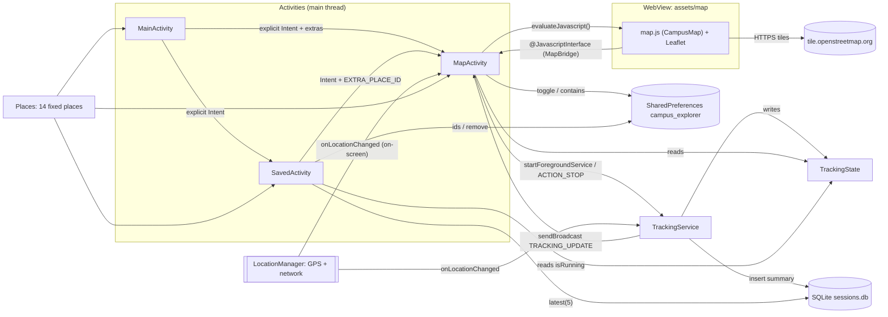
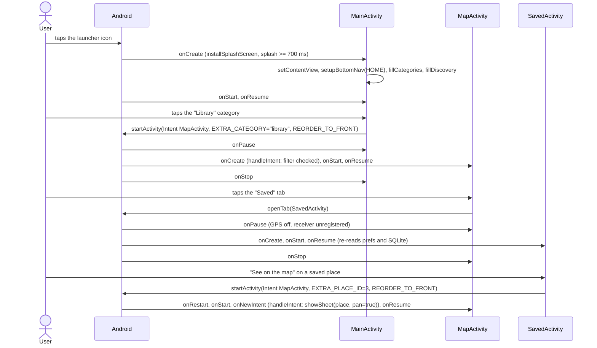
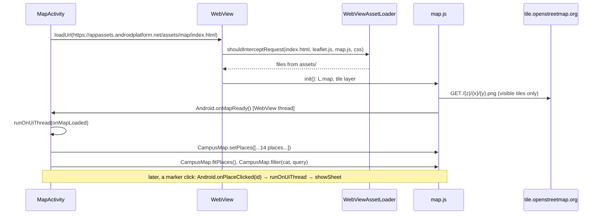
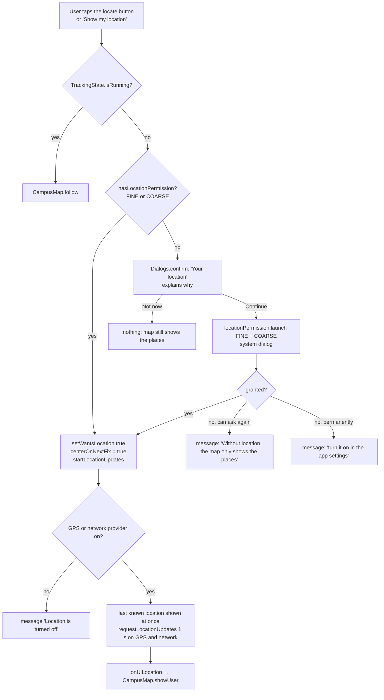
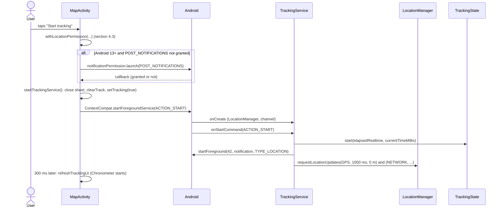
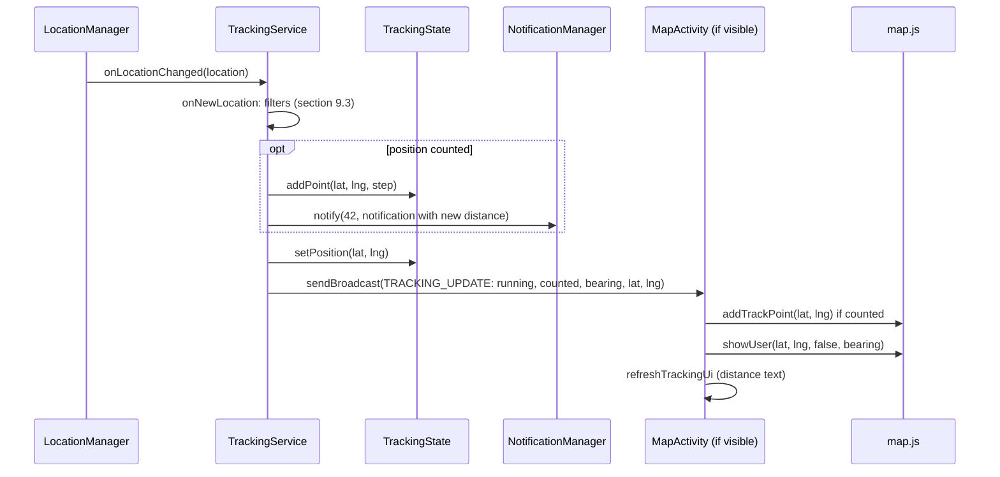
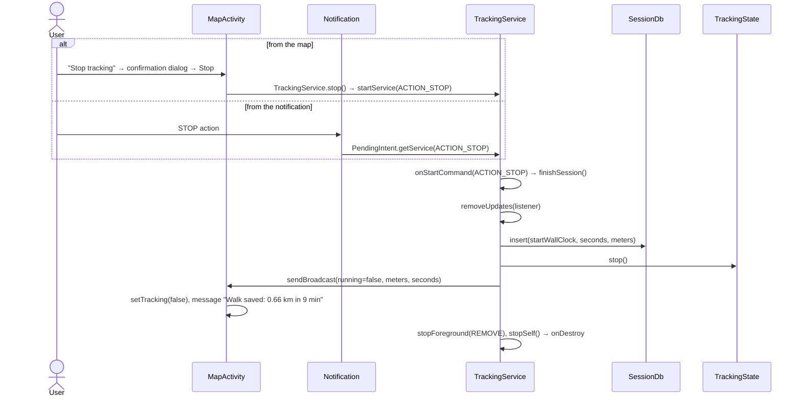
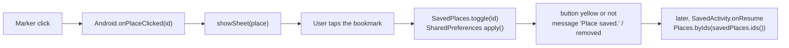
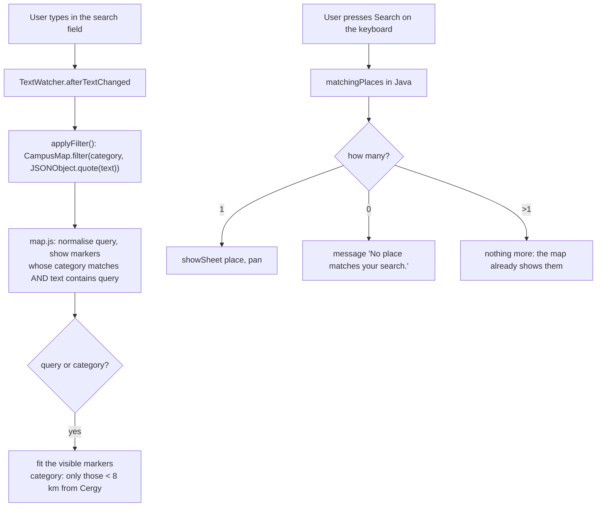
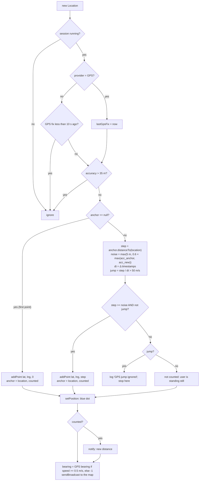

# CY Campus Explorer: Technical Documentation

Mobile Computing class project, L3 Informatique, CY Cergy Paris Université.
Team: BACHIR BEY Asma, GANDONOU Koffi Patrick-Léon. Instructor: Dimitrios Kotzinos.

This document describes the code as it is on 13 November 2026 (branch `main` plus the uncommitted
changes of 12 November: live tracking, 14 places, launch screen). Every statement refers to a file,
a class or a method of the project. When something does not exist in the code, the document says
so, and proposals are always marked **Proposal**.

Paths are relative to `app/src/main/`. Java classes are in `java/fr/cyu/campusexplorer/`.

**Editable diagrams (draw.io):** `docs/diagrams/campus_explorer_diagrams_EN.drawio` (French:
`campus_explorer_diagrammes_FR.drawio`), 6 pages: architecture, class diagram, navigation, tracking
session, GPS filter, location permission. Open them at https://app.diagrams.net (File > Open from >
Device), in the draw.io desktop app, or in VS Code with the "Draw.io Integration" extension.

---

## Contents

1. Overview: what the application does
2. Architecture and class diagram
3. Class-by-class analysis
4. Execution flows (sequence diagrams and flowcharts)
5. Permissions and dependencies
6. User interface and layouts
7. Data storage and preferences
8. Sensors and hardware
9. Route, distance and speed
10. Commented source code
11. Code origins and references
12. Course concepts in the project
13. Requirement-by-requirement compliance
14. End-to-end technical overview
15. Defence preparation: likely questions and answers

---

## 1. Overview: what the application does

CY Campus Explorer helps a student find the places of CY Cergy Paris Université. It has three
screens (Activities) and one background component (a foreground Service):

| Screen / component | What the user can do |
|---|---|
| **Home** (`MainActivity`) | open the map; open the map filtered on a category (buildings, library, food, services); open one of the first 3 places directly; open the saved places |
| **Map** (`MapActivity`) | see 14 places as markers on an OpenStreetMap map; search by name or address (accents ignored); filter by category; open a place's sheet (description, details, save button); show their position (blue dot); start and stop recording a walk |
| **Saved** (`SavedActivity`) | see and remove saved places; open a saved place on the map; see the last 5 walks (date, duration, distance) |
| **Tracking** (`TrackingService`) | records a walk while the screen is off or another app is open; shows a notification with chronometer, distance and a STOP button |

What the application **does not** do (checked in the code): no route calculation to a place, no
distance remaining, no speed display, no use of the accelerometer or gyroscope, no user account, no
remote database. Section 9 explains what would be needed to add some of them.

---

## 2. Architecture and class diagram

### 2.1 Organisation

The code is split into three Java packages and one web page:

| Part | Content | Role |
|---|---|---|
| `fr.cyu.campusexplorer` | `BaseActivity`, `MainActivity`, `MapActivity`, `SavedActivity`, `Dialogs` | screens (presentation and screen logic) |
| `fr.cyu.campusexplorer.data` | `Place`, `Places`, `SavedPlaces`, `SessionDb` | data: fixed places, saved places, session history |
| `fr.cyu.campusexplorer.tracking` | `TrackingService`, `TrackingState` | background tracking and its shared state |
| `assets/map/` | `index.html`, `map.js`, `map.css`, `leaflet/` | the map, a Leaflet page shown in a `WebView` |

There is no MVVM/ViewModel layer: each Activity holds its own screen logic, in the style of the
course. Data classes never touch the views; Activities never touch the GPS during a session (the
service does).



### 2.2 UML class diagram

```mermaid
classDiagram
    direction LR
    class AppCompatActivity
    class Service
    class SQLiteOpenHelper
    class BaseActivity {
        <<abstract>>
        #LIFECYCLE : String
        #onCreate/onStart/onResume/onPause/onStop/onDestroy()
        #applySystemBarInsets(View root, View bottomNav)
        #setupBottomNav(Tab current)
        -setupTab(int id, int icon, int label, boolean selected, Class target)
        #openTab(Class target)
        #noTransition()
    }
    class Tab {
        <<enumeration>>
        HOME
        MAP
        SAVED
    }
    class MainActivity {
        -SPLASH_MIN_MS : long = 700
        #onCreate(Bundle)
        -fillCategories()
        -addCategory(GridLayout, LayoutInflater, Category, int, int)
        -fillDiscovery()
        -openMap(Category, int placeId)
    }
    class MapActivity {
        +EXTRA_PLACE_ID : String
        +EXTRA_CATEGORY : String
        -webView : WebView
        -mapReady : boolean
        -selected : Place
        -lastLocation : Location
        -locationManager : LocationManager
        -savedPlaces : SavedPlaces
        -locationPermission : ActivityResultLauncher
        -notificationPermission : ActivityResultLauncher
        -uiListener : LocationListener
        -trackingReceiver : BroadcastReceiver
        #onCreate / onNewIntent / onResume / onPause / onDestroy
        -handleIntent(Intent)
        -setupWebView()
        -onMapLoaded()
        -js(String code)
        -applyFilter()
        -showSheet(Place, boolean pan)
        -refreshOverlays()
        -withLocationPermission(Runnable)
        -startLocationUpdates() / stopLocationUpdates()
        -onUiLocation(Location)
        -startTrackingService()
        -refreshTrackingUi()
        -isOnline() boolean
    }
    class MapBridge {
        +onMapReady()
        +onPlaceClicked(int id)
        +onTilesError()
        +onTilesLoaded()
    }
    class SavedActivity {
        -savedPlaces : SavedPlaces
        -sessionDb : SessionDb
        #onCreate / onResume / onDestroy
        -showSavedPlaces()
        -showHistory()
    }
    class Dialogs {
        <<utility>>
        ~confirm(Activity, icon, colors, title, text, primary, secondary, Runnable)$
    }
    class Place {
        +id : int
        +name : int
        +category : Category
        +shortCategory : int
        +description : int
        +details : int
        +lat : double
        +lng : double
    }
    class Category {
        <<enumeration>>
        BUILDINGS
        LIBRARY
        FOOD
        SERVICES
        +key : String
        +icon : int
        +markerColor : int
        +softColor : int
    }
    class Places {
        <<utility>>
        -ALL : List~Place~
        +all() List~Place~$
        +byId(int) Place$
        +byIds(List~Integer~) List~Place~$
    }
    class SavedPlaces {
        -prefs : SharedPreferences
        +ids() List~Integer~
        +contains(int) boolean
        +toggle(int) boolean
        +remove(int)
        -save(List~Integer~)
    }
    class SessionDb {
        +onCreate(SQLiteDatabase)
        +onUpgrade(SQLiteDatabase, int, int)
        +insert(long, long, double) long
        +latest(int) List~Session~
    }
    class Session {
        +id : long
        +startTime : long
        +durationSeconds : long
        +distanceMeters : double
    }
    class TrackingService {
        +ACTION_START / ACTION_STOP / BROADCAST_UPDATE
        -locationManager : LocationManager
        -anchor : Location
        -lastGpsFix : long
        -listener : LocationListener
        +start(Context)$
        +stop(Context)$
        +onCreate()
        +onStartCommand(Intent, int, int) int
        -requestUpdates()
        -onNewLocation(Location)
        -finishSession()
        -buildNotification() Notification
        +onDestroy()
        +onBind(Intent) IBinder
    }
    class TrackingState {
        <<static state>>
        -running : boolean
        -startElapsed : long
        -startWallClock : long
        -distanceMeters : double
        -points : List~double[]~
        -position : double[]
        ~start(long, long)$
        ~addPoint(double, double, double)$
        ~setPosition(double, double)$
        ~stop()$
        +isRunning() boolean$
        +distanceMeters() double$
        +points() List$
        +position() double[]$
        +formatDistance(Context, double) String$
    }

    AppCompatActivity <|-- BaseActivity
    BaseActivity <|-- MainActivity
    BaseActivity <|-- MapActivity
    BaseActivity <|-- SavedActivity
    BaseActivity +-- Tab
    Service <|-- TrackingService
    SQLiteOpenHelper <|-- SessionDb
    SessionDb +-- Session
    Place +-- Category
    MapActivity +-- MapBridge
    Places o-- "14" Place
    MainActivity ..> Places
    MainActivity ..> MapActivity : Intent
    MainActivity ..> SavedActivity : Intent
    SavedActivity ..> MapActivity : Intent
    MapActivity --> SavedPlaces
    MapActivity ..> Places
    MapActivity ..> Dialogs
    MapActivity ..> TrackingService : start / stop
    MapActivity ..> TrackingState : reads
    TrackingService ..> TrackingState : writes
    TrackingService ..> SessionDb : insert
    TrackingService ..> MapActivity : broadcast + notification PendingIntent
    SavedActivity --> SavedPlaces
    SavedActivity --> SessionDb
    SavedActivity ..> TrackingState : isRunning
```

Legend: `<|--` inheritance, `+--` nested class, `-->` field (association), `..>` use (dependency),
`$` static.

---

## 3. Class-by-class analysis

Inner classes are listed with their outer class. "Calls" lists the project classes a class uses;
"called by" lists who uses it.

### 3.1 `BaseActivity` (abstract, extends `AppCompatActivity`)

**Purpose.** What the three screens share: lifecycle logs, the bottom navigation bar, and the
margins for the system bars. It is never instantiated itself (`abstract`).

| Method | What it does | Inputs / output |
|---|---|---|
| `onCreate`, `onStart`, `onResume`, `onPause`, `onStop`, `onDestroy` | call `super`, then write `"<ClassName>.onXxx"` in Logcat with the tag `Lifecycle` | the standard callbacks; no return value |
| `applySystemBarInsets(View root, View bottomNav)` | registers an `OnApplyWindowInsetsListener`: the top padding of `root` = height of the status bar, the bottom padding of `bottomNav` = height of the navigation bar | the two views; returns nothing |
| `setupBottomNav(Tab current)` | fills the 3 tabs (icon, label), marks the current one as selected | `Tab.HOME`, `MAP` or `SAVED` |
| `setupTab(...)` (private) | one tab: icon, label, `setSelected`, content description; a click opens the target screen, except on the current tab | id, icon, label, selected, target class |
| `openTab(Class target)` | explicit `Intent` with `FLAG_ACTIVITY_REORDER_TO_FRONT`, then `noTransition()` | target Activity class |
| `noTransition()` | `overridePendingTransition(0, 0)`: no slide animation between tabs | none |

**Nested type.** `enum Tab { HOME, MAP, SAVED }`.

**Uses.** `AppCompatActivity`, `ViewCompat` / `WindowInsetsCompat` (AndroidX Core), `Log`.
**Used by.** The three Activities (`extends BaseActivity`).

**Why `FLAG_ACTIVITY_REORDER_TO_FRONT`:** without it, each tab click would create a new instance of
the screen and the Back button would go through all the screens visited.

### 3.2 `MainActivity` (Home, entry point)

**Purpose.** The launcher Activity (`MAIN` / `LAUNCHER` intent filter in `AndroidManifest.xml`). It
shows the launch screen, then the home page.

| Method | What it does |
|---|---|
| `onCreate(Bundle)` | **before** `super.onCreate`: `SplashScreen.installSplashScreen(this)`; on a real launch (`savedInstanceState == null`), keeps the splash at least 700 ms (`setKeepOnScreenCondition`). Then `setContentView(R.layout.activity_main)`, insets, bottom bar (`Tab.HOME`), click listeners on `btn_explore`, `btn_see_all` (open the map) and `btn_saved`, then `fillCategories()` and `fillDiscovery()` |
| `fillCategories()` | adds 4 category cards to the `GridLayout` `category_grid` |
| `addCategory(grid, inflater, category, label, index)` | inflates `item_category.xml`, sets text, icon and pastel colour, computes the grid position (row `index / 2`, column `index % 2`, 9 dp gap converted to pixels), click → `openMap(category, -1)` |
| `fillDiscovery()` | inflates `item_discovery.xml` for the first 3 places of `Places.all()`, numbered 01 to 03; click → `openMap(null, place.id)` |
| `openMap(Category category, int placeId)` | explicit `Intent` to `MapActivity`, with `EXTRA_CATEGORY` (the category key) and/or `EXTRA_PLACE_ID` |

**Uses.** `Places`, `Place.Category`, `MapActivity` (constants), `SavedActivity`, `SplashScreen`
(AndroidX core-splashscreen). **Called by.** The system (launcher icon), and the Home tab.

### 3.3 `MapActivity` (Map screen)

**Purpose.** The central screen: the map, search and filters, the place sheet, the on-screen
location, and the controls of a tracking session. It is the largest class (about 830 lines with
comments).

**State (fields).** `webView`, `mapReady` (the page has called `onMapReady`), `search`, `filters`,
`currentCategory` (`"all"` by default), `sheet`, `sheetExpanded`, `selected` (the open `Place`, or
null), the overlay views, `handler` (main-thread `Handler` for delayed actions), `savedPlaces`,
`locationManager`, `listeningLocation`, `lastLocation`, `lastUiGpsFix`, `centerOnNextFix`,
`afterPermission` (what to do once permission is granted).

| Group | Method | What it does |
|---|---|---|
| Lifecycle | `onCreate` | layout, insets, bottom bar, `SavedPlaces`, `LocationManager`, then `bindViews`, `setupWebView`, `setupSearchAndFilters`, `setupControls`, `setupSheet`, `setupTracking`; restores the open place after a rotation; `handleIntent(getIntent())` |
| | `onNewIntent(Intent)` | the Activity already exists (reorder to front): reads the new extras |
| | `onResume` | `webView.onResume()`; registers `trackingReceiver` (`RECEIVER_NOT_EXPORTED`); starts on-screen location if the user asked for it and permission is granted; refreshes the offline banner, the tracking panel and the overlays; reopens the sheet |
| | `onPause` | stops on-screen location, unregisters the receiver, stops the `Chronometer`, `webView.onPause()` |
| | `onSaveInstanceState` | saves the id of the open place |
| | `onDestroy` | clears the `Handler`, removes the JavaScript interface, destroys the `WebView` |
| Intents | `handleIntent(Intent)` | `EXTRA_CATEGORY` → checks the filter; `EXTRA_PLACE_ID` → `showSheet(place, true)`; each extra is removed after use |
| Map | `setupWebView()` | `WebViewAssetLoader` serves `assets/` at `https://appassets.androidplatform.net/assets/`; JavaScript on, file and content access off; user agent + "CampusExplorer/1.0"; `WebViewClient` that intercepts requests and blocks navigation; `addJavascriptInterface(new MapBridge(), "Android")`; loads `map/index.html` |
| | `onMapLoaded()` | `mapReady = true`, sends the places (`CampusMap.setPlaces`), frames them, applies the filter, reselects the place, redraws the blue dot and, during a session, the whole track |
| | `drawFullTrack()` | sends `TrackingState.points()` as JSON, the last position, and `setTracking(true)` |
| | `js(String)` | `webView.evaluateJavascript(code, null)` if `mapReady` |
| | `placesJson()` | builds `[{"id","name","text","cat","lat","lng"}, ...]` with `org.json` |
| | `searchText(Place)`, `simplify(String)` | name + details, lower case, accents removed (`Normalizer` NFD + regex `\p{M}`) |
| | `coords(lat, lng)` | `"%.6f,%.6f"` with `Locale.US` (a decimal comma would break the JavaScript call) |
| Search | `setupSearchAndFilters()` | `TextWatcher` → `applyFilter()`; clear button; keyboard Search key → open the sheet if exactly one place matches, message if none; filter radio buttons → `currentCategory` |
| | `applyFilter()` | `CampusMap.filter(category, query)`; the query goes through `JSONObject.quote` (no JavaScript injection) |
| | `matchingPlaces()` | same rule in Java, for the Search key |
| | `categoryFor`, `filterIdFor`, `FILTERS` | radio button id ↔ category key |
| | `hideKeyboard()` | `InputMethodManager.hideSoftInputFromWindow` |
| Controls | `setupControls()` | zoom +/−; locate button: during a session `CampusMap.follow()`, otherwise `showMyPosition()` |
| | `showMyPosition()` | permission → remember the choice → blue dot centred → start on-screen location |
| Sheet | `setupSheet()` | close, "See details" toggle, save button (`savedPlaces.toggle`, message) |
| | `showSheet(Place, boolean pan)` | fills the sheet, colours the icon by category, `CampusMap.select(id, pan)` |
| | `hideSheet()`, `updateSaveButton()` | close; yellow save button if the place is saved |
| Overlays | `refreshOverlays()` | decides from 3 states (tracking, place selected, position known) which of the tracking panel, sheet, start button and location prompt are visible, and the status pill |
| | `setStatus`, `showToast` (2 overloads) | status text and dot colour; custom black message that fades in and out with `View.animate()` and the `Handler` |
| Permission | `locationPermission` (field) | `registerForActivityResult(RequestMultiplePermissions)`: granted → runs `afterPermission`; refused → message, different after a permanent refusal |
| | `notificationPermission` (field) | `RequestPermission` for `POST_NOTIFICATIONS`; whatever the answer, starts the service |
| | `hasLocationPermission()` | FINE **or** COARSE granted |
| | `withLocationPermission(Runnable)` | granted → run now; otherwise the explanation dialog (`Dialogs.confirm`), then the system request |
| | `wantsLocation()`, `setWantsLocation(boolean)` | the preference `show_location` (see section 7) |
| Location | `uiListener` (field) | `LocationListener` → `onUiLocation` |
| | `startLocationUpdates()` | GPS and/or network enabled? otherwise message; last known location shown at once; `requestLocationUpdates(provider, 1000 ms, 0 m, uiListener)` |
| | `stopLocationUpdates()` | `removeUpdates(uiListener)` |
| | `onUiLocation(Location)` | ignored during a session; network position ignored if GPS answered in the last 10 s; moves the blue dot |
| Tracking | `setupTracking()` | Start button: permission, then (Android 13+) notification permission, then `startTrackingService()`; Stop: confirmation dialog then `TrackingService.stop(this)` |
| | `startTrackingService()` | closes the sheet, clears the old track, map follows the user, `TrackingService.start(this)`, refreshes the UI 300 ms later |
| | `trackingReceiver` (field) | `EXTRA_RUNNING == true`: new position (track point if `EXTRA_COUNTED`, blue dot with bearing, panel); `false`: session ended, summary message |
| | `refreshTrackingUi()` | `Chronometer` base = `TrackingState.startElapsed()`, distance text |
| Offline | `updateOfflineBanner()`, `isOnline()` | `ConnectivityManager.getActiveNetwork()` + `NET_CAPABILITY_INTERNET` |

**Inner class `MapBridge`.** Four `@JavascriptInterface` methods called by `map.js`:
`onMapReady()`, `onPlaceClicked(int id)`, `onTilesError()`, `onTilesLoaded()`. They run on a
WebView thread, so each one wraps its work in `runOnUiThread`.

**Uses.** `Places`, `Place`, `SavedPlaces`, `TrackingService`, `TrackingState`, `Dialogs`,
`WebView`, `WebViewAssetLoader`, `LocationManager`, `ConnectivityManager`, `ActivityResultContracts`,
`org.json`. **Called by.** `MainActivity`, `SavedActivity`, `BaseActivity.openTab`, and the
notification of `TrackingService` (`PendingIntent`).

### 3.4 `SavedActivity` (Saved places and history)

| Method | What it does |
|---|---|
| `onCreate` | layout, insets, bottom bar (`Tab.SAVED`), creates `SavedPlaces` and `SessionDb`; "Explore" and "active session" → map |
| `onResume` | `showSavedPlaces()`, `showHistory()`, shows the "session in progress" card if `TrackingState.isRunning()`. Everything is re-read here so that a change made on the map appears when the user comes back |
| `onDestroy` | `sessionDb.close()` |
| `showSavedPlaces()` | `Places.byIds(savedPlaces.ids())`; count with plurals (`R.plurals.saved_count`); empty state; one `item_saved_place.xml` per place; "See on the map" → `Intent` with `EXTRA_PLACE_ID`; bin → `savedPlaces.remove(id)` and redraw |
| `showHistory()` | `sessionDb.latest(5)`; date in the phone's format (`DateFormat.LONG, SHORT`), duration `min:s`, distance in km |

**Uses.** `SavedPlaces`, `SessionDb`, `Places`, `TrackingState`, `MapActivity`.

### 3.5 `Dialogs` (utility, package-private, `final`, private constructor)

One static method, `confirm(activity, icon, iconColor, iconBackground, title, text, primary,
secondary, onPrimary)`: inflates `dialog_confirm.xml`, fills it, creates an `AlertDialog` with a
transparent window background (so only the rounded card is visible), runs `onPrimary` after the
primary button, closes on the secondary one. **Called by** `MapActivity`: the location explanation
(`withLocationPermission`) and the stop confirmation (`setupTracking`).

### 3.6 `Place` and `Place.Category` (data model)

`Place` is an immutable value object (all fields `final`): `id`, `name`, `category`,
`shortCategory`, `description`, `details` (string **resource ids**, `@StringRes int`), `lat`, `lng`.
Storing resource ids instead of `String` lets `getString()` translate the texts at display time
(`values/places.xml` in English, `values-fr/places.xml` in French).

`Category` is an `enum` with 4 values, each with a `key` (sent to JavaScript: `"buildings"`,
`"library"`, `"food"`, `"services"`), an icon, a marker colour and a pastel colour. `softColor` is
declared but not read anywhere (`MainActivity` uses its own colour array).

### 3.7 `Places` (utility, the 14 fixed places)

`ALL` is an unmodifiable list of 14 `Place` objects, built once (static). Coordinates come from
OpenStreetMap. Places 1–4 are those of the Figma mockup, 5–9 are other sites in Cergy-Pontoise,
10–14 are sites elsewhere in Île-de-France.

| # | Name (English) | Category |
|---|---|---|
| 1 | University library (Cerclades) | library |
| 2 | University restaurant | food |
| 3 | Teaching building (Chênes) | buildings |
| 4 | Student house | services |
| 5 | Saint-Martin site | buildings |
| 6 | Bernard Hirsch site | buildings |
| 7 | Crous residence | services |
| 8 | Neuville site | buildings |
| 9 | CY Tech, Parc site | buildings |
| 10 | Saint-Germain-en-Laye site | buildings |
| 11 | Versailles site | buildings |
| 12 | Argenteuil site | buildings |
| 13 | Gennevilliers site | buildings |
| 14 | Sarcelles site | buildings |

Methods: `all()`; `byId(int)` (linear search, `null` if unknown); `byIds(List<Integer>)` (keeps the
order, skips unknown ids). **Used by** all three Activities.

### 3.8 `SavedPlaces` (SharedPreferences wrapper)

| Method | What it does | Return |
|---|---|---|
| constructor | `getSharedPreferences("campus_explorer", MODE_PRIVATE)` | |
| `ids()` | reads `"saved_place_ids"` (default `""`), splits on commas, ignores broken values | `List<Integer>` in order of addition |
| `contains(int)` | `ids().contains(id)` | `boolean` |
| `toggle(int)` | adds if absent, removes if present, saves | `true` if now saved |
| `remove(int)` | removes and saves | |
| `save(List<Integer>)` (private) | joins with commas, `edit().putString(...).apply()` | |

A comma-separated string is used instead of `putStringSet` because a `Set` does not keep the order.
**Used by** `MapActivity` (toggle, contains) and `SavedActivity` (ids, remove).

### 3.9 `SessionDb` and `SessionDb.Session` (SQLite)

`SessionDb extends SQLiteOpenHelper`, database `sessions.db`, version 1, table `SESSIONS`:

```sql
CREATE TABLE SESSIONS (
    ID          INTEGER PRIMARY KEY AUTOINCREMENT,
    START_TIME  INTEGER NOT NULL,   -- ms since 1970
    DURATION_S  INTEGER NOT NULL,
    DISTANCE_M  REAL    NOT NULL)
```

| Method | What it does |
|---|---|
| `onCreate(SQLiteDatabase)` | runs the `CREATE TABLE` (once, when the file does not exist) |
| `onUpgrade(...)` | empty: there is only version 1 |
| `insert(start, duration, distance)` | `ContentValues` + `insert`; returns the new row id (−1 on error) |
| `latest(int limit)` | `query(... orderBy START_TIME DESC, limit)`, `Cursor` closed by try-with-resources; returns `List<Session>` |

`Session` is an immutable row (`id`, `startTime`, `durationSeconds`, `distanceMeters`).
**Written by** `TrackingService.finishSession()`; **read by** `SavedActivity.showHistory()`.

### 3.10 `TrackingService` (foreground Service)

**Purpose.** Records a walk. It runs only during a session started by the user, in the foreground
(type `location`), with a persistent notification. It is a *started* service, not a *bound* one
(`onBind` returns `null`).

| Method | What it does |
|---|---|
| `start(Context)` (static) | `ContextCompat.startForegroundService` with `ACTION_START` |
| `stop(Context)` (static) | `startService` with `ACTION_STOP` |
| `onCreate()` | gets the `LocationManager`, creates the notification channel |
| `onStartCommand(intent, flags, startId)` | `ACTION_STOP` → `finishSession()`; no permission → `stopSelf()`; otherwise starts `TrackingState` (if not running), `ServiceCompat.startForeground(..., FOREGROUND_SERVICE_TYPE_LOCATION)`, `requestUpdates()`; returns `START_NOT_STICKY` |
| `hasLocationPermission()` | FINE or COARSE |
| `requestUpdates()` | GPS and network providers, 1 position per second, no minimum distance, delivered on the main `Looper`; `SecurityException` → `finishSession()` |
| `onNewLocation(Location)` | the filtering and distance algorithm (section 9.3) |
| `accuracy(Location)` | accuracy in metres, 20 m if unknown |
| `finishSession()` | removes updates; if a session was running, computes duration and distance, `SessionDb.insert`, `TrackingState.stop()`; broadcasts the end with the summary; `stopForeground(REMOVE)`; `stopSelf()` |
| `createChannel()` | channel `"tracking"`, `IMPORTANCE_LOW` (no sound) |
| `buildNotification()` | title, text, distance as sub-text, chronometer from the start time, `setOngoing(true)`, tap → `MapActivity`, action STOP → `ACTION_STOP` (`PendingIntent`s with `FLAG_IMMUTABLE`) |
| `onDestroy()` | removes the location updates |

**Constants (tuning).** `MIN_TIME_MS = 1000`, `MIN_DISTANCE_M = 0`, `MAX_ACCURACY_M = 35`,
`MIN_STEP_M = 5`, `MAX_SPEED_MS = 50`, `GPS_FRESH_MS = 10 000`, `MIN_SPEED_FOR_BEARING = 0.5`.

**Broadcast extras** (`BROADCAST_UPDATE = "fr.cyu.campusexplorer.TRACKING_UPDATE"`):
`running`, `counted`, `bearing`, `lat`, `lng`, and at the end `meters`, `seconds`.

### 3.11 `TrackingState` (shared static state)

**Purpose.** The state of the current session, shared between the service and the screens. Both run
in the same process, so a static object is enough: when the map comes back (`onResume`), it finds
the chronometer start, the distance and the track immediately.

Fields: `running`, `startElapsed` (`SystemClock.elapsedRealtime()`), `startWallClock`
(`System.currentTimeMillis()`), `distanceMeters`, `points` (list of `{lat, lng}`), `position`
(last position, even if not added to the track).

Writers (package-private, so only `TrackingService` can call them): `start`, `addPoint`,
`setPosition`, `stop`. Readers (public): `isRunning`, `startElapsed`, `distanceMeters`, `points`
(returns a **copy**), `position` (returns a clone), plus `formatDistance(Context, meters)` ("350 m"
below 1 km, then "1.25 km" / "1,25 km"). All methods are `synchronized`.

**Limit.** The state lives in memory only: if Android kills the process, the session in progress is
lost (section 13.3).

### 3.12 The map page: `index.html`, `map.js`, `map.css`, Leaflet

`index.html` loads `leaflet/leaflet.css`, `map.css`, `leaflet/leaflet.js` (Leaflet 1.9.4, bundled,
no CDN) and `map.js`. `map.js` is an immediately-invoked function that creates the map and exposes
one global object, `window.CampusMap`:

| Function | Called from Java by | Role |
|---|---|---|
| `setPlaces(list)` | `onMapLoaded` | creates one `L.marker` per place, with a `divIcon` (SVG pin); click → `Android.onPlaceClicked(id)` |
| `filter(category, query)` | `applyFilter` | shows/hides markers; frames the visible ones (only those within 8 km of Cergy for a category) |
| `select(id, pan)` | `showSheet`, `hideSheet`, `onMapLoaded`, `startTrackingService` | bigger marker for the selected place; `flyTo` if `pan` |
| `fitPlaces()` | `onMapLoaded` | frames the places within 8 km of Cergy |
| `zoomIn()`, `zoomOut()` | zoom buttons | |
| `showUser(lat, lng, center, bearing)` | `onUiLocation`, `trackingReceiver`, `showMyPosition`, `onMapLoaded`, `drawFullTrack` | blue dot, direction arrow if `bearing >= 0`, camera follows if `following` |
| `follow()` | locate button during a session, first tracked position | `following = true`, `flyTo` |
| `setTracking(on)` | start, end, `drawFullTrack` | `tracking = following = on` |
| `setTrack(points)`, `addTrackPoint(lat, lng)`, `clearTrack()` | `drawFullTrack`, `trackingReceiver`, `startTrackingService` | the track (two `L.polyline`s: black underneath, yellow on top) |
| `hideUser()` | **never called** from Java | |

Internal helpers: `bridge()` (returns `window.Android` or null when opened in a normal browser),
`markerIcon`, `isNearCergy` (Leaflet `distanceTo`, 8 000 m), `fit`, `drawTrack` (adds a last
segment to the blue dot so the line ends at the user), `init` (map centred on 49.0367, 2.0775, zoom
15, OSM tile layer, `tileerror`/`tileload` events → `onTilesError`/`onTilesLoaded`, `dragstart`
stops following).

---

## 4. Execution flows

### 4.1 Launch and navigation between screens



Because of `FLAG_ACTIVITY_REORDER_TO_FRONT`, an existing `MapActivity` is brought back and receives
`onNewIntent` instead of a second `onCreate`.

### 4.2 Loading the map (Java ↔ JavaScript)



### 4.3 "Show my location" (runtime permission)



### 4.4 Starting a tracking session



### 4.5 A new position during a session



When the map is not visible (`onPause` has unregistered the receiver), the broadcast is simply not
received; the service keeps writing `TrackingState`. When the map comes back, `onResume` →
`refreshTrackingUi`, and `onMapLoaded`/`drawFullTrack` redraws the whole track from
`TrackingState.points()`.

### 4.6 Stopping a session (from the app or the notification)



### 4.7 Saving a place



### 4.8 Search and filter



---

## 5. Permissions and dependencies

### 5.1 Permissions (`AndroidManifest.xml`)

| Permission | Protection | Used for | Used in | Runtime request | If refused |
|---|---|---|---|---|---|
| `INTERNET` | normal (granted at install) | OSM tiles in the `WebView` | `map.js` tile layer | no | n/a |
| `ACCESS_NETWORK_STATE` | normal | knowing whether the phone is online (offline banner) | `MapActivity.isOnline()` | no | n/a |
| `ACCESS_FINE_LOCATION` | dangerous | precise position (GPS) | `MapActivity` (blue dot), `TrackingService` | yes, `locationPermission` launcher, after the explanation dialog | message; map still works with the places; tracking cannot start |
| `ACCESS_COARSE_LOCATION` | dangerous | approximate position | same | yes, asked together with FINE (Android 12+ lets the user choose "approximate") | same |
| `FOREGROUND_SERVICE` | normal | `startForeground` (Android 9+) | `TrackingService` | no | n/a |
| `FOREGROUND_SERVICE_LOCATION` | normal | foreground service of type `location` (Android 14+) | `TrackingService`, manifest `foregroundServiceType="location"` | no, but Android checks that a location permission is granted | the service never starts without permission (`onStartCommand` checks) |
| `POST_NOTIFICATIONS` | dangerous (Android 13+) | showing the tracking notification | `MapActivity.notificationPermission` | yes, before the first session | tracking still starts; the notification is hidden from the shade |

`<uses-feature android:name="android.hardware.location.gps" android:required="false"/>`: the app can
be installed on a device without GPS.

**Not requested on purpose: `ACCESS_BACKGROUND_LOCATION`.** The session is always started by the
user while the map is visible, and the service is in the foreground with type `location`. In that
case Android treats the access as "while in use", so background location permission is not needed.

**Where permissions are checked.** `MapActivity.hasLocationPermission()` before every location
call; `TrackingService.onStartCommand` checks again (a service can be started by the notification);
`requestUpdates()` catches `SecurityException` (permission revoked during a session) and ends the
session cleanly.

### 5.2 Libraries (`app/build.gradle.kts`, `gradle/libs.versions.toml`)

| Library | Version | Why |
|---|---|---|
| `androidx.appcompat:appcompat` | 1.8.0 | `AppCompatActivity`, `ActivityResultContracts` (through AndroidX Activity) |
| `com.google.android.material:material` | 1.14.0 | Material theme base |
| `androidx.webkit:webkit` | 1.14.0 | `WebViewAssetLoader` (serves assets at an https address) |
| `androidx.core:core-splashscreen` | 1.0.1 | launch screen from Android 8 to 16 |
| Leaflet (JavaScript, bundled) | 1.9.4 | the interactive map |
| OpenStreetMap tiles (online) | n/a | map background |

Build: Android Gradle Plugin 9.0.1, `compileSdk` 36, `minSdk` 26 (Android 8.0), `targetSdk` 36,
Java 11. No Google Play Services, no Google Maps API key.

### 5.3 Important imports by class

| Class | Imports and why |
|---|---|
| `BaseActivity` | `AppCompatActivity` (base Activity), `Log` (lifecycle logs), `ViewCompat`, `WindowInsetsCompat`, `Insets` (system bar margins), `@DrawableRes`/`@StringRes` (lint checks on resource ids) |
| `MainActivity` | `SplashScreen` (launch screen), `SystemClock` (minimum splash time), `GridLayout`, `LayoutInflater` (building cards), `ColorStateList`, `ContextCompat` (colours) |
| `MapActivity` | `WebView`, `WebSettings`, `WebViewClient`, `WebResourceRequest/Response`, `JavascriptInterface`, `WebViewAssetLoader` (map); `LocationManager`, `LocationListener`, `Location` (position); `ActivityResultLauncher`, `ActivityResultContracts` (permissions); `BroadcastReceiver`, `IntentFilter`, `ContextCompat.registerReceiver` (service updates); `ConnectivityManager`, `NetworkCapabilities` (offline); `Chronometer` (session time); `org.json` (data for JavaScript); `Normalizer` (accent-free search); `Handler`, `Looper` (delayed tasks) |
| `SavedActivity` | `DateFormat`, `Date` (localised dates), `SavedPlaces`, `SessionDb`, `TrackingState` |
| `Dialogs` | `AlertDialog`, `ColorDrawable` (transparent window) |
| `SavedPlaces` | `SharedPreferences` |
| `SessionDb` | `SQLiteOpenHelper`, `SQLiteDatabase`, `ContentValues`, `Cursor` |
| `TrackingService` | `Service`, `LocationManager`, `LocationListener`, `Looper`, `NotificationChannel`, `NotificationCompat`, `PendingIntent`, `ServiceCompat`, `ServiceInfo` (foreground type), `SystemClock` |
| `TrackingState` | `Context` (formatting with resources) |

---

## 6. User interface and layouts

### 6.1 Approach

The interface uses **XML layouts and standard Android Views** (no Jetpack Compose). Lists are built
in code by inflating small item layouts into a `LinearLayout` or `GridLayout` (the lists are short:
at most 14 places, 5 sessions), so there is no `RecyclerView` or `ListView`. The map is the only
part drawn by a web page (Leaflet in a `WebView`).

### 6.2 Layout files

| Layout | Used by | Content |
|---|---|---|
| `activity_main.xml` | `MainActivity` | `ScrollView`: logo (`include view_logo`), title, "Explore" button (`btn_explore`), `GridLayout category_grid`, "See all" (`btn_see_all`), `LinearLayout discovery_list`, saved button (`btn_saved`); bottom bar |
| `activity_map.xml` | `MapActivity` | header with status pill (`status_dot`, `status_text`); `FrameLayout` with the `WebView map_web` underneath and, on top: search card (`search`, `search_clear`), `HorizontalScrollView` with `RadioGroup filters` (5 `RadioButton`s), `offline_banner`, locate and zoom buttons, `location_prompt`, `btn_start_tracking`, `include view_tracking_panel` (`tracking_panel`), `include view_place_sheet` (`place_sheet`), custom `toast`; bottom bar |
| `activity_saved.xml` | `SavedActivity` | `saved_count`, `saved_list`, `empty_state` with `btn_empty_explore`, `active_session`, `history_list`, `history_empty`; bottom bar |
| `view_place_sheet.xml` | map | the place sheet: icon, category, name, description, details box, "See details" button, save button, close button |
| `view_tracking_panel.xml` | map | `Chronometer tracking_time`, `tracking_distance`, `tracking_stop` |
| `view_bottom_nav.xml`, `view_nav_item.xml` | all screens | the bar and one tab (included 3 times) |
| `view_logo.xml` | all screens | logo and name |
| `item_category.xml`, `item_discovery.xml` | home | category card, numbered place card |
| `item_saved_place.xml`, `item_session.xml` | saved | saved place row, session row |
| `dialog_confirm.xml` | `Dialogs` | the custom dialog |

Resources: `res/values/colors.xml` (colours of the mockup), `res/font/` (Inter, OFL licence),
`res/drawable/` (shapes `bg_*.xml` and vector icons `ic_*.xml`), `res/color/` (state selectors),
`res/values/themes.xml` (`Theme.CampusExplorer` and `Theme.CampusExplorer.Starting`), `strings.xml`
and `places.xml` in `values/` (English) and `values-fr/` (French), `res/xml/locales_config.xml`.

### 6.3 Connecting XML and Java

1. `setContentView(R.layout.activity_map)` turns the XML into a tree of View objects.
2. `findViewById(R.id.xxx)` returns a view of that tree (`MapActivity.bindViews()`).
3. Listeners are attached in code with lambdas, e.g.
   `findViewById(R.id.btn_zoom_in).setOnClickListener(v -> js("CampusMap.zoomIn()"))`.
   The project does not use the `android:onClick` XML attribute.
4. Lists: `getLayoutInflater().inflate(R.layout.item_..., parent, false)`, fill, `addView`.
5. Overlays on the map are shown/hidden with `setVisibility` in **one** method, `refreshOverlays()`.

### 6.4 Navigation

Explicit Intents only (`new Intent(this, MapActivity.class)`), from the bottom bar
(`BaseActivity.openTab`), the home buttons (`MainActivity.openMap`), the saved list
(`SavedActivity`), and the notification (`PendingIntent.getActivity`). Data passed between screens:
`EXTRA_PLACE_ID` (int) and `EXTRA_CATEGORY` (String). No implicit Intent is used.

---

## 7. Data storage and preferences

| Mechanism | Used? | What | Where on the phone | Written by | Read by | Survives closing the app? |
|---|---|---|---|---|---|---|
| SharedPreferences `campus_explorer` | **yes** | saved places, key `saved_place_ids`, value like `"3,1,4"`, default `""` | `/data/data/fr.cyu.campusexplorer/shared_prefs/campus_explorer.xml` | `SavedPlaces.save` (via `toggle`, `remove`) | `SavedPlaces.ids`, `contains` | yes |
| Activity preferences of `MapActivity` | **yes** | key `show_location` (boolean, default `false`): the user asked to see their position | `shared_prefs/MapActivity.xml` (`getPreferences` names the file after the Activity) | `MapActivity.setWantsLocation` | `MapActivity.wantsLocation` | yes |
| SQLite `sessions.db` | **yes** | table `SESSIONS`: start, duration, distance of each walk | `/data/data/fr.cyu.campusexplorer/databases/sessions.db` | `TrackingService.finishSession` → `SessionDb.insert` | `SavedActivity.showHistory` → `SessionDb.latest(5)` | yes |
| In-memory static object | yes | current session: start times, distance, track points, last position | RAM (`TrackingState`) | `TrackingService` | `MapActivity`, `SavedActivity` | **no**: lost if the process is killed |
| `Bundle` (instance state) | yes | id of the open place | managed by Android | `MapActivity.onSaveInstanceState` | `MapActivity.onCreate` | across a rotation only |
| Code and resources | yes | the 14 places (coordinates in `Places.java`, texts in `places.xml`) | inside the APK, read-only | developers | everyone | n/a |
| WebView cache | implicit | map tiles already downloaded (HTTP cache of the WebView) | WebView data folder | WebView | WebView | yes, managed by the WebView |
| DataStore, Room, Firebase, files | **no** | | | | | |
| Remote API / database | **no** | only downloads OSM tiles; nothing is uploaded by the app | | | | |

`android:allowBackup="true"` in the manifest: preferences and the database can be included in the
user's Android backup.

**Why SharedPreferences for places and SQLite for sessions.** Saved places are a few integers in
one key: a database would be overkill (as for the name and e-mail of TP2). Sessions are records
with several typed columns that grow over time and are sorted by date: a table with
`ORDER BY START_TIME DESC LIMIT 5` fits (same construction as `EventDbHelper` in TP2).

**Privacy.** The route points are never written to disk: only the summary (start, duration,
distance). The only network traffic is the tile requests to `tile.openstreetmap.org` (they reveal
the area of the map being viewed and the IP address to the OSM servers, like any web map).

---

## 8. Sensors and hardware

| Hardware | Used? | API | Class | How |
|---|---|---|---|---|
| **GNSS / GPS receiver** | **yes, the project's sensor** | `LocationManager.GPS_PROVIDER` | `TrackingService`, `MapActivity` | `requestLocationUpdates` with a `LocationListener`, 1 position per second |
| Network location (Wi-Fi, cell towers) | yes, as a fallback | `LocationManager.NETWORK_PROVIDER` | same | used only if the GPS has been silent for 10 s (indoors) |
| Network interface | yes | `ConnectivityManager` | `MapActivity.isOnline` | offline banner |
| Screen, touch | yes | Views, WebView gestures | all screens | |
| Accelerometer | **no** | (`SensorManager`, `Sensor.TYPE_ACCELEROMETER` would be needed) | none | |
| Gyroscope | **no** | | none | |
| Magnetometer / compass | **no** | | none | the arrow direction comes from the GPS bearing, not from a compass |
| Step counter | **no** | | none | |

**What a `Location` object gives** (all used fields are in `TrackingService.onNewLocation`):
latitude/longitude; `getAccuracy()` (radius in metres, 68 % confidence) used to reject bad
positions and to set the noise threshold; `getElapsedRealtimeNanos()` (timestamp) used to compute the
time between two positions; `getSpeed()` (m/s) and `getBearing()` (degrees from north) used only to
draw and orient the arrow when the user moves faster than 0.5 m/s; `getProvider()` to tell GPS
from network.

**How the data is processed.** Positions go through the filter of section 9.3, then become (1) a
point of the track and a distance increment in `TrackingState`, (2) a broadcast to the map, (3) an
update of the notification.

**Battery.** GPS is used only while the map is visible (on-screen location, stopped in `onPause`) or
during a session explicitly started by the user (service). There is no location work at all
otherwise. One update per second is a "navigation" rate: accurate but costly; a less frequent rate
would save battery (section 13.3).

---

## 9. Route, distance and speed

### 9.1 What "route" means in this project

The app **records the route the user actually walks** (a track). It does **not** compute an
itinerary to a destination.

| Question | Answer from the code |
|---|---|
| How is a route created? | by `TrackingService.onNewLocation`, which adds filtered positions to `TrackingState.points` |
| How is it displayed? | as two Leaflet polylines in `map.js` (`drawTrack`), plus a last segment to the blue dot |
| How is the current position obtained? | `LocationManager.requestLocationUpdates` (GPS, network fallback), sections 4.3 and 4.5 |
| Is there a destination? | **no.** A place can be selected (sheet), but nothing computes a path or a distance to it |
| Distance travelled or remaining? | **travelled only**, shown live (panel, notification) and saved (SQLite) |
| Map service | OpenStreetMap tiles with Leaflet. No Google Maps API, no routing API |

### 9.2 How the distance is calculated

Distance travelled = sum of the lengths of the segments between consecutive **retained** points:

```
d_total = Σ distance(P_i, P_i+1)        (TrackingState.addPoint adds each step)
```

Each segment uses `Location.distanceTo(Location)` (Android), which computes the distance on the
**WGS84 ellipsoid** (the shape of the Earth used by GPS), so the result is in metres on the ground,
not a flat difference of coordinates. On the JavaScript side, `isNearCergy` uses Leaflet's
`latLng.distanceTo`, which uses the haversine formula on a sphere; it is only used to decide which
places to frame (8 km), not for the walked distance.

### 9.3 The filtering algorithm (`TrackingService.onNewLocation`)

Raw GPS positions "jitter" by a few metres even when the user stands still; summing them would make
the distance grow without moving. The algorithm keeps an **anchor** (last retained point) and only
counts a movement that is larger than the uncertainty.



Worked example: anchor accuracy 10 m, new accuracy 20 m → noise = max(5, 0.6 × 20) = 12 m. A
step of 8 m is ignored (jitter), a step of 15 m in 10 s (1.5 m/s, walking) is counted, a step of
900 m in 2 s (450 m/s) is a GPS jump and is ignored.

Why measure from the anchor and not from the previous raw position: small steps of a slow walk add
up until they exceed the noise threshold, so slow movement is not lost, while jitter around one
spot never does.

### 9.4 Speed: what exists and what does not

**Current implementation.**

- Speed is **not displayed** and **not stored**.
- `location.getSpeed()` (speed in m/s provided by the location provider) is read only to decide
  whether to show the direction arrow (`>= 0.5 m/s`).
- A speed is computed implicitly in the jump test: `step / seconds > 50 m/s`.
- The **average speed** of a walk can already be derived from stored data:
  `v_avg = DISTANCE_M / DURATION_S` (e.g. 660 m in 540 s = 1.22 m/s = 4.4 km/h), but no screen
  shows it.

**Which approach is technically appropriate.**

| Approach | How | Assessment |
|---|---|---|
| GPS speed from the provider | `Location.getSpeed()`, when `hasSpeed()` | the simplest and most reliable outdoors; receivers usually derive it from the Doppler shift of the satellite signals, which is more precise than differentiating positions |
| GPS distance over time | `v = Δd / Δt` between two retained points (the code already has `step` and `seconds`), smoothed over several points | works with any provider; noisy at walking speed if Δt is short, so average over a window (e.g. 10 s) |
| Average speed of the session | `TrackingState.distanceMeters() / elapsed time` | trivial to add, stable |
| Accelerometer | measures **acceleration** (m/s²), gravity included, **not speed**. Speed would need: remove gravity (`TYPE_LINEAR_ACCELERATION`), rotate the vector from the phone's axes to Earth axes (`TYPE_ROTATION_VECTOR`), then integrate `v(t) = v0 + ∫ a dt` | **not suitable alone**: a small constant bias b gives a speed error b·t that grows without limit (a 0.05 m/s² bias gives 3 m/s of error after one minute). Only usable fused with GPS (e.g. a Kalman filter) to smooth between GPS fixes |
| Gyroscope | measures **angular velocity** (rad/s), i.e. rotation | gives no linear speed; useful only for orientation (heading) in sensor fusion |
| Step detector / counter | `TYPE_STEP_DETECTOR` or `TYPE_STEP_COUNTER` × stride length | reasonable estimate for walking indoors, where GPS is weak; needs a stride length (calibrated or estimated); requires the `ACTIVITY_RECOGNITION` runtime permission on Android 10+ |

**Recommendation for this app:** GPS-based speed (provider speed when available, otherwise Δd/Δt
smoothed), plus the session average. Inertial sensors only as a later improvement.

### 9.5 Proposals (not implemented)

1. **Live speed in the tracking panel.** In `onNewLocation`, put `location.getSpeed()` (if
   `hasSpeed()`) in the broadcast (`EXTRA_SPEED`); in `MapActivity.trackingReceiver`, show it in
   km/h (`× 3.6`) in a new `TextView` of `view_tracking_panel.xml`.
2. **Average speed in the history.** In `SavedActivity.showHistory`, compute
   `session.distanceMeters / session.durationSeconds × 3.6` (guard against 0 s). No database change
   needed.
3. **Distance to a selected place (straight line).** In `showSheet`, if `lastLocation != null`,
   `Location.distanceBetween(lat, lng, place.lat, place.lng, result)` and show "850 m away". This is
   a bird's-eye distance, not a walking distance.
4. **A real walking itinerary.** Needs a routing engine on a road graph: an online service built on
   OpenStreetMap data (for example OSRM, GraphHopper or openrouteservice), or a Leaflet routing
   plugin that calls such a service. It adds a network dependency and possibly an API key and usage
   limits; it would also send the user's position to that service, which changes the privacy
   statement of the project declaration.

---

## 10. Commented source code

Comments were added on 13 November 2026 to every Java class and to `map.js`, in the language and
style of the existing comments (French, without accents in Java source). They document parameters
and return values, the Android APIs used and why each choice was made, and explain step by step the
complex parts: `TrackingService.onNewLocation` (filtering and distance), `MapActivity.refreshOverlays`
(table of visible views), the permission flow, `SessionDb` (SQL equivalents), `SavedPlaces`
(storage format, `apply` vs `commit`), and in `map.js` the track drawing, tiles and accent
removal.

**Behaviour unchanged, verified:** the project was compiled before and after the comments, and
the bytecode of all 20 compiled classes was compared with `javap -c -p`: no difference.

Where to read first, for the defence:

| Topic | File, method |
|---|---|
| Lifecycle | `BaseActivity` (all callbacks), `MapActivity.onResume` / `onPause` |
| Intents and extras | `MainActivity.openMap`, `MapActivity.handleIntent`, `onNewIntent` |
| Permissions | `MapActivity.withLocationPermission`, `locationPermission`, `notificationPermission` |
| GPS | `TrackingService.requestUpdates`, `onNewLocation`; `MapActivity.startLocationUpdates` |
| Service | `TrackingService.onStartCommand`, `finishSession`, `buildNotification` |
| Broadcast | `TrackingService.onNewLocation` (send), `MapActivity.trackingReceiver` (receive) |
| Storage | `SavedPlaces`, `SessionDb`, `MapActivity.wantsLocation` |
| Java ↔ JavaScript | `MapActivity.setupWebView`, `MapBridge`, `js()`; `map.js` |

---

## 11. Code origins and references

### 11.1 What is original project code

All Java classes, the XML layouts, `map.js`, `map.css` and `index.html` were written for this
project (Git history: 7 commits on 6 November 2026, plus the uncommitted changes of 12 November).
They follow patterns from the course and from the official Android documentation (below), adapted
to the project; no file was copied from a tutorial, a GitHub repository or Stack Overflow, and no
such source is referenced in the code.

> **To declare (team decision).** Parts of the code, the comments and this documentation were
> written with the help of an AI coding assistant (Claude, by Anthropic). Check the course's rules
> on AI tools and declare this use in the report or the README if they require it. Both team
> members should be able to explain every part, which is the purpose of section 15.

### 11.2 Patterns from the course and the labs

| Pattern | Origin | Where in the project |
|---|---|---|
| Activities, explicit Intents, extras | Lecture 02 (Activities, Intents, UI), TP1 | `openTab`, `openMap`, `handleIntent` |
| Activity lifecycle logging | Lecture 02, project declaration | `BaseActivity` |
| SharedPreferences | TP2 (name and e-mail) | `SavedPlaces`, `wantsLocation` |
| `SQLiteOpenHelper` + `ContentValues` + `Cursor` | TP2 (`EventDbHelper`) | `SessionDb` |
| `LocationManager` + `LocationListener` + `requestLocationUpdates` / `removeUpdates` | Lecture 06 (Location and Maps), TP3 | `TrackingService`, `MapActivity` |
| GPS in a service that sends a broadcast to the Activity | Lecture 06, first example (GPS service + `sendBroadcast`) | `TrackingService` → `trackingReceiver` |
| Started service, `onStartCommand`, `stopSelf` | Lecture 04 (Services) | `TrackingService` |
| Runtime permissions | Lecture 02/03, TP3, TP4 | `MapActivity` |

### 11.3 Third-party code and assets

| Item | Licence | Source | How it is used |
|---|---|---|---|
| Leaflet 1.9.4 (`assets/map/leaflet/`) | BSD 2-Clause | https://leafletjs.com, documentation https://leafletjs.com/reference.html | used unchanged (bundled files) |
| OpenStreetMap tiles and data | ODbL (data), tile usage policy | https://www.openstreetmap.org/copyright, https://operations.osmfoundation.org/policies/tiles/ | tiles loaded online, attribution shown on the map; user agent identifies the app as the policy asks; place coordinates read from OSM |
| Inter font (`res/font/`) | SIL Open Font License 1.1 (`assets/INTER_LICENSE.txt`) | https://github.com/rsms/inter | bundled unchanged |
| AndroidX AppCompat, Core, Webkit, Core SplashScreen; Material Components | Apache 2.0 | Google Maven repository | Gradle dependencies |
| Figma Make prototype (`design/`) | team's own design | made by the team | source of the colours, icons (SVG paths converted to vector drawables) and screens |

### 11.4 Official documentation behind specific techniques

| Technique in the code | Official reference (Android Developers) |
|---|---|
| `WebViewAssetLoader` (serving assets at an https address) | androidx.webkit `WebViewAssetLoader` reference: https://developer.android.com/reference/androidx/webkit/WebViewAssetLoader |
| `addJavascriptInterface`, `evaluateJavascript` | "Build web apps in WebView": https://developer.android.com/develop/ui/views/layout/webapps/webview |
| Foreground service of type `location` | "Foreground services": https://developer.android.com/develop/background-work/services/fgs |
| Location permissions (foreground, approximate, background) | "Request location permissions": https://developer.android.com/develop/sensors-and-location/location/permissions |
| `registerForActivityResult` and permission contracts | "Request runtime permissions": https://developer.android.com/training/permissions/requesting |
| Notification channels, `POST_NOTIFICATIONS` | "Notification runtime permission": https://developer.android.com/develop/ui/views/notifications/notification-permission |
| Splash screen library | "Splash screens": https://developer.android.com/develop/ui/views/launch/splash-screen |
| Edge-to-edge and window insets | "Display content edge-to-edge": https://developer.android.com/develop/ui/views/layout/edge-to-edge |
| `Location.distanceTo`, `getAccuracy`, `getSpeed` | `android.location.Location` reference: https://developer.android.com/reference/android/location/Location |

---

## 12. Course concepts in the project

### 12.1 Concepts covered in the course

| Concept (theory) | Where | What it shows |
|---|---|---|
| **Activity**: one screen, with its own lifecycle, declared in the manifest | 3 Activities; manifest | the app is split into screens with one responsibility each |
| **Lifecycle**: `onCreate` → `onStart` → `onResume` (visible, interactive) → `onPause` → `onStop` → `onDestroy`; resources acquired in `onResume` are released in `onPause` | `BaseActivity` logs; `MapActivity.onResume`/`onPause` (GPS, receiver, chronometer, WebView); `SavedActivity.onResume` re-reads data; `onSaveInstanceState` for rotation | the GPS of the screen is used only while visible (battery); state refreshed when coming back |
| **Explicit Intent and extras** | `openMap`, `openTab`, `handleIntent`, `onNewIntent` | navigation and passing the place id between screens |
| **Back stack and flags** | `FLAG_ACTIVITY_REORDER_TO_FRONT`, `FLAG_ACTIVITY_SINGLE_TOP` (notification) | no duplicate screens in the stack |
| **Manifest and permissions** (normal vs dangerous, runtime request) | manifest; `MapActivity` | permission asked only when needed, with an explanation; denial handled |
| **Started Service** (`startService`, `onStartCommand`, `stopSelf`, return value) | `TrackingService` | work that outlives the screen; `START_NOT_STICKY` |
| **BroadcastReceiver** (dynamic registration, `sendBroadcast`) | `TrackingService` → `MapActivity.trackingReceiver` | communication from service to Activity; private broadcast (`setPackage`, `RECEIVER_NOT_EXPORTED`) |
| **Main thread / UI thread** | `runOnUiThread` in `MapBridge`; listeners on the main `Looper`; `Handler` | views are only changed on the main thread |
| **Sensor as "manager + listener", asynchronous callback** | `LocationManager` + `LocationListener` | the system calls `onLocationChanged`; the app subscribes and unsubscribes |
| **Location providers** (GPS vs network, last known location) | `requestUpdates`, `startLocationUpdates`, `getLastKnownLocation` | GPS first, network as fallback, immediate display of a known position |
| **SharedPreferences** | `SavedPlaces`, `getPreferences` | small key-value data |
| **SQLite** (`SQLiteOpenHelper`, `onCreate`, `insert`, `query`, `Cursor`) | `SessionDb` | structured history |
| **XML layouts, Views, listeners** | all layouts; lambdas | classic View-based UI |
| **Resources and localisation** (`values`, `values-fr`, plurals) | `strings.xml`, `places.xml`, `R.plurals.saved_count` | the app follows the phone language with no code |

### 12.2 Concepts added during the project (beyond the course)

| Concept | Where | Why it was needed |
|---|---|---|
| Foreground service with type `location`, notification channel, `PendingIntent` actions | `TrackingService` | Android 8+ limits background services; Android 14 requires a type; a visible notification is required for a foreground service |
| `ActivityResultContracts` (modern permission API) | `MapActivity` | replaces the deprecated `onRequestPermissionsResult` |
| WebView with JavaScript bridge, `WebViewAssetLoader` | `MapActivity`, `map.js` | the course's Google Maps v1 API no longer exists; Leaflet + OSM needs no API key |
| GPS noise filtering (accuracy, adaptive threshold, speed gate) | `TrackingService.onNewLocation` | raw GPS gives a false distance |
| Edge-to-edge insets | `BaseActivity.applySystemBarInsets` | mandatory drawing under system bars from Android 15 (`targetSdk` 35+) |
| Splash screen library | `MainActivity` | consistent launch screen from Android 8 to 16 |
| Input sanitising for JavaScript (`JSONObject.quote`) | `MapActivity.applyFilter` | prevents breaking or injecting the JavaScript call |
| Unicode normalisation for search | `MapActivity.simplify`, `map.js` | "chenes" finds "Chênes" |

### 12.3 Course concepts not used (and why)

`ContentProvider` (no data shared with other apps), implicit Intents (no external app needed),
`AsyncTask`/threads for work (no long blocking work: location is callback-based, SQLite operations
are tiny), `SensorManager` sensors (GPS was chosen as the project's sensor in the declaration),
geocoding (places have fixed coordinates and texts), WakeLock (the foreground service keeps
location updates without one).

---

## 13. Requirement-by-requirement compliance

### 13.1 Objectives of the project declaration

| # | Requirement | Feature | Classes / methods | Status | Evidence |
|---|---|---|---|---|---|
| 1 | Display a campus map with predefined points of interest | Leaflet map, 14 markers | `MapActivity.setupWebView`, `onMapLoaded`, `placesJson`; `map.js setPlaces`; `Places.ALL` | **Implemented** | 14 `Place` objects; `CampusMap.setPlaces` |
| 2 | Show basic information about a selected place | sheet with category, name, description, details | `showSheet`, `view_place_sheet.xml` | **Implemented** | marker click → `onPlaceClicked` → `showSheet` |
| 3 | Display the user's current location once permission is granted | blue dot | `showMyPosition`, `startLocationUpdates`, `onUiLocation`, `CampusMap.showUser` | **Implemented** | `withLocationPermission` before any location call |
| 4 | Start and stop a location-tracking session | Start button, Stop button + dialog, STOP in notification | `setupTracking`, `TrackingService.start/stop`, `finishSession` | **Implemented** | |
| 5 | Manage the lifecycle and navigate between screens | lifecycle logs, resources in `onResume`/`onPause`, bottom bar | `BaseActivity`, `MapActivity.onResume/onPause` | **Implemented** | Logcat tag `Lifecycle` |
| 6 | Keep tracking in a background service when the app is not visible, only if the user started it | foreground service | `TrackingService` (started only by `startTrackingService`, `START_NOT_STICKY`) | **Implemented** | tested with screen off / app in background (README) |

### 13.2 Screens, technical choices and privacy rules

| Requirement | Status | Evidence / remark |
|---|---|---|
| Home: name, description, button to the map, button to saved places | **Implemented** | `activity_main.xml`, `btn_explore`, `btn_saved` |
| Map: centred on the campus, markers with name and description, location button, start/stop | **Implemented** | `fitPlaces`, `btn_locate`, `btn_start_tracking`, `tracking_stop` |
| Saved: saved places and recent sessions, select a place to return to the map, local data | **Implemented** | `showSavedPlaces`, `showHistory`, `EXTRA_PLACE_ID` |
| Explicit Intents, place id as an extra | **Implemented** | `EXTRA_PLACE_ID` |
| `onCreate`, `onResume`, `onPause`, `onStop` implemented and tested | **Implemented** | `BaseActivity` |
| Persistent notification with status and Stop action | **Implemented** | `buildNotification` (`setOngoing`, chronometer, distance, STOP) |
| When the session ends, stop location updates and release resources | **Implemented** | `finishSession`: `removeUpdates`, `stopForeground`, `stopSelf`; `onDestroy` also removes updates |
| GPS as the sensor | **Implemented** | `GPS_PROVIDER`, network only as fallback |
| Saved places and session summaries stored locally | **Implemented** | SharedPreferences + SQLite |
| Permission requested when needed, with an explanation | **Implemented** | `Dialogs.confirm` "Your location" before the system dialog |
| Denied permission or no GPS never crashes; map still shows places | **Implemented** | messages in `locationPermission`, `startLocationUpdates`; `SecurityException` caught |
| No Internet: message, places still available | **Implemented** | `offline_banner`, `onTilesError`, markers are local |
| Location data stays on the phone, nothing sent to a server | **Implemented, with a nuance** | the app sends no position anywhere; tile downloads do reach OSM servers (area viewed, IP) |
| No accounts, no cloud, no remote database | **Respected** | |
| Testing: transitions, denied permission, no GPS, screen off | **Done manually** (README "Tested on the emulator") | no automated tests in the project (no `test/` or `androidTest/` folder) |

### 13.3 Limitations and possible improvements

| Limitation | Cause in the code | Possible improvement |
|---|---|---|
| A session is lost if Android kills the process | `TrackingState` is in memory; `START_NOT_STICKY` | save points periodically to SQLite, restore on restart |
| The route itself is not kept | only the summary is inserted | a `POINTS` table linked to `SESSIONS` (would change the privacy statement) |
| With "approximate location" only, the distance may stay at 0 | approximate positions usually have an accuracy far above `MAX_ACCURACY_M = 35` m and are rejected | explain it to the user, or relax the filter when only COARSE is granted |
| No itinerary, no distance to a place, no speed | not implemented | section 9.5 |
| Battery: 1 position per second | `MIN_TIME_MS = 1000` | 2–5 s when the screen is off |
| No automated tests | none written | unit tests for `SavedPlaces` parsing, `formatDistance`, the filter logic (extracted to a pure method) |
| A deprecated API is still used | `overridePendingTransition` (deprecated in API 34, kept for older versions) | `overrideActivityTransition` on Android 14+ |
| Unused code | `Category.softColor`, `CampusMap.hideUser` | remove, or use them |
| Fixed places | in `Places.java` | load from a JSON asset or a server |

---

## 14. End-to-end technical overview

1. **Launch.** Android starts `MainActivity` (launcher). `installSplashScreen` shows the yellow
   splash for at least 0.7 s, then the home page is built from `activity_main.xml`; categories and
   the first 3 places are created in code from `Places`. Every lifecycle callback is logged by
   `BaseActivity`.
2. **Map.** A category, a place or the Map tab sends an explicit Intent to `MapActivity`, with the
   category or the place id as extras. `MapActivity` loads a local Leaflet page in a `WebView`
   through `WebViewAssetLoader`. When the page is ready it calls `Android.onMapReady()`, and Java
   sends it the 14 places as JSON. From then on, Java drives the map with `evaluateJavascript`, and
   the map reports clicks back through the `@JavascriptInterface` bridge. Search and filters hide
   markers in JavaScript; the place sheet is a native view.
3. **Position.** The first time the user asks for their position, a dialog explains why, then the
   system dialog asks for FINE/COARSE location. Once granted, `LocationManager` delivers one
   position per second from GPS (network as fallback) to a `LocationListener`, **only between
   `onResume` and `onPause`**, and the blue dot moves.
4. **Tracking.** "Start tracking" asks for the notification permission on Android 13+, then starts
   `TrackingService` with `startForegroundService`. The service goes to the foreground with type
   `location` and a persistent notification, subscribes to GPS updates, and for each position runs
   the filter: precise enough, larger than the noise, not a jump. Retained points extend the track
   and the distance in `TrackingState`; every position is broadcast to the map, which draws the
   line and the arrow and follows the user. Leaving the map does not stop the service; coming back
   redraws everything from `TrackingState`.
5. **Stop.** From the panel (after a confirmation) or from the notification, `ACTION_STOP` reaches
   `onStartCommand`; the service stops GPS updates, writes the summary (start, duration, distance) in
   SQLite, broadcasts the end, removes the notification and destroys itself.
6. **Saved.** The bookmark of a sheet toggles the place id in SharedPreferences. `SavedActivity`
   re-reads the saved places and the last 5 sessions in each `onResume`, and can send the user back
   to a place on the map.

---

## 15. Defence preparation: likely questions and answers

Answers point to the code so that you can show it during the defence.

**Architecture and Activities**

1. *Why three Activities and not fragments?* The declaration and the course are built on
   Activities and explicit Intents; three independent screens with a bottom bar fit that model.
   `BaseActivity` avoids repeating the shared code.
2. *What happens when you press a tab twice, or go Map → Saved → Map?* `openTab` uses
   `FLAG_ACTIVITY_REORDER_TO_FRONT`: the existing `MapActivity` comes to the front
   (`onRestart` → `onStart` → `onNewIntent` → `onResume`), no second instance.
3. *How is the place id passed?* `intent.putExtra(MapActivity.EXTRA_PLACE_ID, place.id)`, read in
   `handleIntent` with `getIntExtra(EXTRA_PLACE_ID, -1)`, then removed so that coming back does not
   reopen a sheet the user closed.
4. *Show the lifecycle sequence when you open the map from Home.* Home `onPause` → Map `onCreate`,
   `onStart`, `onResume` → Home `onStop` (Logcat filter `Lifecycle`).
5. *What happens on rotation?* The Activity is recreated; `onSaveInstanceState` keeps the selected
   place id, restored in `onCreate`. The splash timer is not restarted (`savedInstanceState != null`).

**Location and sensor**

6. *Which sensor do you use and how?* The GPS, through `LocationManager.requestLocationUpdates`
   with a `LocationListener`. The system calls `onLocationChanged` (asynchronous callback); we never
   call it ourselves.
7. *Why two location listeners?* `MapActivity.uiListener` = the blue dot while the screen is
   visible, stopped in `onPause`. `TrackingService.listener` = the session, independent of the
   screen. During a session, `onUiLocation` returns immediately so that only the service moves the
   dot (otherwise two sources would disagree).
8. *Why not `FusedLocationProviderClient`?* It requires Google Play Services; `LocationManager` is
   the API of the course and works on any Android device. Fused would save battery.
9. *What if GPS is off?* `startLocationUpdates` shows "Location is turned off on this phone" and
   returns; `requestUpdates` logs and waits. Nothing crashes.
10. *Why is the network provider used, and why is it ignored sometimes?* Indoors GPS may be silent;
   the network position is used only if no GPS fix arrived in the last 10 s, because mixing the two
   makes the line zigzag.

**Distance and speed**

11. *How do you compute the distance?* Sum of `Location.distanceTo` between retained points
   (ellipsoid WGS84), section 9.2.
12. *Why does the distance not grow when I stand still?* A step must exceed
   `max(5 m, 0.6 × worst accuracy)`; jitter stays below. Jumps faster than 50 m/s are rejected.
13. *Do you compute speed?* Not displayed. `getSpeed()` is only used for the arrow. Average speed =
   distance / duration is possible from the stored data. The accelerometer gives acceleration, not
   speed; integrating it drifts quickly (section 9.4).
14. *Do you compute a route to a place?* No. We record the route walked. A real itinerary would need
   a routing service on OSM data (section 9.5).

**Service, notification, broadcast**

15. *Why a foreground service and not a normal background service?* Since Android 8, background
   services are stopped quickly and background location is restricted. A foreground service with a
   visible notification may keep receiving locations, and the user always knows it is running.
16. *Why `foregroundServiceType="location"` and `FOREGROUND_SERVICE_LOCATION`?* Required from
   Android 14 for a foreground service that uses location; `startForeground` passes
   `FOREGROUND_SERVICE_TYPE_LOCATION`.
17. *Why no `ACCESS_BACKGROUND_LOCATION`?* The service is started by the user from a visible screen
   and is in the foreground: that is "while in use" access.
18. *Why `START_NOT_STICKY`?* The declaration says the service never runs without a session the user
   started. If Android kills it, it must not restart on its own.
19. *How does the service talk to the map?* `sendBroadcast` of an Intent with
   `setPackage(getPackageName())`; the map registers `trackingReceiver` in `onResume` with
   `RECEIVER_NOT_EXPORTED` and unregisters it in `onPause`. Shared data that must survive the
   screen goes through `TrackingState`.
20. *Why not a bound service?* The map only needs notifications of new positions and the current
   state; a broadcast plus a shared static state is simpler and matches the course's GPS service
   example. `onBind` returns null.
21. *What does the STOP button of the notification do?* A `PendingIntent.getService` with
   `ACTION_STOP`: `onStartCommand` → `finishSession`.
22. *What is `FLAG_IMMUTABLE`?* Required from Android 12: the `PendingIntent` cannot be modified by
   whoever receives it.

**Permissions**

23. *When do you ask for location permission?* Only on "Show my location" or "Start tracking", after
   our own dialog explains why (`withLocationPermission`).
24. *What if the user refuses twice?* `shouldShowRequestPermissionRationale` returns false for both
   permissions: Android will not show the dialog again, so we tell the user to enable it in the
   settings.
25. *What if the notification permission is refused?* Tracking still starts; the notification is
   hidden from the shade. The service remains a foreground service.
26. *Can the permission be removed during a session?* Then the process is killed by Android, or
   `requestUpdates` throws a `SecurityException`, which is caught and ends the session.

**Storage**

27. *Where are saved places stored and in which format?* SharedPreferences file `campus_explorer`,
   key `saved_place_ids`, value `"3,1,4"` to keep the order (a `Set` would not).
28. *Why SQLite for sessions?* Typed records sorted by date and limited (`ORDER BY START_TIME DESC
   LIMIT 5`), same pattern as TP2.
29. *Do you store the GPS points?* No, only the summary: start, duration, distance (privacy).
30. *`apply()` or `commit()`?* `apply()`: asynchronous write, does not block the UI thread.

**Map and WebView**

31. *Why Leaflet in a WebView and not Google Maps?* No API key, no billing, OpenStreetMap data, and it
   was the choice of the declaration.
32. *Why `WebViewAssetLoader` instead of `file:///android_asset`?* With `file://` the page has no web
   origin, and the OSM tile servers refused the requests (HTTP 403). The loader serves the files at
   `https://appassets.androidplatform.net`.
33. *How do Java and JavaScript communicate?* Java → JS with `evaluateJavascript("CampusMap.x(...)")`;
   JS → Java with `addJavascriptInterface(new MapBridge(), "Android")`. Bridge methods run on a WebView
   thread, hence `runOnUiThread`.
34. *Is the JavaScript bridge a security risk?* Only methods annotated `@JavascriptInterface` are
   exposed (4 harmless callbacks); the page is local; navigation away is blocked
   (`shouldOverrideUrlLoading` returns true); file access is disabled; the search text is escaped with
   `JSONObject.quote`.
35. *What happens offline?* `isOnline()` and the `tileerror` event show the banner; markers are local,
   so the places stay visible.

**UI**

36. *XML or code?* XML layouts for every screen; small items inflated in code because the lists are
   short and built from data.
37. *How do you translate the app?* `values/` (English) and `values-fr/` (French); `Place` stores
   string resource ids; Android picks the folder from the phone language.

---

*Document generated from the source code of the project. Diagrams are written in Mermaid: they are
drawn in the PDF version, on GitHub and in the VS Code Markdown preview with a Mermaid extension.*
